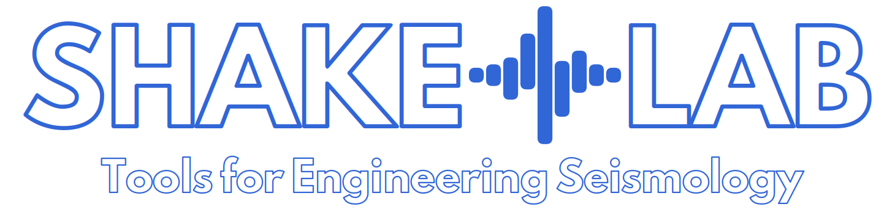

[](https://www.gnu.org/licenses/lgpl-3.0.html)
[](https://www.python.org/)
[](https://github.com/shakelab/shakelab/actions/workflows/tests.yml)

# ShakeLab

**ShakeLab** is an open-source Python library of tools for engineering
seismology. It is meant for seismologists, geophysicists and engineers
working on the analysis of ground-motion data, ground-motion modelling,
site response, seismic hazard and rapid seismic impact assessment.

> [!IMPORTANT]
> ShakeLab is under active development and has not reached a stable
> release yet. Most functionalities are usable, but the API may still
> change between versions, and some modules are being reorganised.
> Please pin a specific commit if you depend on ShakeLab in your work.

## Contents

The library is organised in subpackages, which can be used
independently:

| Subpackage | Content |
|---|---|
| `signals` | Waveform records and streams, filtering, Fourier spectra, spectrograms, instrument response, StationXML, FDSN web services, file formats (MiniSEED, SAC, DYNA, TDMS, ASCII) |
| `groundmotion` | Ground-motion models (GMPEs) and ground-motion providers (e.g. ShakeMap grids) |
| `site` | Soil models, one-dimensional site response, quarter-wavelength methods, surface waves |
| `exploration` | Ambient-noise and MASW analysis |
| `hazard` | Magnitude-frequency distributions, completeness, magnitude scaling |
| `seismicity` | Earthquake catalogues, magnitudes, QuakeML and ISC tools |
| `engineering` | Exposure, fragility and taxonomy models, impact scenarios (ShakeScenario, with client/server and web interface), engineering parameters of records |
| `graphics` | Plotting helpers |
| `libutils` | Shared utilities: time handling, geodesy, JSON and ASCII I/O, time zones |

## Installation

ShakeLab requires **Python 3.10 or later**.

### From GitHub (recommended)

Install the most recent version directly from the GitHub repository:

```bash
pip install git+https://github.com/shakelab/shakelab.git
```

To upgrade an existing installation:

```bash
pip install --upgrade git+https://github.com/shakelab/shakelab.git
```

### From a local copy (for development)

To modify the code, clone the repository and install it in editable
mode, so that changes to the source are used immediately:

```bash
git clone https://github.com/shakelab/shakelab.git
cd shakelab
pip install -e ".[dev]"
```

Optionally, create and activate a virtual environment first:

```bash
python3 -m venv venv
source venv/bin/activate  # On Windows: venv\Scripts\activate
```

### From PyPI (outdated)

The release available on [PyPI](https://pypi.org/project/shakelab/)
(0.0.1, 2022) is obsolete and does not reflect the current code. It
will be updated with the first stable release.

## Dependencies

Required packages, installed automatically:

- [NumPy](https://numpy.org/) >= 1.24
- [SciPy](https://scipy.org/) >= 1.10
- [Requests](https://pypi.org/project/requests/) >= 2.32
- [cymseed3](https://pypi.org/project/cymseed3/) >= 0.2.0 (MiniSEED
  I/O based on libmseed, part of the ShakeLab ecosystem)

Optional extras:

- `webui`: [Flask](https://flask.palletsprojects.com/), for the
  ShakeScenario web interface (`pip install "shakelab[webui] @ git+https://github.com/shakelab/shakelab.git"`);
- `all`: Flask and [wxPython](https://wxpython.org/), for the
  graphical tools;
- `dev`: [pytest](https://pytest.org/), for development.

## Documentation

The documentation is available at [shakelab.org](http://shakelab.org)
(under construction). The repository also contains:

- [Conventions](docs/conventions.md): time, coordinates, units and
  numerical representation adopted across the library;
- [Development guidelines](docs/development.md): architecture and
  coding principles for contributors;
- [Examples](examples/README.md): runnable scripts organized by
  subpackage;
- [Changelog](CHANGELOG.md): notable changes, deprecations and
  scientific corrections.

## Contributing

Bug reports, suggestions and contributions are welcome through
[GitHub issues](https://github.com/shakelab/shakelab/issues) and pull
requests. New code should follow the
[development guidelines](docs/development.md) and come with tests.

## License

ShakeLab is free software, released under the
**GNU Lesser General Public License v3.0** or (at your option) any
later version. You can redistribute it and/or modify it under the
terms of the license.

The license text is in [`COPYING.LESSER`](COPYING.LESSER), which
supplements the GNU General Public License v3.0 in
[`COPYING`](COPYING). See <https://www.gnu.org/licenses/lgpl-3.0.html>
for details.

## Disclaimer

ShakeLab is distributed in the hope that it will be useful, but
**without any warranty**, including the implied warranty of
merchantability or fitness for a particular purpose. The authors
assume no liability for any use of the software.
