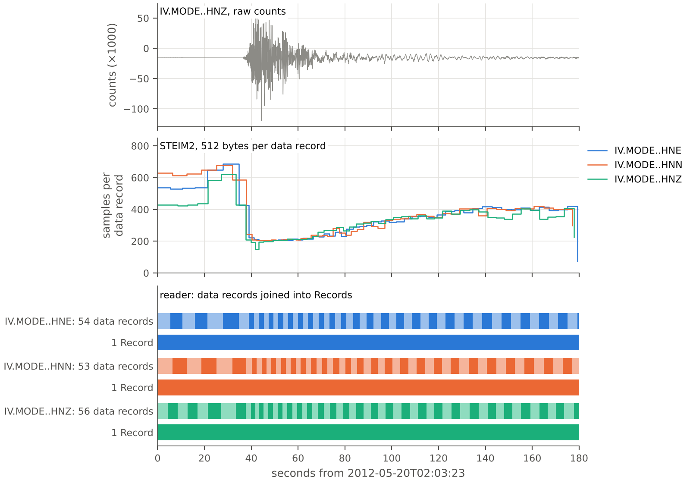
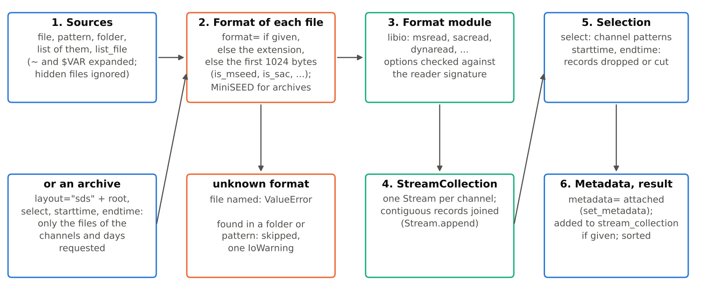
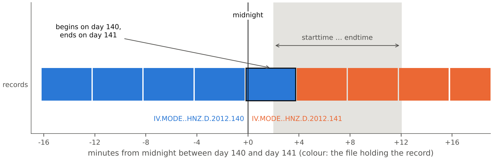

[ShakeLab documentation](../README.md) › [Signals](signals.md) ›
Input and output

# Input and output

Waveforms reach ShakeLab as files: MiniSEED from data centres and
archives, SAC from analysis programs, the ASCII files of the
strong-motion databases, text tables written by loggers and
spreadsheets, TDMS files of acquisition systems. The module
`shakelab.signals.io` is the single entry point for all of them:
`reader` reads files of any supported format into a `StreamCollection`
and `writer` writes records, streams and collections back. The formats
themselves are implemented in `shakelab.signals.libio`, one module per
format with the same scheme, which can also be used directly to
examine or change a file in the terms of its format.

This guide describes the formats and the concepts behind reading and
writing (Part I), the use of every function, option and format module
(Part II), and the design choices, validation and limits (Part III).
The containers that `reader` returns are described in
[`waveforms.md`](waveforms.md); channel metadata and instrument
responses in [`response.md`](response.md); data downloaded from data
centres in [`fdsnws.md`](fdsnws.md) and received in real time in
[`seedlink.md`](seedlink.md).

The examples use these files:

| Name | Content |
|---|---|
| `waveforms.mseed` | three components of a strong-motion station in raw counts, MiniSEED 2 with STEIM2 compression, 100 Hz, 180 s |
| `station.xml` | StationXML of the same channels, with their responses |
| `acceleration.asc` | the processed vertical acceleration of the same event from a strong-motion database, DYNA 1.2, 200 Hz, 200 s, cm/s² |
| `event/` | a folder with the three processed accelerations of the event (DYNA) |
| `database/` | a folder with all the files of the station for the event downloaded from the database: accelerations, velocities, displacements, response spectra (DYNA) |
| `waveforms.txt` | three long-period channels of another station in Simple ASCII, 1 Hz, 4200 samples |
| `acquisition.tdms` | one second of a distributed acoustic sensing acquisition, 16 channels at 200 Hz (NI TDMS) |
| `archive/` | a SeisComP Data Structure archive holding the same three channels as `waveforms.mseed` |

The numbers in the comments come from the test data of ShakeLab
(station IV.MODE and its records of the 2012 Emilia earthquake from
ESM, IU.COLA from the libmseed test files, an excerpt of an iDAS
acquisition). Files shown in full in the guide (`logger.csv`,
`files.txt`) are written as given.

## Contents

Part I. Formats and concepts

1. [Supported formats](#1-supported-formats)
2. [From files to objects](#2-from-files-to-objects)
3. [Recognizing the format](#3-recognizing-the-format)
4. [Archives organized by channel and day](#4-archives-organized-by-channel-and-day)
5. [File name templates](#5-file-name-templates)
6. [MiniSEED backends and encodings](#6-miniseed-backends-and-encodings)

Part II. Use

7. [Listing the formats](#7-listing-the-formats)
8. [Reading](#8-reading)
9. [Writing](#9-writing)
10. [Using the format modules directly](#10-using-the-format-modules-directly)
11. [Metadata](#11-metadata)
12. [Workflows](#12-workflows)

Part III. Design, validation and limits

13. [Design choices](#13-design-choices)
14. [Validation](#14-validation)
15. [Current limitations](#15-current-limitations)
16. [References](#16-references)

# Part I. Formats and concepts

## 1. Supported formats

| Format (`format=`) | Aliases | Extensions | Read | Write | One record per file | Recognized from content | Module |
|---|---|---|---|---|---|---|---|
| MiniSEED 2 and 3 (`mseed`) | `miniseed`, `ms`, `seed` | `.mseed`, `.miniseed`, `.ms`, `.seed` | yes | yes | no | yes | `libio.cymseed`, `libio.mseed` |
| SAC binary (`sac`) | | `.sac` | yes | yes | yes | yes | `libio.sac` |
| DYNA 1.2 (`dyna`) | | `.asc` | yes | yes | yes | yes | `libio.dyna` |
| Simple ASCII (`simpleascii`) | | none | yes | yes | no | yes | `libio.simpleascii` |
| Text tables (`ascii`) | | `.csv` | yes | yes | no | no | `libio.ascii` |
| NI TDMS (`tdms`) | | `.tdms` | yes | no | no | yes | `libio.tdms` |
| Python pickle (`pickle`) | `pkl` | `.pkl`, `.pickle` | yes | yes | no | no | `io` |

Format names are case-insensitive. GSE, RefTek, SEG-2, SEG-Y and
SEISAN are known names but not supported yet: giving one raises
`NotImplementedError`, any other unknown name a `ValueError`.

What each format holds, and what a round trip through it keeps:

- **MiniSEED** (SEED manual, chapter 8; MiniSEED 3 specification) is
  the exchange format of seismology: a sequence of independent data
  records of fixed length (512 bytes or 4096 bytes are usual), each
  with a fixed header (codes, start time, sampling rate, number of
  samples), blockettes and compressed samples. Integers are usually
  compressed with the STEIM1 or STEIM2 differences; floats are stored
  as they are. Times are stored to 0.1 ms with the microseconds of
  blockette 1001 in MiniSEED 2, and to the nanosecond in MiniSEED 3.
  The sample type is kept (int32 stays int32). No coordinates, units
  or responses: they come from StationXML.
- **SAC** (Seismic Analysis Code) holds one waveform: a header of
  632 bytes (codes, times, station and event coordinates, picks, user
  fields) and the samples as 32-bit floats. Coordinates and
  orientation of the sensor are part of the header, so SAC files are
  often used to exchange events with their station positions. Float64
  data are rounded to float32; the sampling interval, a 32-bit float
  in the usual version 6 of the header, is read back as the intended
  decimal value (§10.3).
- **DYNA 1.2** is the ASCII format of the Engineering Strong Motion
  database (ESM) and of the Italian Accelerometric Archive (ITACA): 64
  `KEY: value` header lines (event, station, instrument, processing)
  and one value per line. Waveforms are in cm/s², cm/s or cm; the same
  format holds response spectra and Fourier spectra. Times to the
  millisecond.
- **Simple ASCII** is the text format of `mseed2ascii` and of the
  EarthScope data services: one `TIMESERIES` line per segment (code,
  number of samples, rate, start time, layout, type, units) followed by
  a list of samples (`SLIST`) or of time-sample pairs (`TSPAIR`).
- **Text tables** are the tables of loggers, spreadsheets and simple
  programs, with any delimiter and decimal separator: one record per
  data column, with an optional column of times and `key: value`
  parameter lines.
- **TDMS** is the binary format of National Instruments (LabVIEW, DAQ
  systems, DAS interrogators): groups of channels with properties.
  ShakeLab reads it; it does not write it.
- **Pickle** saves records, streams and collections as Python objects
  with everything they hold, for intermediate results (§10.8).

Channel metadata are read from StationXML, RESP, the text format of the
FDSN station service and the JSON of ShakeLab (§11 and
[`response.md`](response.md) §7).

## 2. From files to objects

Every format module converts the content of a file to ShakeLab
records in the same way:

- the source identifier `NET.STA.LOC.CHA`, the start time, the
  sampling interval and the units go to the header of the record;
- station coordinates, burial depth and sensor orientation, when the
  format has them, go to the channel metadata of the record
  (`record.head.meta`, a `ChannelEpoch`), where they are found also
  when the metadata come from StationXML;
- every other field of the format (event, picks, processing,
  instrument, user fields) is kept in `record.head.extra["<format>"]`,
  and written back when the record is written in the same format, so
  that a file read and written again keeps its information;
- values are kept as written: units are declared, not converted,
  unless a format requires a conversion when writing (DYNA, §10.4).

`reader` adds the records to a `StreamCollection`, one `Stream` per
source identifier, and joins contiguous records of a channel into one
`Record` with the rules of `Stream.append` (tolerance of half a
sample; see [`waveforms.md`](waveforms.md) §4). This matters most for
MiniSEED, where the word *record* means two different things: a
MiniSEED data record is a block of the file, a few hundred samples at
most, while a ShakeLab `Record` is a contiguous series of samples. The
163 data records of `waveforms.mseed` become three Records, one per
channel; a gap would start a new Record (Figure 1).



*Figure 1. The MiniSEED file of IV.MODE as data records and as
ShakeLab records. Lower panel: the 512-byte data records of each
channel (alternate shades show their boundaries) and the Record into
which `reader` joins them. STEIM2 compression stores the differences
between consecutive samples, so the number of samples in a data record
follows the signal (middle panel, with the vertical component above):
up to 685 where it changes slowly, as few as 149 during the strong
shaking. Data: IV.MODE, 20 May 2012.*

## 3. Recognizing the format

Unless `format` is given, `reader` decides the format of each file
(Figure 2):

1. from the extension, when it belongs to one format (`.mseed`,
   `.sac`, `.csv`, `.tdms`, `.pkl`...);
2. otherwise, for files without an extension, with an unknown one, or
   with `.asc` (used by DYNA and by many other text files), from the
   first 1024 bytes, with the detection function of each format:

| Format | Recognized when |
|---|---|
| MiniSEED | the file starts with `MS` and version 3, or with a plausible MiniSEED 2 fixed header: a sequence number of digits, spaces or zeros, a quality indicator `D`, `R`, `Q` or `M`, a valid year, day and time of day (the checks of libmseed) |
| SAC | in one byte order, the header version is 6 or 7, the number of points is not negative, the file type is known and `LEVEN` is 0 or 1 |
| DYNA | the first line that is not blank starts with `EVENT_NAME:` |
| Simple ASCII | the first line that is not blank starts with `TIMESERIES ` |
| TDMS | the file starts with the tag of a TDMS segment, `TDSm` |

Text tables and pickle files are never recognized from their content:
a table has no distinctive first line, and a pickle file can run code
when it is read, so it is read only when its extension or `format`
says so.

What happens to a file whose format is not recognized depends on how
it was given. A file named explicitly is an error (`ValueError`): the
user meant to read it. Files found in a folder or by a pattern are
skipped, with one `IoWarning` listing them, so that a folder with a
README or a log among the data can be read as it is. Hidden files
(names starting with a dot) and subfolders are ignored.



*Figure 2. What `reader` does with its arguments: sources are expanded
into files, the format of each file is decided and the file is read by
its format module into one collection; channels and the time window
are then selected and the metadata attached.*

## 4. Archives organized by channel and day

Continuous data are kept in archives with one file per channel and
day. The most common organization is the SeisComP Data Structure
(SDS), written by SeisComP and by many acquisition systems:

```text
archive/
  2012/                         year
    IV/                         network
      MODE/                     station
        HNZ.D/                  channel, type D (waveform data)
          IV.MODE..HNZ.D.2012.141     NET.STA.LOC.CHA.TYPE.YEAR.DAY
```

The files have no extension: their format, MiniSEED, is recognized
from the content when they are read one by one, and assumed when the
archive is read with `layout="sds"`. With the layout, `reader`
builds the list of files from the channels (`select`) and the time
window (`starttime`, `endtime`) and opens only those, without listing
the whole archive.

A MiniSEED record is stored in the file of the day in which it
begins. A record that starts a few seconds before midnight therefore
sits in the file of the previous day, but its samples after midnight
belong to the next day. To return them, `reader` opens also the file
of the day before `starttime` (Figure 3); the records outside the
window are then dropped. Missing days are not an error: a request with
no data at all gives an empty collection and an `IoWarning`.



*Figure 3. Records of one channel in the files of two consecutive
days, and a request that begins just after midnight. The last record
of day 140 starts before midnight and holds the first seconds of the
request, so `reader` opens the files of days 140 and 141 and keeps
the samples within the window. Schematic.*

## 5. File name templates

`writer` can name the files it writes from the records themselves, with
a template whose fields are the codes and the start time of each
record:

| Field | Value |
|---|---|
| `{net}`, `{sta}`, `{loc}`, `{cha}` | codes of the source identifier |
| `{sid}` | the source identifier, `NET.STA.LOC.CHA` |
| `{time}` | start time, a `datetime` in UTC, with any `strftime` format: `{time:%Y%m%d_%H%M}` |
| `{start}` | short for `{time:%Y%m%dT%H%M%S}` |
| `{year}` | year, four digits |
| `{jday}` | day of the year, three digits |

The archives written by the SeedLink client use the same codes and
dates, but there `{time}` is the start of the rotation interval of the
files and `{sid}` and `{start}` do not exist (see
[`seedlink.md`](seedlink.md) §6). The template is applied to every
record; records that get the same name are written to the same file,
and the folders of the names are created. A template therefore decides
how the data are split: `{sta}.mseed` gives one file per station with
all its channels, `{sid}.mseed` one per channel, `{sid}.{start}.mseed`
one per record. Formats holding one record per file (SAC, DYNA) need a
template that gives each record its own name, usually with `{start}`.

## 6. MiniSEED backends and encodings

MiniSEED is read and written by two modules with the same interface
and results:

| | `libio.cymseed` (default) | `libio.mseed` |
|---|---|---|
| Implementation | libmseed 3 of EarthScope, through the `cymseed3` package | pure Python |
| Versions | MiniSEED 2 and 3 | MiniSEED 2 |
| Encodings | all | text, int16, int32, float32, float64, STEIM1, STEIM2 |
| Speed | fast | slower (about 3 µs per sample when writing STEIM) |
| Extras | | raw records: `msrawread`, `msrawiter`, `msrawwrite`, `MSRecord` |

`io.USE_LIBMSEED` sets the default for every call (True); the option
`mseed_backend` (`"auto"`, `"libmseed"` or `"python"`) chooses one for
a single call of `reader`, `writer` or `read_mseed_bytes`. The two
return the same records; the only difference is the type of int16
samples, which libmseed returns as int32.

When writing, the encoding follows the type of the samples unless
`encoding` is given: STEIM2 for integers (STEIM1, or int32, when the
differences between samples are too large for STEIM2), 4 (float32)
for float32 data and 5 (float64) for other floats. STEIM compression
applies to integers only: corrected data, in floats, are written
uncompressed. The sizes of the three channels of `waveforms.mseed`
(18001 int32 samples each) in the different encodings:

| Encoding | `encoding=` | Size |
|---|---|---|
| STEIM2, 512-byte records (as downloaded) | 11 | 83 kB |
| STEIM2, 4096-byte records | 11, `reclen=4096` | 78 kB |
| STEIM1 | 10 | 99 kB |
| int32 | 3 | 243 kB |
| float32 | 4 | 243 kB |
| float64 | 5 | 485 kB |
| int16 | 1 | not possible: the counts exceed ±32767 |

For comparison, the same data take 218 kB as SAC files (float32),
360 kB as Simple ASCII and 472 kB as a CSV table. Longer records
compress slightly better but are less suited to real-time transmission
(SeedLink uses 512 bytes).

# Part II. Use

## 7. Listing the formats

`formats()` describes the supported formats, as in the table of §1:

```python
from shakelab.signals.io import formats

sorted(formats())
# ['ascii', 'dyna', 'mseed', 'pickle', 'sac', 'simpleascii', 'tdms']
formats()["sac"]
# {'description': 'SAC binary', 'extensions': ('.sac',), 'read': True,
#  'write': True, 'per_record': True, 'detect': True}
```

## 8. Reading

### 8.1 One file

```python
from shakelab.signals.io import reader

data = reader("waveforms.mseed")
print(data.sid)
# ['IV.MODE..HNE', 'IV.MODE..HNN', 'IV.MODE..HNZ']
record = data["IV.MODE..HNZ"][0]
print(record)
# Record IV.MODE..HNZ: 2012-05-20T02:03:23.000000Z -
# 2012-05-20T02:06:23.000000Z, 100 Hz, 18001 samples
```

`reader` always returns a `StreamCollection`, sorted, whatever the
format and the number of files: a single SAC file gives a collection
with one stream holding one record. `StreamCollection.read` does the
same into an existing collection (§8.7).

### 8.2 Several files, patterns, folders and lists

```python
data = reader(["waveforms.mseed", "waveforms.txt"])   # a list
data = reader("event/")                       # the files of a folder
data = reader("event/*HNZ*")                  # a wildcard pattern
data = reader("~/data/$PROJECT/event/")       # ~ and variables expanded
```

A folder gives its files, not those of its subfolders, in alphabetical
order; patterns accept `*`, `?` and `[...]`. A pattern that matches no
file, or a file that does not exist, raises `FileNotFoundError`.

Long lists of files are kept in a text file, one entry per line, in
any of the forms above. Empty lines and lines starting with `#` are
ignored, and relative paths refer to the folder of the list:

```text
# files.txt
waveforms.txt
event/*HNE*
```

```python
data = reader(list_file="files.txt")
print(data.sid)
# ['IU.COLA.00.LH1', 'IU.COLA.00.LH2', 'IU.COLA.00.LHZ', 'IV.MODE..HNE']
```

The files of `list_file` are read after those of `source`, when both
are given. Files of different formats can be read together; files of
the same channel with different sampling rates or holding different
quantities cannot (§15).

### 8.3 Imposing the format, and options of the formats

`format` imposes one format on all files, for instance for MiniSEED
files with an unusual extension or text tables with `.txt`:

```python
data = reader("waveforms.mseed", format="mseed")
data = reader("waveforms.mseed", format="MiniSEED")   # alias, any case
data = reader("waveforms.mseed", format="segy")  # NotImplementedError
```

Other keyword arguments are options of the format reader, the same for
all files: `byte_order` for SAC and for the Python MiniSEED backend,
`mseed_backend` for MiniSEED, the parameters of text tables (`rate`,
`first_sample_time`, `columns`...) and of TDMS files (`group`,
`network`...). They are checked against the signature of the reader
before any file is read, so that a misspelled option stops at once:

```python
data = reader("waveforms.mseed", mseed_backend="python")
data = reader("waveforms.mseed", rate=100.0)     # TypeError: unknown option
```

The options accepted by each reader are listed in §10.

### 8.4 Selecting channels and a time window

`select` keeps the channels that match one or more patterns
`NET.STA.LOC.CHA`, with `*`, `?`, `[...]` and `{A,B}`; codes missing at
the end match anything (the patterns of `shakelab.signals.codes`,
described in [`waveforms.md`](waveforms.md) §8.3). `starttime` and
`endtime` keep the samples between two times, bounds included: records
outside the window are dropped, the others cut to it as by
`Record.cut`. `duration` gives the length of the window in seconds
after `starttime`, instead of `endtime`.

```python
data = reader("waveforms.mseed", select="IV.MODE..HN{E,N}")
print(data.sid)
# ['IV.MODE..HNE', 'IV.MODE..HNN']
data = reader("waveforms.mseed", select=["*.*.*.HNZ", "IV.MODE..HNE"])
data = reader("waveforms.mseed", select="IV.MODE")   # all its channels

data = reader("waveforms.mseed", select="*.*.*.HNZ",
              starttime="2012-05-20T02:04:00",
              endtime="2012-05-20T02:04:30")
print(data.records()[0])
# Record IV.MODE..HNZ: 2012-05-20T02:04:00.000000Z -
# 2012-05-20T02:04:30.000000Z, 100 Hz, 3001 samples
data = reader("waveforms.mseed", select="*.*.*.HNZ",
              starttime="2012-05-20T02:04:00", duration=30.0)
print(data.records()[0].nsamp)
# 3001
```

Times are `Date` objects or ISO 8601 strings, in UTC. A date without
the time of day is midnight: `starttime="2012-05-20"`,
`endtime="2012-05-20"` is an instant, not the whole day (use
`endtime="2012-05-21"`, `"2012-05-20T23:59:59.999"`, or
`duration=86400`). A window
that falls between two samples keeps the samples inside it:

```python
data = reader("waveforms.mseed", starttime="2012-05-20T02:04:00.004")
print(data.records()[0].time)
# 2012-05-20T02:04:00.010000Z     the first sample within the window
late, early = "2012-05-20T03:00", "2012-05-20T02:00"
reader("waveforms.mseed", starttime=late, endtime=early)  # ValueError
```

The selection is done after reading each file. It saves memory when
many channels are read and few kept, but every file is still opened:
to avoid that for archives, use `layout` (§8.5). The time window
`starttime`, `endtime` differs from the `first_sample_time` option of
some formats, which gives the time of the first sample to files that
do not have it (text tables, TDMS); both can be given in one call.
The same selection on a collection already in memory is
`StreamCollection.select(sid, starttime=..., endtime=...)`, with the
same `duration`
([`waveforms.md`](waveforms.md) §8.3): reading with `select` and the
window, or reading everything and then calling `select` with the same
arguments, gives the same data.

### 8.5 Archives

`layout="sds"` reads an SDS archive (§4) from its root folder,
opening only the files of the channels and days requested; `starttime`
and `endtime` are required:

```python
data = reader("archive/", layout="sds", select="IV.MODE..HNZ",
              starttime="2012-05-20T02:04:00",
              endtime="2012-05-20T02:05:00")
print(data.records()[0])
# Record IV.MODE..HNZ: 2012-05-20T02:04:00.000000Z -
# 2012-05-20T02:05:00.000000Z, 100 Hz, 6001 samples

data = reader("archive/", layout="sds", select="IV.*..HN?",
              starttime="2013-01-01", endtime="2013-01-02")
# IoWarning: no data in the archive for IV.*..HN? from ...
print(len(data))
# 0

data = reader("archive/", layout="sds")   # ValueError: times required
```

Several archives are read together by giving a list of roots. The
day files can also be read one by one without the layout, since
MiniSEED is recognized from the content:

```python
data = reader("archive/2012/IV/MODE/HNZ.D/")
print(data.sid)
# ['IV.MODE..HNZ']
```

### 8.6 Metadata while reading

`metadata` attaches channel metadata to the records read, as
`StreamCollection.set_metadata` does: a `MetadataCollection`, a
`ChannelEpoch`, or one or more files read with `metadata_reader`
(§11.3). The metadata are read before the data, so that an error in
them stops before the data are read, and attached after the
selection:

```python
data = reader("waveforms.mseed", metadata="station.xml")
record = data["IV.MODE..HNZ"][0]
print(record.location)
# WgsPoint(longitude=10.949167, latitude=44.629722, elevation=41.0)
print(record.orientation)
# Orientation(azimuth=0.0, dip=-90.0)
```

Channels read without an epoch in the metadata give one
`MetadataWarning` listing them, and keep their metadata.

### 8.7 Adding to an existing collection

`stream_collection` adds the records to a collection instead of
creating a new one, and returns it. `StreamCollection.read` does the
same with the collection itself:

```python
from shakelab.signals.base import StreamCollection

data = StreamCollection()
data.read("waveforms.mseed", select="*.*.*.HNZ")
data.read("waveforms.txt", select="*.*.*.LHZ")
print(data.sid)
# ['IU.COLA.00.LHZ', 'IV.MODE..HNZ']

more = reader("event/*HNE*", stream_collection=data)
print(more is data, len(data))
# True 3
```

With a selection or metadata, the new records are read into a separate
collection and then added, so that the records already in the
collection are neither cut nor given new metadata. Records are added
with `Stream.append`: data already present are added again, not
recognized as duplicates ([`waveforms.md`](waveforms.md) §7.1).

### 8.8 MiniSEED in memory

`read_mseed_bytes` reads MiniSEED records held in memory, such as the
reply of a web service or a SeedLink packet, with the same backends
(the FDSN and SeedLink clients use it):

```python
from shakelab.signals.io import read_mseed_bytes

with open("waveforms.mseed", "rb") as fid:
    content = fid.read(5120)                # the first ten records

data = read_mseed_bytes(content)
print(data.records()[0])
# Record IV.MODE..HNE: 2012-05-20T02:03:23.000000Z -
# 2012-05-20T02:04:08.340000Z, 100 Hz, 4535 samples
read_mseed_bytes("waveforms.mseed")      # TypeError: bytes required
```

### 8.9 Warnings and errors

| Situation | Result |
|---|---|
| no `source` nor `list_file` | `ValueError` |
| file or archive root missing, pattern matching nothing | `FileNotFoundError` |
| format of a file given by name not recognized | `ValueError` (set `format`) |
| files of unknown format in folders or patterns | skipped, one `IoWarning` |
| files without waveforms (DYNA and SAC spectra) in folders or patterns | skipped, one `IoWarning` |
| a file without waveforms given by name | `NotWaveformError` (a `ValueError`) |
| format known but not supported (GSE, SEG-Y...) | `NotImplementedError` |
| option not accepted by the reader of the format | `TypeError`, before reading |
| reversed time window, unknown layout, layout without times | `ValueError` |
| no data in an archive for the request | empty collection, `IoWarning` |
| channels without metadata (`metadata=`) | `MetadataWarning` |
| a file of a known format that cannot be read (corrupt) | the error of the format reader |

Arguments are checked before the files are read, and the files are
read in order: an error in one file stops the reading, and no
collection is returned. A given `stream_collection` may already hold
the records of the files read before the error (unless a selection or
metadata were given).

## 9. Writing

### 9.1 One file

`writer(data, target)` writes a `Record`, a `Stream` or a
`StreamCollection`; the format follows from the extension of `target`
unless `format` is given:

```python
from shakelab.signals.io import writer

data = reader("waveforms.mseed")
writer(data, "copy.mseed")                          # all channels
writer(data["IV.MODE..HNZ"][0], "vertical.sac")     # one record
writer(data, "copy.data", format="mseed")
writer(data, "copy.mseed")               # FileExistsError: copy.mseed exists (use owrite=True)
writer(data, "copy.mseed", owrite=True)
writer(data, "all.sac")                  # ValueError: one record per file
```

Existing files are not overwritten unless `owrite=True`. Formats
holding one record per file (SAC, DYNA) accept a single record for one
file name; several records need a folder or a template.
`StreamCollection.write` delegates to `writer`:

```python
data.write("copy.mseed", owrite=True, encoding=10)
```

### 9.2 One file per channel in a folder

A target that is an existing folder, or a name ending with a
separator, gives one file per channel named `NET.STA.LOC.CHA` with the
extension of the format, or one file per record, named
`NET.STA.LOC.CHA.<start>`, for SAC and DYNA. The format must be given,
since a folder has no extension; missing folders are created:

```python
writer(data, "sac/", format="sac")
# sac/IV.MODE..HNE.20120520T020323.sac, ... HNN ..., ... HNZ ...
writer(data, "channels/", format="mseed")
# channels/IV.MODE..HNE.mseed, ...
writer(data, "other/")                   # ValueError: format required
```

The extensions of the files written are `.mseed`, `.sac`, `.asc`
(DYNA), `.txt` (Simple ASCII), `.csv` (tables) and `.pkl`.

### 9.3 File name templates

A target with fields in braces is a template (§5):

```python
writer(data, "{sta}/{sta}.{cha}.{start}.sac")
# MODE/MODE.HNE.20120520T020323.sac, ...
writer(data, "{sta}.mseed")                      # one file per station
writer(data, "{time:%Y%m%d}_{sid}.txt", format="simpleascii")
# 20120520_IV.MODE..HNE.txt, ...
writer(data, "{station}.mseed")          # ValueError: unknown field
```

The format comes from the extension of the template, or from `format`
when the names have no extension. An SDS archive (§4) is written with
the template of its layout:

```python
writer(data, "sds/{year}/{net}/{sta}/{cha}.D/"
             "{net}.{sta}.{loc}.{cha}.D.{year}.{jday}", format="mseed")
```

The files are named after the start of each record: a record that
continues past midnight is written whole in the file of the day it
begins, which is how SDS stores data and why the reader opens the day
before (§4); records are not split at midnight.

### 9.4 Existing files

With a folder or a template, all the names are computed and checked
first: if any file exists and `owrite` is false, `FileExistsError` is
raised and no file is written, so that a collection is never written
in part. With `owrite=True` existing files are replaced, not appended
to. Every writer of ShakeLab (formats, `writer`, the FDSN client, the
results of YARRAY) gives the same error, `<file> exists (use
owrite=True)`, and the commands suggest `--owrite`.

```python
writer(data, "sac/", format="sac")       # FileExistsError
writer(data, "sac/", format="sac", owrite=True)
```

### 9.5 Options of the formats

Other keyword arguments are options of the format writer, checked
against its signature before writing:

| Format | Options |
|---|---|
| MiniSEED | `encoding` (1, 3, 4, 5, 10, 11; from the data type if None), `reclen` (record length, 128 to 65536 bytes, default 512), `msformat` (2 or 3; 3 with libmseed only), `mseed_backend` |
| SAC | `byte_order` (`"be"`, default, or `"le"`) |
| DYNA | `fmt` (format of the values, default `"%.9g"`) |
| Simple ASCII | `style` (`"slist"`, default, or `"tspair"`), `columns` (samples per line in `slist`, default 1) |
| Text tables | `time` (`"relative"`, default: seconds from the start; `"absolute"`: dates; None: no column of times), `delimiter` (default `","`), `fmt` (default `"%.9g"`) |
| Pickle | none |

```python
writer(data, "steim1.mseed", encoding=10, reclen=4096)
writer(data["IV.MODE..HNZ"][0], "vertical_le.sac", byte_order="le")
writer(data, "pairs.txt", format="simpleascii", style="tspair")
writer(data, "table.csv", time="absolute", delimiter=";")
writer(data, "v3.mseed", msformat=3)        # needs libmseed
writer(data, "int16.mseed", encoding=1)  # ValueError: out of range
```

## 10. Using the format modules directly

### 10.1 The common scheme

The format modules are usually reached through `reader` and `writer`.
Used directly, they give the whole content of a file in the terms of
its format: all the header fields of a SAC file, the spectra of a
DYNA file, the raw records of a MiniSEED file, the groups of a TDMS
file. Every module has the same parts, named after the format:

| Part | Content |
|---|---|
| `xxxread(source[, stream_collection], **options)` | read a file as a `Record` (formats with one waveform per file) or into a `StreamCollection` |
| `xxxwrite(target, data, ..., owrite=False)` | write a `Record` or a collection |
| `is_xxx(head)` | whether the first bytes of a file belong to the format (§3) |
| format class | the content of a file (or of one MiniSEED record) in the terms of the format, with `read`, `write`, `to_shakelab`, `from_shakelab`, `info`, `sid`, `start_ns`, `is_timeseries` |
| `XxxWarning` | warning class of the format |

A source can be a path, the content of the file (bytes, or text for
text formats) or a file already opened. How to add a format following
this scheme is described in the
[`libio` README](../../shakelab/signals/libio/README.md#5-adding-a-format).

### 10.2 MiniSEED

`msread` and `mswrite` exist in both backends, with the arguments of
`reader` and `writer`:

```python
from shakelab.signals.libio.mseed import msread, mswrite

data = msread("waveforms.mseed")                 # a StreamCollection
mswrite("steim2.mseed", data, encoding=11, reclen=512)
mswrite("steim2.mseed", data)            # FileExistsError
```

The Python module also reads and writes the data records of a file as
they are, `MSRecord` objects with their fixed header, blockettes and
decoded samples, including records that are not waveforms (log,
timing and detection records):

```python
from shakelab.signals.libio.mseed import msrawiter, msrawread, msrawwrite

records = msrawread("waveforms.mseed")
print(len(records), records[0])
# 163 MSRecord(IV.MODE..HNE, 2012-05-20T02:03:23.000000Z, nsamp=537,
# rate=100.0, encoding=11)
print(records[0].record_length, records[0].byte_order)
# 512 be
records[0].info()                    # every field of the fixed header

vertical = [r for r in msrawiter("waveforms.mseed")
            if r.sid == "IV.MODE..HNZ"]
msrawwrite(vertical, "vertical.mseed", encoding=10, record_length=1024)
```

`msrawiter` decodes one record at a time, for files too large for
memory. `msrawwrite` renumbers the records from 1 and keeps the
record length and encoding of each record unless `record_length` or
`encoding` are given (a record re-encoded in a less compact encoding
must fit in its length: here STEIM1 needs 1024 bytes for the samples
of a 512-byte STEIM2 record); it takes the records first and the file
second,
unlike the other writers (§15). An `MSRecord` converts to and from a
ShakeLab record with `to_shakelab()` and
`MSRecord.from_shakelab(record)`, and to bytes with `to_bytes()`.
`is_mseed(head)` recognizes MiniSEED 2 and 3 from the first bytes.

### 10.3 SAC

```python
from shakelab.signals.libio.sac import Sac, sacread, sacwrite

writer(data["IV.MODE..HNZ"][0], "record.sac", owrite=True)
record = sacread("record.sac")                    # a Record

sac = Sac.read("record.sac")
print(sac)
# Sac(IV.MODE..HNZ, npts=18001, delta=0.009999999776482582, iftype=1)
print(sac.head["KSTNM"], sac.head["NZJDAY"], sac.head["USER0"])
# MODE 141 None
sac.head["KUSER0"] = "checked"
sac.info()                                 # the defined header fields
sac.write("record_checked.sac")
record = sac.to_shakelab()
print(record.delta)
# 0.01
print(record.head.extra["sac"])
# {'KUSER0': 'checked'}
```

`Sac.head` holds all the header fields by name (undefined fields are
None, logical fields booleans, text fields stripped strings), `data`
the samples and `data2` the second data block of spectra and x-y
files, which are read by `Sac` only (`is_timeseries` is False). The
byte order of a file is detected and kept in `sac.byte_order`;
`sacread(source, byte_order=...)` imposes one. Headers of version 6
and 7 are read (the double-precision footer of version 7 takes
precedence); version 6 is written, big-endian unless
`byte_order="le"`, and version 7 with `version=7`:

```python
writer(data["IV.MODE..HNZ"][0], "record7.sac", version=7)
sacwrite("record7.sac", record, owrite=True, version=7)   # the same
```

Version 7 adds after the samples a footer with the sampling interval,
the times, the event and station coordinates in double precision. SAC
reads it from version 102.0, but other programs may accept only
version 6: write it when the files stay within ShakeLab and SAC.

In version 6 the sampling interval is a 32-bit float, which cannot
hold 0.01 exactly (`Sac.head["DELTA"]` shows 0.009999999776, the value
in the file). A 32-bit value stands for all the numbers within about
1e-7 of it, so the conversion to a record takes among them the decimal
number with the fewest significant digits, as interval or as sampling
rate: 0.01 for 100 Hz, 1/3 for 3 Hz, 0.008 for 125 Hz, the same values
that MiniSEED gives for the same channel. An interval without such a
value within 9 digits (an odd rate such as 99.9999 Hz) keeps its
32-bit value.

In the conversion, `STLA`, `STLO`, `STEL`, `STDP`, `CMPAZ` and
`CMPINC` become the channel metadata (`CMPINC`, measured from the
vertical, becomes the SEED dip); the reference time and `B` the start
time; the time markers (`O`, `A`, `F`, `T0` to `T9`) are kept in
`head.extra["sac"]` as absolute dates. When writing, the reference
time is the start time truncated to the millisecond and `B` holds the
rest, so that microseconds are kept. The samples are stored as
32-bit floats.

### 10.4 DYNA

```python
from shakelab.signals.libio.dyna import Dyna, dynaread, dynawrite

record = dynaread("acceleration.asc")
print(record.head.units, record.eid, record.rate)
# CM/S**2 IT-2012-0008 200.0
print(record.head.extra["dyna"]["MAGNITUDE_W"])
# 6.1
dynawrite("copy.asc", record)
```

Station coordinates and sensor depth go to the channel metadata,
`EVENT_ID` to the event identifier, the other header fields (event,
site, instrument, processing, data citation) to `head.extra["dyna"]`.
Values and units are kept as in the file (cm/s², cm/s, cm). When
writing, records in m/s², m/s or m are converted to cm, and the peak
value, its time, the number of samples and the duration are computed
from the data; the time of the first sample is written to the
millisecond. Records with other units cannot be written:

```python
raw = reader("waveforms.mseed")
writer(raw["IV.MODE..HNZ"][0], "counts.asc")    # ValueError: units
```

DYNA files of the databases also hold response spectra (`SA`, `SD`)
and Fourier amplitude spectra (`FAS`). They are not waveforms: `Dyna`
reads them, with the periods or frequencies in `abscissa`, and
`dynaread` refuses them with `NotWaveformError` (a `ValueError`;
`reader` skips them in folders and patterns, §8):

```python
spectrum = Dyna.read("database/IV.MODE..HNZ.D.IT-2012-0008.SA.MP.ASC")
print(spectrum)
# Dyna(sid='IV.MODE..HNZ', data_type='ACCELERATION RESPONSE SPECTRUM',
# ndata=105)
print(spectrum.abscissa[[0, -1]], spectrum.data.max())
# [ 0.01 10.  ] 117.512932         periods (s), cm/s**2
dynaread("database/IV.MODE..HNZ.D.IT-2012-0008.SA.MP.ASC")  # NotWaveformError
```

`Dyna.header` holds the fields in file order, `data` the values;
`from_text` and `to_text` convert from and to text. Files of ESM 3.0,
which write two fields on one line, are read correctly.

### 10.5 Simple ASCII

```python
from shakelab.signals.libio.simpleascii import (
    SimpleAscii, simpleasciiread, simpleasciiwrite)

data = simpleasciiread("waveforms.txt")
print(data.sid, data.records()[0].head.units)
# ['IU.COLA.00.LH1', 'IU.COLA.00.LH2', 'IU.COLA.00.LHZ'] Counts
segments = SimpleAscii.read("waveforms.txt")      # a list of segments
print(segments[0].header["TIME"], segments[0].header["FORMAT"])
# 2010-02-27T06:50:00.069539 SLIST
simpleasciiwrite("six.txt", data, columns=6)
```

Each `TIMESERIES` segment becomes a record: the source code
`NET_STA_LOC_CHA_Q` gives the identifier and the quality, kept in
`head.extra["simpleascii"]`; units are declared as written. `SLIST`
files are written by default; `style="tspair"` writes time-sample
pairs. The file holds no coordinates.

### 10.6 Text tables

`asciiread` reads the tables written by loggers, spreadsheets and
simple programs. It recognizes the delimiter, the decimal comma, the
line of column names and `key: value` lines before the table, and
builds one record per numeric column. A logger file:

```text
# logger.csv
# station: LOG
# network: XX
# rate: 200 Hz
# first_sample_time: 2026-03-01T10:00:00
# units: m/s**2
X;Y;Z
0,0012;-0,0004;0,0101
0,0015;-0,0002;0,0098
0,0011;-0,0006;0,0103
0,0013;-0,0003;0,0100
```

```python
from shakelab.signals.libio.ascii import asciiread, asciiwrite

data = asciiread("logger.csv")
print(data.sid)
# ['XX.LOG..X', 'XX.LOG..Y', 'XX.LOG..Z']
record = data.records()[2]
print(record.rate, record.time, record.head.units, record.data[0])
# 200.0 2026-03-01T10:00:00.000000Z m/s**2 0.0101
```

The parameters can be written in the file or given as arguments, with
the same names; arguments take precedence over the file, and the file
over what is derived from a column of times:

| Parameter | Keys accepted in the file (case, blanks and units ignored) |
|---|---|
| `rate` | `rate`, `sampling_rate`, `sample_rate`, `sps`, `fs`, `sampling_frequency` (Hz; `100 Hz` accepted) |
| `delta` | `delta`, `dt`, `sampling_interval`, `time_step` (s) |
| `first_sample_time` | `first_sample_time`, `start`, `starttime`, `start_time`, `t0` (ISO 8601, UTC) |
| `sid` | `sid`, `source_id` |
| `network`, `station`, `location` | `network`, `net`; `station`, `sta`; `location`, `loc` |
| `units` | `units`, `unit` (one value, or one per column) |

The column of times is the one named `time`, `t`, `date`, `datetime`,
`timestamp`, `seconds`... (or given with `time_column`), or the first
column if it holds dates: dates give the start time, numbers are
seconds from `first_sample_time`, and the sampling interval is checked
to be uniform. Without names in the file, `columns` gives them (None
skips a column); `sid` gives the identifiers, as a template with
`{column}`, one identifier or a list:

```python
data = reader("logger.csv", rate=100.0, sid="XX.LOG..HN{column}")
print(data.sid, data.records()[0].rate)
# ['XX.LOG..HNX', 'XX.LOG..HNY', 'XX.LOG..HNZ'] 100.0
data = reader("logger.csv", columns=[None, None, "HNZ"])
print(data.sid)
# ['XX.LOG..HNZ']
```

Without rate, interval or column of times the table cannot be read
(`ValueError`); without start time the records have none (`time` is
None) and cannot be cut to a time window. `asciiwrite` writes records
with the same start, sampling and length as columns of one table,
preceded by their parameters as `# key: value` lines, so that
`asciiread` reads them back; text files with an extension other than
`.csv` need `format="ascii"` in `reader`.

### 10.7 TDMS

```python
from shakelab.signals.libio.tdms import TdmsFile, tdmsread

tdms = TdmsFile.read("acquisition.tdms")
tdms.info()                          # groups, channels, properties
group = tdms.groups["Measurement"]
print(len(group.channels), tdms.properties["SamplingFrequency[Hz]"])
# 16 200.0
print(group.channels["0"].data[:3])
# [-7888  4983  7476]

data = tdmsread("acquisition.tdms", network="XX", station="DAS",
                channel_prefix="C")
print(data.sid[:3], data.records()[0].rate)
# ['XX.DAS..C0', 'XX.DAS..C1', 'XX.DAS..C2'] 200.0
```

`TdmsFile` holds the file properties and the groups, each with its
properties and channels (`TdmsChannel`: name, path, properties,
data); files are read with memory mapping and the NI scales of the
channels applied (`scaled=False` keeps the raw values). `tdmsread`
reads the numeric channels of one group (`group=`, or the only group,
or the one most likely to hold DAS data) as records, taking the
sampling rate, the start time and the units from the properties of
the channel, the group or the file, or from `rate` and
`first_sample_time`. The channel code is `channel_prefix` followed by
the channel name.
`tdms_to_matrix` returns the channels of a DAS acquisition as one
matrix with their spacing; it is provisional, waiting for containers
designed for DAS data. TDMS files are not written.

### 10.8 Pickle

The `pickle` format saves a `Record`, `Stream` or `StreamCollection`
as Python objects, with everything they hold (metadata with their
responses, extra fields, float64 samples):

```python
writer(data, "intermediate.pkl")
again = reader("intermediate.pkl")
```

It is meant for intermediate results of one's own: a pickle file can
run code when it is read, so only files from trusted sources should be
read, and files written by one version of ShakeLab may not be readable
by another. For this reason pickle files are recognized by their
extension or by `format="pickle"` only, never from their content, and
pickle is not a format for exchange or archiving.

## 11. Metadata

### 11.1 Metadata in waveform files

| Format | To the channel metadata | Kept in `head.extra` | Not represented |
|---|---|---|---|
| MiniSEED | nothing | nothing (quality and flags are not kept) | coordinates, orientation, units, response |
| SAC | coordinates, burial depth, azimuth and dip | `"sac"`: event, picks, user fields, other header fields | units (`IDEP` is not used), response |
| DYNA | coordinates, sensor depth | `"dyna"`: event, site, instrument, processing | orientation, response |
| Simple ASCII | nothing | `"simpleascii"`: quality | coordinates, orientation, response |
| Text tables | nothing | `"ascii"`: column name, `key: value` lines | the rest unless written as parameters |
| TDMS | nothing | `"tdms"`: group, channel name and properties | coordinates, orientation, response |
| Pickle | everything | everything | |

The units are those of the record header (`record.head.units`), as
declared by the format: `CM/S**2` for DYNA, `Counts` in Simple ASCII,
None for MiniSEED and SAC.

### 11.2 Keeping metadata through a format

Formats without coordinates lose them when writing, and the formats
that hold them keep them:

```python
data = reader("waveforms.mseed", metadata="station.xml")
writer(data, "with_coordinates/", format="sac")
again = reader("with_coordinates/")
print(again["IV.MODE..HNZ"][0].location)
# WgsPoint(longitude=10.949167251586914, latitude=44.629722595214844,
# elevation=41.0)            float32 values of the SAC header
print(again["IV.MODE..HNZ"][0].head.meta.response)
# None
```

The response is never written into a waveform file: keep the
StationXML, or write the metadata in the JSON of ShakeLab
(`MetadataCollection.write`, [`response.md`](response.md) §8.3), and
attach them again with `metadata=` when reading.

### 11.3 Reading metadata files

`metadata_reader` reads channel metadata (StationXML, RESP, the text
format of the FDSN station service, JSON) into a `MetadataCollection`,
with the same sources as `reader`: a file, a pattern, a folder, a list
or a `list_file`. The format is inferred from the file name or, for
the FDSN text format, from its header line; `format` imposes one
(`"xml"`, `"resp"`, `"fdsntext"` or `"json"`):

```python
from shakelab.signals.io import metadata_reader

metadata = metadata_reader("station.xml")
print(metadata)
# MetadataCollection(stations=1, channels=3, epochs=3)
metadata = metadata_reader(["station.xml", "station.xml"])  # no duplicates
data = reader("waveforms.mseed", metadata=metadata)
```

Epochs equal to one already read are ignored; overlapping epochs of
the same channel from different files give a `MetadataWarning`. Files
of other formats in folders and patterns are skipped with an
`IoWarning`. The content of metadata, their selection and their use
are described in [`response.md`](response.md) §6-11.

## 12. Workflows

### 12.1 From raw counts to SAC files with coordinates

```python
import os

data = reader("waveforms.mseed", metadata="station.xml",
              starttime="2012-05-20T02:03:40",
              endtime="2012-05-20T02:05:40")
data.detrend()
data.taper(5.0)
data.deconvolve_response(prefilter=(0.05, 0.1, 30.0, 40.0))   # m/s**2
writer(data, "sac_event/{net}.{sta}.{loc}.{cha}.sac")
print(sorted(os.listdir("sac_event")))
# ['IV.MODE..HNE.sac', 'IV.MODE..HNN.sac', 'IV.MODE..HNZ.sac']
```

SAC keeps the coordinates and the orientation, so that the files can
be used by programs that need them; the units are not written (§11.1).

### 12.2 A window from an archive

```python
window = reader("archive/", layout="sds", select="IV.MODE..HN?",
                starttime="2012-05-20T02:04:00",
                endtime="2012-05-20T02:04:59.99")
writer(window, "window.mseed")
print(len(window.records()), window.records()[0].nsamp)
# 3 6000
```

### 12.3 From a strong-motion database to MiniSEED

The processed accelerations of a database, in DYNA, become one
MiniSEED file in m/s², ready for software that reads MiniSEED; the
event and processing information stays in the DYNA files:

```python
event = reader("event/")
for record in event.records():
    record.data = record.data / 100.0          # cm/s**2 -> m/s**2
    record.head.units = "m/s**2"
writer(event, "event.mseed", encoding=5)      # float64
print(event.sid)
# ['IV.MODE..HNE', 'IV.MODE..HNN', 'IV.MODE..HNZ']
```

To read only the accelerations of a database folder that also holds
velocities, displacements and spectra, select the files by name
(§15):

```python
acceleration = reader("database/*.ACC.MP.ASC")
print(acceleration.sid)
# ['IV.MODE..HNE', 'IV.MODE..HNN', 'IV.MODE..HNZ']
```

### 12.4 A logger table

```python
data = reader("logger.csv")
data.write("logger/", format="mseed")
print(sorted(os.listdir("logger")))
# ['XX.LOG..X.mseed', 'XX.LOG..Y.mseed', 'XX.LOG..Z.mseed']
```

### 12.5 A new format

A format not yet supported is added as a module of `libio` following
the scheme of §10.1 and registered in the table of formats of `io`;
its options then become options of `reader` and `writer`
automatically. The steps are described in the
[`libio` README](../../shakelab/signals/libio/README.md#5-adding-a-format).

# Part III. Design, validation and limits

## 13. Design choices

- **One entry point.** `reader` and `writer` are the same for every
  format, so that a program does not change when the format changes,
  and what is learned about selection, folders and templates holds for
  all of them. The format modules stay usable on their own.
- **Formats in separate modules, imported on demand.** Each format is
  a module of `libio` with the same scheme; `io` keeps a table of
  formats and imports a module only when a file of its format is read
  or written. Objects of ShakeLab do not know the formats.
- **Content before extension when the extension says little.** The
  daily files of archives have no extension and `.asc` is used by
  many formats: the first bytes decide. Pickle is never recognized
  from content, for safety.
- **Explicit files are errors, found files are warnings.** A file
  named by the user that cannot be read is an error; unknown files and
  files without waveforms (spectra) in a folder are skipped with one
  warning, so that folders can be read as they are. A corrupt file
  stops the reading in both cases.
- **Options checked before reading.** Options of the format readers
  and writers pass through `reader` and `writer` and are checked
  against their signatures before any file is opened.
- **Nothing written in part.** With folders and templates all the
  names are checked before the first file is written.
- **Values as written.** Readers declare the units and keep the values
  of the file; conversions happen only where a format requires them
  (DYNA in cm when writing).
- **Nothing lost in a round trip.** Fields without a place in the
  ShakeLab header are kept in `head.extra` and written back.
- **Two MiniSEED implementations.** libmseed for speed and MiniSEED 3,
  a pure-Python module for environments without compiled code and for
  access to raw records; both give the same records.
- **Modules named after formats**, not after the organizations that
  defined them.

## 14. Validation

The functions of `io` and the format modules are covered by the tests
of `tests/signals/test_io.py` (44 tests) and `tests/signals/libio/`
(192 tests). Each format is compared with the reference software of
the format, or with files written by it:

| Check | Result |
|---|---|
| MiniSEED 2 test files of libmseed (every encoding and byte order, odd rates, dates before 1970, mixed record lengths, time corrections) read by the Python backend | identifiers, start times, rates, number of samples and samples equal to those read by libmseed |
| The two MiniSEED backends on the same files, reading and writing | the same records |
| MiniSEED written and read again, every encoding and record length | samples and times unchanged |
| SAC files from the test data of ObsPy (both byte orders, version 6, text fields, alphanumeric files) | header fields and samples as expected; round trip unchanged |
| SAC round trip at 100, 3, 30, 125, 1000 and 0.1 Hz (version 6) and at an odd rate (version 7); a record read from SAC appended to the rest of its channel | the interval of `1 / rate`; one joined record |
| DYNA files of ESM (waveforms, response and Fourier spectra), read and written | every sample and typed header field read; header text written as in the ESM files; round trip without losses |
| Folders and patterns with DYNA spectra next to the waveforms; a spectrum named explicitly | spectra skipped with one `IoWarning`; `NotWaveformError` |
| Simple ASCII written by `mseed2ascii` from the libmseed files | the same records as libmseed reads from the originals; files written by ShakeLab equal to those of `mseed2ascii` |
| TDMS scenarios of npTDMS (segments, interleaved and incomplete data, scales, timestamps) | the expected channel data |
| Detection of every format, files without extension, unknown files in folders | the expected format, warning or error |
| Selection, time windows, SDS layout (day boundaries, missing days), templates, `owrite` | the expected files and records |

## 15. Current limitations

- **Files of the same channel with different content.** Records are
  grouped by source identifier only. Reading together the
  acceleration, velocity and displacement of a channel, as provided
  by the strong-motion databases, puts them in the same stream as
  overlapping records; files of the same channel with different
  sampling rates (the raw and the processed record) stop the reading
  with `ValueError: records have incompatible sampling intervals`.
  Read such files separately, or select them by name (§12.3).
- **SAC sampling interval and units.** In version 6 of the header an
  odd sampling rate without a short decimal value (§10.3) keeps the
  32-bit interval, so that the record cannot be joined with the same
  channel read from MiniSEED (`ValueError`) and its end time differs
  by a few microseconds; `version=7` keeps it exact. Units are not
  written to SAC (`IDEP` is not used).
- **Text tables** are recognized only by the `.csv` extension; with
  other extensions they need `format="ascii"`. A `.asc` file that is
  neither DYNA nor another recognized format is read as DYNA and
  fails.
- **Times** are stored to the millisecond in DYNA and to the
  microsecond in MiniSEED 2, SAC and Simple ASCII; the nanoseconds of
  ShakeLab are kept only by MiniSEED 3 (with libmseed) and pickle.
- **Templates** name files to the second (`{start}`): two records of
  one channel starting within the same second, in a format with one
  record per file, give a `ValueError`. Records are not split at day
  boundaries when writing archives (§9.3).
- **Archives**: only the SDS layout is read; other layouts (BUD, the
  archives of other acquisition systems) are read file by file.
- **Formats** not supported: GSE, RefTek, SEG-2, SEG-Y, SEISAN, GeoCSV,
  ASDF; TDMS is read only, and `tdms_to_matrix` is provisional.
- **Duplicates.** Reading the same data twice, from two files or in
  two calls, adds them twice ([`waveforms.md`](waveforms.md) §7.1).
- **Interface asymmetries** (under review): records and streams have
  no `read` or `write` (only `StreamCollection` and the functions of
  `io`); the format classes name their header `head` (`Sac`) or
  `header` (`Dyna`, `SimpleAscii`, `MSRecord`) and are built from
  fields (`Sac`, `MSRecord`) or from a dictionary (`Dyna`,
  `SimpleAscii`); `SimpleAscii.read` returns a list and `MSRecord` has
  no `read`; `msrawwrite` takes the records before the file and calls
  `record_length` the `reclen` of `mswrite`; the second argument of the
  writers is `record` for SAC and DYNA and `stream_collection` for the
  others; empty codes default to `""` in `tdmsread` and to None in
  `asciiread`; `byte_order` is accepted for MiniSEED by the Python
  backend only; DYNA units are written as `CM/S**2`, not in the form
  of ShakeLab (`m/s**2`).

## 16. References

FDSN (2023). MiniSEED 3 specification, version 3.0. International
Federation of Digital Seismograph Networks.

Goldstein, P., Dodge, D., Firpo, M., and Minner, L. (2003). SAC2000:
Signal processing and analysis tools for seismologists and engineers.
In: International Handbook of Earthquake and Engineering Seismology,
Part B, 1613-1614. Academic Press.

Helmholtz Centre Potsdam GFZ (2008-2024). SeisComP Data Structure
(SDS) archive layout. SeisComP documentation.

IRIS (2012). SEED Reference Manual, version 2.4, chapter 8
(MiniSEED). Incorporated Research Institutions for Seismology.

Luzi, L., Puglia, R., Russo, E., and ORFEUS WG5 (2016). Engineering
Strong Motion Database, version 1.0. Istituto Nazionale di Geofisica
e Vulcanologia, Observatories and Research Facilities for European
Seismology. doi:10.13127/ESM.

National Instruments (2023). TDMS file format internal structure.
NI documentation.
