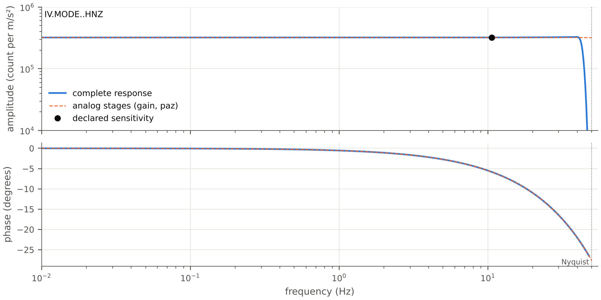
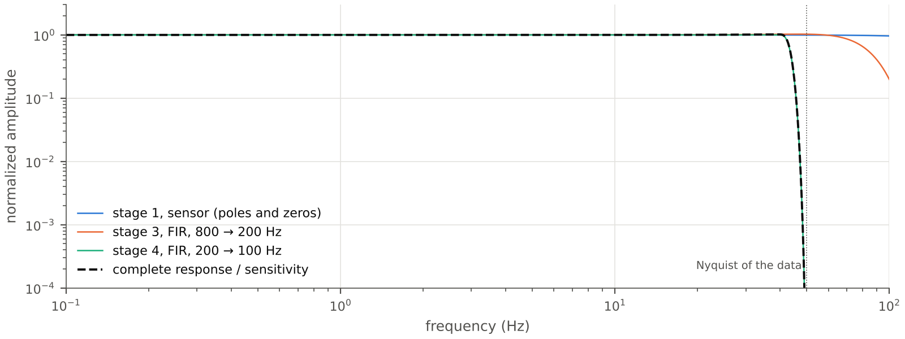
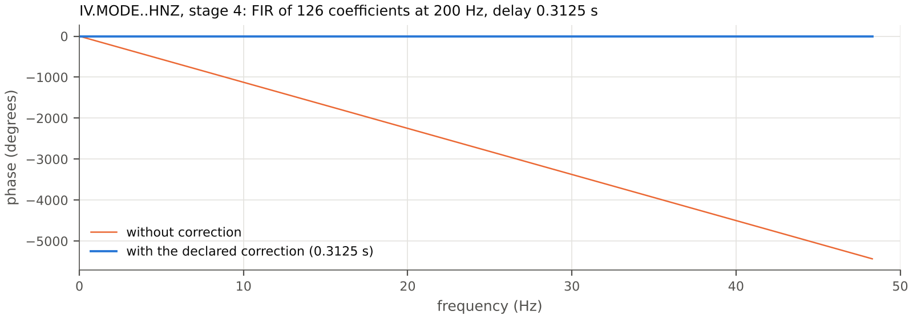
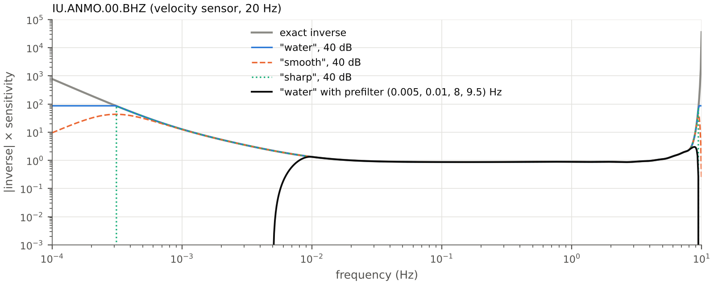
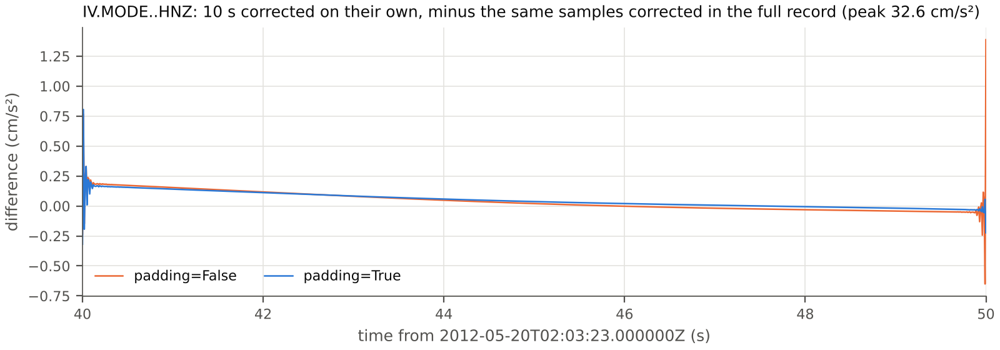
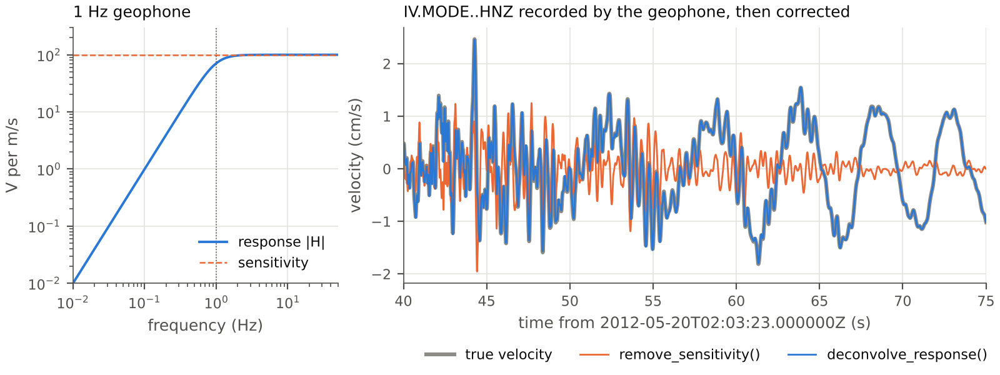

[ShakeLab documentation](../README.md) › [Signals](signals.md) ›
Metadata and instrument response

# Metadata and instrument response

A recording is a sequence of numbers produced by an instrument: to
turn them back into ground motion, and to place them in space and
time, ShakeLab keeps with every record the description of the channel
that recorded it. `shakelab.signals.metadata` describes the channels
(position, burial depth, orientation, sampling rate, equipment) and
their validity in time; `shakelab.signals.response` describes the
instrument response, stage by stage, as written in SEED and FDSN
StationXML. The readers `stationxml`, `respfile` and `stationtext`
fill this model from the usual metadata formats.

This guide gives the theory and the conventions of the response model
(Part I), the complete use of the metadata and response classes and
of the correction of data (Part II), and the design choices,
validation and limits (Part III). The containers that carry the
metadata are described in [`waveforms.md`](waveforms.md); downloading
metadata from data centres in [`fdsnws.md`](fdsnws.md).

The examples read the StationXML of a strong-motion station,
`station.xml` (three channels of an accelerometer and a 24-bit
datalogger at 100 Hz), its waveforms `waveforms.mseed` (raw counts),
the nominal response of the same instrument, `nominal.xml`, the RESP
file of a broadband velocity sensor, `station.resp` (two epochs), and
a channel list of the FDSN text format, `channels.txt`. The numbers in
the comments come from the test data of ShakeLab
(`tests/signals/data/`: IV.MODE of INGV, its response from the
EarthScope Nominal Response Library, and IU.ANMO.00.BHZ from the
evalresp test data). The examples of a section continue those before
it.

## Contents

Part I. Theory and conventions

1. [The response as a chain of stages](#1-the-response-as-a-chain-of-stages)
2. [Stage types](#2-stage-types)
3. [Normalization and gain](#3-normalization-and-gain)
4. [Digital stages](#4-digital-stages)
5. [Removing the response](#5-removing-the-response)
6. [Channel metadata](#6-channel-metadata)

Part II. Use

7. [Reading metadata](#7-reading-metadata)
8. [MetadataCollection](#8-metadatacollection)
9. [Channel and station epochs](#9-channel-and-station-epochs)
10. [Responses](#10-responses)
11. [Attaching metadata to data](#11-attaching-metadata-to-data)
12. [Correcting data](#12-correcting-data)
13. [Inspecting and checking a response](#13-inspecting-and-checking-a-response)
14. [Workflows](#14-workflows)

Part III. Design, validation and limits

15. [Design choices](#15-design-choices)
16. [Validation](#16-validation)
17. [Current limitations](#17-current-limitations)
18. [References](#18-references)

# Part I. Theory and conventions

## 1. The response as a chain of stages

A seismic channel converts a ground motion (displacement, velocity or
acceleration) into numbers through a chain of stages: the sensor
turns the motion into a voltage, the analog-to-digital converter turns
the voltage into counts at a high sampling rate, and digital filters
remove the high frequencies and decimate the data to the final rate.
Each stage $`i`$ is a linear system with a transfer function
$`H_i(f)`$ from its input to its output, and the response of the
channel is their product,

```math
H(f) = \prod_i H_i(f) ,
```

from the **input units** of the first stage (the ground motion, e.g.
`m/s**2`) to the **output units** of the last (the recorded data,
e.g. `count`). The spectrum of the recorded data $`Y(f)`$ is the
spectrum of the ground motion $`X(f)`$ multiplied by the response,
$`Y(f) = H(f)\,X(f)`$; correcting the data for the instrument means
recovering $`X`$ from $`Y`$ (§5).

The **sensitivity** of the channel is the amplitude of the response
at a frequency where it is flat, declared in the metadata with that
frequency and the units: for the accelerometer of the examples,
321707 counts per m/s² at 10.625 Hz. Within the flat band, dividing
the data by the sensitivity is a sufficient correction.

In ShakeLab a response is a `StageSet`: the list of its stages
(`StageResponse` objects, in order of application), the declared
sensitivity (`Sensitivity`) and the sampling rate of the data. It is
held by the channel metadata (`ChannelEpoch.response`, §6) and
evaluated with `transfer_function(frequency)`.



*Figure 1. Response of the vertical channel of IV.MODE (INGV
StationXML): an accelerometer, flat from 0 Hz, and a datalogger whose
digital filters cut the band just below the Nyquist frequency of the
data (50 Hz). The analog stages alone (dashed) have the same
amplitude in the passband; the dot is the declared sensitivity.*

## 2. Stage types

The stages follow the response elements of FDSN StationXML and the
response blockettes of SEED 2.4:

| ShakeLab | StationXML | SEED | Transfer function |
|---|---|---|---|
| `StagePoleZero` | `PolesZeros` | 53 | ratio of products of roots |
| `StageCoefficients` | `Coefficients`, `FIR` | 54, 61 | ratio of polynomials |
| `StageResponseList` | `ResponseList` | 55 | table of amplitude and phase |
| `StagePolynomial` | `Polynomial` | 62 | non-linear calibration |
| `StageGain` | `StageGain` | 58 | constant |
| `StageUnsupported` | other elements | 56, 60 | none (error when used) |

**Poles and zeros.** An analog stage (sensor, anti-alias filter) is
described by its poles $`p_k`$, zeros $`z_k`$ and normalization factor
$`A_0`$:

```math
T(f) = A_0\,\frac{\prod_k (s - z_k)}{\prod_k (s - p_k)} ,
```

with $`s = 2\pi i f`$ for poles and zeros in rad/s (`pz_type`
`"LAPLACE (RADIANS/SECOND)"`, the default) or $`s = i f`$ for poles
and zeros in Hz (`"LAPLACE (HERTZ)"`). A digital stage given by its
poles and zeros in the z-plane (`"DIGITAL (Z-TRANSFORM)"`) uses
$`z = e^{2\pi i f/f_s}`$ in place of $`s`$, with $`f_s`$ the input
sampling rate of the stage. A velocity sensor has zeros at the origin,
one for each power of $`f`$ by which its response falls at low
frequency; an accelerometer has none and is flat down to zero
frequency.

**Coefficients.** Digital filters are given by the coefficients of
the numerator $`b_k`$ and of the denominator $`a_k`$ (`cf_type`
`"DIGITAL"`, the default):

```math
T(f) = \frac{\sum_k b_k\, w^k}{\sum_k a_k\, w^k}, \qquad
w = z^{-1} = e^{-2\pi i f / f_s} ,
```

with the coefficients in forward order (`numerator[k]` multiplies
$`z^{-k}`$). A finite impulse response (FIR) filter has the
denominator 1 and the numerator equal to its impulse response; the
`FIR` element of StationXML and blockette 61 store symmetric filters
by their first half, which the readers expand
(`expand_fir_symmetry`). A stage with no coefficients is $`T = 1`$:
the analog-to-digital converter, which only changes the units from V
to counts, is written this way. Analog coefficients (`"ANALOG
(RADIANS/SECOND)"`, `"ANALOG (HERTZ)"`) are polynomials in ascending
powers of $`s`$.

**Response list.** A table of amplitude and phase (degrees) at given
frequencies, for instruments described only by measurements. Between
the tabulated frequencies the amplitude is interpolated linearly in
log-amplitude against log-frequency and the unwrapped phase linearly
against frequency; outside the table the response is zero, with a
`ResponseWarning` (there is no extrapolation).

**Polynomial.** A non-linear stage, used by sensors of physical
quantities other than motion (temperature, pressure): the input of
the stage is a polynomial of its output,

```math
x = \sum_k a_k\, y^k ,
```

valid within declared bounds. It is not a frequency response:
`evaluate(y)` applies it to recorded values. Only a linear polynomial
has a transfer function, the constant gain $`1/a_1`$; a non-linear one
raises a `ValueError` when used in the frequency domain.

**Gain.** A constant $`G_i`$ that multiplies the stage, declared with
the frequency at which it applies.

**Unsupported elements** (for example the generic response of
blockette 56) are kept as `StageUnsupported`, with their units and
position, so that a response known to be incomplete cannot be used
without notice: evaluating it raises `NotImplementedError`.

## 3. Normalization and gain

In SEED and StationXML the transfer function of a poles-and-zeros
stage is normalized: $`A_0`$ is chosen so that
$`|T(f_n)| = 1`$ at the normalization frequency $`f_n`$, and the
amplitude of the stage is carried by its gain $`G_i`$, declared at a
frequency $`f_{g,i}`$. The gain is the amplitude of the stage at that
frequency (SEED blockette 58). ShakeLab therefore evaluates each
poles-and-zeros and coefficients stage as

```math
H_i(f) = G_i\, \frac{T_i(f)}{|T_i(f_{g,i})|} ,
```

so that $`|H_i(f_{g,i})| = G_i`$ also when the gain frequency differs
from the normalization frequency, or when a digital filter does not
have unit gain at $`f_{g,i}`$, as evalresp does. With consistent
metadata the factor $`|T_i(f_{g,i})|`$ is 1. If it is zero or not
finite (a gain declared at 0 Hz for a stage with zeros at the origin)
the stage is used as declared, with a `ResponseWarning`.

The declared **sensitivity** $`S_0`$ at $`f_0`$ should equal
$`|H(f_0)|`$, and the product of the stage gains when all the gains
refer to $`f_0`$. ShakeLab uses the stages to compute the response and
the sensitivity only for `remove_sensitivity`; `validate()` reports the
differences between the two (§13).

## 4. Digital stages

Digital stages run at their own sampling rate: the converter samples
at a high rate (800 Hz in the datalogger of the examples) and each
decimating filter divides it (`decimation_factor`), down to the rate
of the data. Each digital stage is evaluated at its **input sampling
rate** (`input_sample_rate`, StationXML `Decimation/InputSampleRate`);
when a stage does not declare it, the sampling interval of the data
(`delta`) is used. The response of a digital stage is periodic in
frequency with period $`f_s`$, and is meaningful up to the Nyquist
frequency of the data.



*Figure 2. The stages of IV.MODE..HNZ normalized to unit gain: the
sensor is flat far beyond the band of the data; the first FIR filter,
at 800 Hz, attenuates above 60 Hz before decimating to 200 Hz; the
second, at 200 Hz, sets the corner of the complete response at about
40 Hz before decimating to 100 Hz. The analog-to-digital converter
(stage 2) is a pure gain.*

A symmetric FIR filter of $`N`$ coefficients delays the signal by
$`(N-1)/(2 f_s)`$ seconds, its **delay**. Dataloggers usually correct
it by shifting the time stamps; the metadata declare the applied
**correction** $`c`$ (StationXML `Decimation/Correction`, SEED
blockette 57, field 8), and ShakeLab multiplies the response of the
stage by

```math
e^{2\pi i f c} ,
```

a time advance for positive $`c`$. A correction equal to the delay
cancels the linear phase of the filter, so that the corrected response
has zero phase (Figure 3). The declared delay is not applied: it is
information, which `validate()` compares with the symmetry of the
coefficients.



*Figure 3. Phase of the last FIR filter of IV.MODE..HNZ: without the
correction it falls linearly, by $`-2\pi f \tau`$ with the delay
$`\tau`$ = 0.3125 s; with the declared correction (equal to the
delay) it is zero in the passband.*

## 5. Removing the response

Correcting data for the instrument divides their spectrum by the
response,

```math
X(f) = \frac{Y(f)}{H(f)} ,
```

which is unstable where $`|H|`$ is small: at low frequency for
velocity sensors, near and above the Nyquist frequency for all
digital channels. ShakeLab regularizes the inverse with a **water
level** $`w`$ in dB below the maximum of the response,

```math
\varepsilon = \max_f |H(f)|\; 10^{-w/20} ,
```

which does not depend on the units of the response, and one of three
methods (`method`):

| Method | Inverse | Behaviour |
|---|---|---|
| `"water"` (default) | $`1/(\max(\lvert H\rvert, \varepsilon)\, e^{i\varphi})`$ | amplitude raised to $`\varepsilon`$ where smaller, phase kept |
| `"sharp"` | $`1/H`$ where $`\lvert H\rvert \geq \varepsilon`$, 0 elsewhere | removes the frequencies below the level |
| `"smooth"` | $`H^*/(\lvert H\rvert^2 + \varepsilon^2)`$ | damped least squares, no discontinuity |

with $`\varphi`$ the phase of $`H`$. In all three the amplification
is limited to about $`1/\varepsilon`$, $`w`$ dB above the inverse of
the maximum. The default level is 60 dB: a thousandth of the maximum
amplitude.

The water level only limits the noise amplified by the correction. To
restrict the result to the band where the response and the signal are
reliable, the inverse is multiplied by a band-pass window
(`prefilter=(f1, f2, f3, f4)`, as `freqlimits` in SAC `transfer`): 0
below $`f_1`$ and above $`f_4`$, 1 between $`f_2`$ and $`f_3`$, and a
half cosine in between,

```math
W(f) = \frac{1}{2}\left[1 - \cos\left(\pi\,\frac{f - f_1}{f_2 - f_1}\right)\right]
\quad (f_1 < f < f_2) ,
```

and symmetrically between $`f_3`$ and $`f_4`$ (Figure 4).



*Figure 4. Inverse of the response of IU.ANMO.00.BHZ, a broadband
velocity sensor sampled at 20 Hz, multiplied by its sensitivity (1 in
the flat band). With a water level of 40 dB the "water" inverse is
clipped at 100, "sharp" drops to zero below the level, "smooth"
tapers off; the prefilter limits the correction to 0.01-8 Hz.*

The division is made on the discrete Fourier transform of the record,
which treats it as periodic: the correction of one end of the record,
where an acausal filter (the inverse of a response) spreads in time,
wraps around onto the other end. With `padding=True` the record is
followed by at least as many zeros before the transform, and cut back
after it, so that the wrap-around falls on the zeros (Figure 5). The
record must be detrended and tapered first, otherwise the jump from
its last sample to the zeros becomes a step that the correction turns
into large transients. Detrending and tapering are needed in any case,
for the same reason, at both ends of the periodic record.



*Figure 5. Ten seconds of IV.MODE..HNZ corrected on their own, minus
the same samples corrected within the whole record. Without padding
the correction of the start wraps onto the end (orange spike at 50
s); with padding it falls on the zeros. The transients at the start
and the slow drift come from the short window itself and remain.*

The **sensitivity correction** (`remove_sensitivity`) divides the data
by $`S_0`$: exact within the flat band of the instrument, and the usual
quick correction of accelerometers.

**Units.** The corrected data take the input units of the response.
The units of the data are checked against the output units of the
response when both are declared (`count` and `counts` are the same):
a record already corrected, in `m/s**2`, cannot be corrected again
against a response that outputs counts.

## 6. Channel metadata

A **channel epoch** (`ChannelEpoch`) describes a channel
`NET.STA.LOC.CHA` during a time interval in which nothing changes,
from its start time (included) to its end time (excluded; an open
bound is None). A new epoch begins whenever the sensor, the
datalogger, the gain or the position change. It holds:

| Attribute | Content |
|---|---|
| `sid` | source identifier `NET.STA.LOC.CHA` |
| `starttime`, `endtime` | validity interval (`Date`, None if open) |
| `location` | `WgsPoint` (longitude, latitude, elevation in m, positive upward) |
| `depth` | burial depth below `location`, in km, positive downward |
| `orientation` | `Orientation` (azimuth, dip) |
| `sample_rate` | declared sampling rate, Hz |
| `sensor`, `datalogger` | `Equipment` (type, description, manufacturer, model, serial number) |
| `response` | `StageSet` |
| `station` | `StationEpoch` it belongs to |
| `extra` | dictionary of other information |

The **orientation** gives the direction in which the component is
positive: the azimuth in degrees clockwise from north, in
$`[0, 360)`$, and the dip in degrees below the horizontal, in
$`[-90, 90]`$ (SEED and StationXML): a horizontal north component has
azimuth 0 and dip 0, a vertical component positive upward has dip
$`-90`$. The unit vector of the positive direction, in east, north and
up components, is

```math
𝐮 = \left(\cos\delta \sin\alpha,\; \cos\delta \cos\alpha,\;
-\sin\delta\right),
```

with $`\alpha`$ the azimuth and $`\delta`$ the dip
(`Orientation.vector`).

The **elevation** is that of the ground surface as written in the
metadata (StationXML refers it to the local surface, usually to mean
sea level); the sensor is at `location.elevation - 1000 * depth` m.

A **station epoch** (`StationEpoch`) describes a station `NET.STA`:
code, validity interval, location, site name and description. A
**MetadataCollection** holds channel epochs and station epochs in a
flat model: each channel epoch refers to its station epoch, rather
than a tree of networks, stations and channels; the collection selects
the epoch valid for a channel at a time (§8).

# Part II. Use

## 7. Reading metadata

Metadata are read into a `MetadataCollection`, from StationXML
(`"xml"`, also `"sxml"`), RESP (`"resp"`), the text format of the FDSN
station service (`"fdsntext"`) or the JSON written by the collection
(`"json"`):

```python
from shakelab.signals.metadata import MetadataCollection

metadata = MetadataCollection("station.xml")
metadata.info()
# 1 stations, 3 channels, 3 epochs
# IV.MODE (Modena)  2007-10-18T12:00:00.000000Z -> open  lon 10.949167 ...
#   IV.MODE..HNZ  2008-04-07T08:00:00.000000Z -> open  100 Hz  az 0 ...
#   IV.MODE..HNN  ...
```

The format is inferred from the file name (`RESP.` at the start or
`.resp` at the end for RESP, otherwise the extension); files and
contents with another extension (e.g. `.txt`) are recognized as FDSN
text from their header line. StationXML, RESP and FDSN text can also
be given as text, bytes or an open file. `read` replaces the content,
or adds to it with `append=True`:

```python
resp = MetadataCollection("station.resp")   # RESP: two epochs, no coordinates
text = MetadataCollection("channels.txt")   # FDSN text: no response stages

metadata.read("nominal.xml", append=True)   # add to the collection
metadata.read("station.xml")                # replace the content
```

The formats give what they contain: StationXML the complete
description; RESP only the responses (no coordinates, orientation or
equipment, no station epochs); FDSN text coordinates, depth,
orientation, sampling rate, sensor description and the overall
sensitivity, without stages. The reader of `shakelab.signals.io` reads
many files, folders and patterns at once:

```python
from shakelab.signals.io import metadata_reader

metadata = metadata_reader("station.xml")   # or a list, "meta/*.xml"
```

The FDSN client downloads metadata directly into a collection
(`Client.get_metadata`, [`fdsnws.md`](fdsnws.md)). A collection is
written, and read back, in JSON, which keeps everything ShakeLab read
(stations once, channels referring to them):

```python
metadata.write("station.json")
again = MetadataCollection("station.json")
```

## 8. MetadataCollection

### 8.1 Content, indexing and iteration

```python
len(metadata)                       # 3 channel epochs
metadata.sid                        # ['IV.MODE..HNZ', ..., 'IV.MODE..HNE']
"IV.MODE..HNZ" in metadata          # True
metadata["IV.MODE..HNZ"]            # list of the epochs of a channel
metadata[0]                         # first channel epoch
metadata[:2]                        # list of the first two epochs

for epoch in metadata:              # channel epochs, channel by channel
    print(epoch.sid, epoch.starttime, epoch.sample_rate)
```

The epochs of a channel are kept in order of start time. `[sid]`
raises a `KeyError` for a missing channel; integers and slices index
the sequence of all the epochs and return epochs or lists (not
collections). Station epochs are reached with `stations()` (§8.2).

### 8.2 Selection

`get(sid, time)` returns the epoch of a channel valid at a time:

```python
epoch = metadata.get("IV.MODE..HNZ", "2012-05-20T02:03:23")
epoch = metadata.get("IV.MODE..HNZ")        # a channel with one epoch
```

The time may be omitted only if the channel has one epoch (otherwise
`ValueError`); a missing channel or a time outside every epoch raises
a `KeyError`; if several overlapping epochs are valid, the first is
returned with a `MetadataWarning`. `select(sid, time)` returns a new
collection with the epochs matching a pattern of
`shakelab.signals.codes` (code by code: `*`, `?`, `[...]`, `{A,B}`;
missing trailing codes match everything), optionally valid at a time;
`stations(code, time)` the station epochs:

```python
horizontal = metadata.select("IV.MODE..HN[NE]")
network = resp.select("IU", time="2015-01-01")   # every channel of IU in 2015
metadata.stations()                 # [StationEpoch('IV.MODE', ...)]
metadata.stations("IV.*", time="2012-05-20")
```

### 8.3 Building a collection

`append` adds a copy of a channel or station epoch; `extend` adds
those of another collection or of an iterable. The station of a
channel epoch is shared with an equal station already in the
collection (or added once); a channel epoch equal to one already
present is ignored; an epoch that overlaps a different epoch of the
same channel is added with a `MetadataWarning`, and reported by
`validate()`.

```python
from shakelab.signals.metadata import ChannelEpoch, StationEpoch

site = StationEpoch("XX.TEST", starttime="2026-01-01",
                    location=(13.75, 45.65, 120.0), site="Test site")
first = ChannelEpoch("XX.TEST..HHZ", starttime="2026-01-01",
                     endtime="2026-03-01", orientation=(0, -90),
                     sample_rate=100.0, station=site)
second = first.replace(starttime="2026-03-01", endtime=None,
                       sample_rate=200.0)    # e.g. a new datalogger

custom = MetadataCollection()
custom.append(first)
custom.append(second)
custom.append(first)                # equal: ignored
print(len(custom), custom.get("XX.TEST..HHZ", "2026-06-01").sample_rate)
# 2 200.0
```

### 8.4 Checking, copying, views

`validate(rtol=1e-3)` returns a list of problems (empty if none), each
prefixed by channel and epoch start: overlapping epochs of a channel,
the checks of every response (§13), declared sampling rates against
those of the responses. Nothing is changed. `info()` prints a summary;
`copy()` returns a deep copy.

| Operation | Returns |
|---|---|
| `metadata[sid]`, `metadata[i]`, `metadata[i:j]`, iteration | the stored epochs (lists are new, epochs are not) |
| `get(sid, time)`, `stations()` | the stored epochs |
| `select(...)`, `copy()` | new collection with copies |
| `append(epoch)`, `extend(...)`, `read(...)` | copies are stored |

Changing a stored epoch changes the collection and every record that
refers to it (§11); to modify an epoch, use `replace` (§9), which
returns a new one.

## 9. Channel and station epochs

```python
from shakelab.signals.metadata import Equipment, Orientation

channel = ChannelEpoch(
    "XX.TEST..HHZ",
    starttime="2026-01-01",
    location=(13.75, 45.65, 120.0),  # or a WgsPoint
    depth=0.002,                    # burial depth, km
    orientation=(0, -90),           # or Orientation(0, -90)
    sample_rate=100.0,
    sensor=Equipment(manufacturer="ACME", model="S-1"),
    station=site,
)
channel.extra["vault"] = "borehole"
channel.info()
```

The values are checked when assigned: the identifier must have four
dot-separated codes, coordinates two or three numbers, orientation an
azimuth and a dip in $`[-90, 90]`$ (the azimuth is reduced to
$`[0, 360)`$), sampling rate and depth finite numbers, the response a
`StageSet`; wrong values raise `ValueError` or `TypeError`. The codes
are available separately:

```python
channel.network, channel.station_code       # 'XX', 'XX.TEST'
channel.location_code, channel.channel      # '', 'HHZ'
channel.orientation.vector          # [0, 0, 1]: positive upward
str(channel.sensor)                 # 'ACME S-1'
channel.match("2026-06-01")         # True: within the epoch
channel.overlaps(second)            # whether two epochs share time
ChannelEpoch().empty                # True: the metadata of a bare record
```

`replace(**changes)` returns a copy with some attributes changed,
validated as in the constructor; the response and the station are
shared with the original (shallow copy), `extra` is copied. `copy()`
returns a deep copy, station included. `conflicts(other)` lists the
attributes defined in both epochs with different values, ignoring
those missing in either (so that the coordinates read from a SAC file
agree with a complete StationXML epoch) and comparing within
tolerances: 1e-5 degrees and 0.1 m for the location (an elevation of 0
is not compared), 1 mm for the depth, 1e-3 degrees for the
orientation, a relative 1e-4 for the sampling rate.

```python
rotated = channel.replace(orientation=(90, 0))
channel.conflicts(rotated)          # ['orientation']
channel.conflicts(ChannelEpoch("XX.TEST..HHZ", location=(13.75, 45.65)))  # []
```

Epochs compare equal (`==`) when all their attributes are equal;
`to_dict` and `from_dict` convert them to plain values (the station is
not included in the dictionary of a channel). `StationEpoch` has
`code`, `network`, `station`, `starttime`, `endtime`, `location`,
`site`, `description`, `match`, `overlaps`, `to_dict`, `from_dict` and
`copy`.

## 10. Responses

### 10.1 StageSet

```python
response = metadata.get("IV.MODE..HNZ").response
response.info()
# Sampling rate: 100.0 Hz
# Sensitivity: 321707.0 count per m/s**2 at 10.625 Hz
# Stages: (1) paz; (1) gain; (2) coefficients; (2) gain; (3) coefficients; ...

response.stage                      # list of the stages, in order
response[1]                         # first stage with stage number 1 (the paz)
response.get_stage(3)               # the same, by stage number
response.select_stages(("gain", "paz"))     # stages of these types
response.sensitivity                # Sensitivity(value=321707.0, ...)
response.units()                    # ('m/s**2', 'count')
response.units(("gain", "paz"))     # ('m/s**2', 'V'): the analog part
```

`transfer_function(frequency, delta=None, stages=None)` returns the
complex response at given frequencies, of all the stages or of the
selected types (§3). `delta` is the sampling interval used by digital
stages that do not declare their rate.

```python
import numpy as np

frequency = np.logspace(-2, np.log10(50.0), 200)
h = response.transfer_function(frequency)
analog = response.transfer_function(frequency, stages=("gain", "paz"))
print(abs(response.transfer_function([10.625])))   # [321706.7]
```

Stages of a type that cannot be evaluated (a non-linear polynomial, an
unsupported element) raise an error when selected; the others are
evaluated as described in §2-§4. Stage types are the strings of
`STAGE_TYPES`: `"gain"`, `"paz"`, `"coefficients"`,
`"response_list"`, `"polynomial"`, `"unsupported"`. `validate()` checks
the response (§13); `to_dict` and `from_dict` convert it to plain
values for JSON; `copy()` returns a deep copy.

### 10.2 Building stages

Stages are built from keyword arguments, from a dictionary of their
parameters, or from a JSON file, and their parameters are read and
set as attributes or as items:

```python
from shakelab.signals.response import (
    Sensitivity,
    StageGain,
    StagePoleZero,
    StageSet,
)

f0, h0 = 1.0, 0.707                 # natural frequency (Hz) and damping
w0 = 2 * np.pi * f0
poles = [complex(-h0 * w0, w0 * np.sqrt(1 - h0 ** 2)),
         complex(-h0 * w0, -w0 * np.sqrt(1 - h0 ** 2))]

sensor = StagePoleZero(
    poles=poles,
    zeros=[0, 0],                   # velocity sensor: two zeros at the origin
    normalization_factor=1.0,
    normalization_frequency=10.0,
    input_units="m/s",
    output_units="V",
    stage_number=1,
)
gain = StageGain({"sensitivity": 100.0, "frequency": 10.0,
                  "stage_number": 1})        # 100 V per m/s
sensor["normalization_factor"]      # 1.0, as sensor.normalization_factor

seismometer = StageSet()
seismometer.append([sensor, gain])
seismometer.sensitivity = Sensitivity(100.0, 10.0, "m/s", "V")
print(abs(seismometer.transfer_function([0.1, 1.0, 10.0])))
# [1.0 70.7 100.0]: 1 Hz geophone, 100 V/(m/s) above its corner
```

Unknown parameter names raise a `KeyError`; values are converted to
the declared types (poles and zeros to complex arrays). `to_dict()`
returns the parameters; `to_json(file)` and `from_json(file)` write
and read them for stages with real parameters (§17). The other stage
types:

```python
from shakelab.signals.response import (
    StageCoefficients,
    StagePolynomial,
    StageResponseList,
)

fir = StageCoefficients(numerator=[0.25, 0.5, 0.25], input_sample_rate=200.0,
                        decimation_factor=2, delay=0.005, correction=0.005,
                        input_units="count", output_units="count",
                        stage_number=3)
table = StageResponseList(frequency=[1.0, 10.0, 100.0],
                          amplitude=[1.0, 10.0, 100.0],
                          phase=[0.0, -45.0, -90.0], stage_number=1)
thermometer = StagePolynomial(coefficients=[-50.0, 20.0],  # x = -50 + 20 y
                              input_units="degC", output_units="V",
                              stage_number=1)
thermometer.evaluate([2.5, 3.0])    # [0.0, 10.0] degC from volts
```

### 10.3 Helper functions

```python
from shakelab.signals.metadata import select_response, select_sensitivity
from shakelab.signals.response import (
    expand_fir_symmetry,
    response_transfer,
    same_units,
)

select_response(metadata, "IV.MODE..HNZ", "2012-05-20")    # the StageSet
select_sensitivity(metadata, "IV.MODE..HNZ", "2012-05-20") # Sensitivity(...)
response_transfer(response, [1.0])  # (transfer, 'm/s**2', 'count')
same_units("COUNTS", "count")       # True: case and plural ignored
expand_fir_symmetry([1.0, 2.0, 3.0], "ODD")      # [1, 2, 3, 2, 1]
```

`select_response(resp, sid, time)` is what every correction method
uses to find the response: a stage or a stage set is used as it is, a
channel epoch must belong to the channel and be valid at the time of
the data, a collection is searched by identifier and time. Wrong
channel, wrong time or a missing response raise a `ValueError` or a
`KeyError`, so that the response of another channel is never applied
by mistake.

## 11. Attaching metadata to data

Records carry the metadata of their channel in `record.head.meta` (a
`ChannelEpoch`, shared by the records of the same epoch; see
[`waveforms.md`](waveforms.md) §3). They are assigned when reading or
afterwards:

```python
from shakelab.signals.io import reader

data = reader("waveforms.mseed", metadata="station.xml")   # or a collection
raw = reader("waveforms.mseed")
raw.set_metadata(metadata)          # epoch valid at the start of each record

z = data["IV.MODE..HNZ"][0]
z.head.meta                         # ChannelEpoch('IV.MODE..HNZ', ...)
z.location, z.orientation, z.response
```

`set_metadata` exists on records, streams and collections and accepts
a `MetadataCollection` or a `ChannelEpoch`. It warns
(`MetadataWarning`) when it replaces different metadata, when the
declared sampling rate differs from that of the data, or when a record
extends beyond the end of its epoch. On a record or a stream a channel
or an epoch not found raises a `KeyError`; on a collection the
channels without metadata are reported in one warning and left
unchanged.

## 12. Correcting data

### 12.1 Full response

```python
z = data["IV.MODE..HNZ"][0].copy()
z.detrend()
z.taper(5.0)
z.deconvolve_response(prefilter=(0.05, 0.1, 30.0, 40.0))
print(z.head.units, round(z.peak, 4))       # m/s**2 0.3258
```

`deconvolve_response(resp=None, waterlevel=60.0, method="water",
stages=None, prefilter=None, padding=False)` exists on `Record`,
`Stream` and `StreamCollection` (applied record by record) and on
`Spectrum` (without `padding`). By default the response of the
record's metadata is used; `resp` can be a stage, a `StageSet`, a
`ChannelEpoch` or a `MetadataCollection` (searched by identifier and
start time of each record). Options:

```python
x = data["IV.MODE..HNZ"][0].copy()
x.detrend()
x.taper(5.0)
x.deconvolve_response(
    metadata,                       # explicit metadata
    waterlevel=60.0,                # dB below the maximum of |H|
    method="water",                 # or "sharp", "smooth"
    stages=("gain", "paz"),         # analog part only; default: all
    prefilter=(0.05, 0.1, 30.0, 40.0),
    padding=True,                   # zeros against wrap-around
)
```

Correcting a record twice raises a `ValueError` (its units, now
`m/s**2`, differ from the output units of the response, `count`).
The corrected data are not filtered beyond the prefilter: filtering
for a given analysis follows the correction.

### 12.2 Sensitivity only

```python
quick = data["IV.MODE..HNZ"][0].copy()
quick.detrend()
quick.remove_sensitivity()          # divide by 321707 count/(m/s**2)
print(round(quick.peak, 4))         # 0.3241
```

The difference from the full correction (0.5% here) comes from the
anti-alias filters and the sensor above about 10 Hz. The sensitivity
is enough only where the response is flat over the whole band of the
signal, as for this accelerometer. For a sensor whose response falls
within that band, such as a short-period velocity sensor below its
natural frequency, only the full correction recovers the ground
motion (Figure 6).



*Figure 6. The vertical velocity of IV.MODE (from the corrected
accelerogram) as recorded by the 1 Hz geophone of §10.2
(`convolve_response`), then corrected. Left: the response of the
geophone falls as $`f^2`$ below 1 Hz, while the sensitivity is a
single value. Right: dividing by the sensitivity loses the motion
below 1 Hz (peak 1.95 cm/s instead of 2.47, waveform distorted);
`deconvolve_response` recovers the true velocity within 1% of its
peak.*

### 12.3 Applying a response

`convolve_response` multiplies the spectrum by a response, from its
input to its output units: it simulates the recording of a ground
motion by an instrument.

```python
velocity = z.copy()                 # ground acceleration, m/s**2
velocity.integrate()
velocity.head.units = "m/s"
recorded = velocity.copy()
recorded.convolve_response(seismometer)     # volts of the 1 Hz geophone
print(recorded.head.units)          # V
```

The operators do the same with the default options (see
[`waveforms.md`](waveforms.md) §6.6): `record / metadata` removes the
response, `record * response` applies it; on collections only with a
`MetadataCollection` or a response.

### 12.4 Choosing the options

- **Detrend and taper first.** The transform treats the record as
  periodic; offsets and trends become steps at its ends. A taper of a
  few seconds, or a few percent of the record, is usual.
- **Prefilter.** Choose $`f_2`$ and $`f_3`$ to bound the band of
  interest and of reliable signal: above the noise at low frequency
  (for an accelerometer, a few hundredths of a hertz; for a
  short-period sensor, near its natural frequency) and below the
  corner of the anti-alias filter (about 80% of the Nyquist
  frequency); $`f_1`$ and $`f_4`$ give smooth transitions, typically
  half and twice $`f_2`$, or 20-30% beyond $`f_3`$.
- **Water level.** The default 60 dB limits the amplification to a
  factor of 1000 above the inverse of the maximum. With a prefilter it
  rarely matters; without one, a lower level (20-40 dB) suppresses the
  noise outside the passband, a higher one (80-100 dB) corrects closer
  to the exact inverse.
- **Stages.** The full response is the default. The analog part
  (`stages=("gain", "paz")`) ignores the digital filters, whose
  correction matters near the Nyquist frequency.
- **Padding.** For short records, or when the ends of the record
  matter, use `padding=True` on detrended and tapered records.

## 13. Inspecting and checking a response

The amplitude and phase of a response are drawn from
`transfer_function` (Figures 1 and 2):

```python
amplitude = np.abs(h)
phase = np.degrees(np.unwrap(np.angle(h)))
gain_at = np.abs(response.transfer_function([response.sensitivity.frequency]))
```

`validate(rtol=1e-3)`, on a `StageSet` or on a collection, checks:

- the amplitude of the total response at the frequency of the
  sensitivity against the declared sensitivity, and the product of
  the stage gains when they all refer to that frequency;
- the normalization of poles-and-zeros stages ($`|A_0 T(f_n)| = 1`$);
- the continuity of the units from stage to stage, and against the
  sensitivity;
- the decimation chain against the sampling rate of the data;
- the symmetry of FIR filters whose declared delay implies a linear
  phase;
- (collection) overlapping epochs and declared sampling rates.

```python
metadata.validate()                 # [] for consistent metadata
broken = response.copy()
broken.sensitivity.value = 300000.0
broken.validate()
# ['total response amplitude 321707 at 10.625 Hz differs from the
#   sensitivity 300000']
```

Problems are reported, never corrected: the response is used as
written. Two descriptions of the same instrument (the metadata of a
network and the nominal response of its sensor and datalogger) are
compared on their transfer functions:

```python
nominal = MetadataCollection("nominal.xml")
reference = nominal[0].response     # IV.MODE.00.HNZ of the NRL
ratio = reference.transfer_function(frequency) / h
print(np.abs(ratio).min(), np.abs(ratio).max())   # 1.0 1.0
```

## 14. Workflows

### 14.1 From counts to acceleration, velocity and displacement

```python
data = reader("waveforms.mseed", metadata="station.xml")
data.detrend()
data.taper(5.0)
data.deconvolve_response(prefilter=(0.05, 0.1, 30.0, 40.0))  # m/s**2

velocity = data.copy()
velocity.integrate()                # m/s (units not updated)
displacement = velocity.copy()
displacement.integrate()            # m

for record in velocity.records():
    print(record.sid, round(record.peak * 100, 2), "cm/s")
```

For a velocity sensor the same steps give velocity first; the
prefilter then also limits the integration noise at low frequency.

### 14.2 Simulating an instrument

```python
ground = data.copy()                # acceleration, m/s**2
ground.integrate()
for record in ground.records():
    record.head.units = "m/s"
ground.convolve_response(seismometer)       # what a 1 Hz geophone records
```

### 14.3 Checking the metadata of a station

```python
problems = metadata.validate()
for epoch in metadata:
    response = epoch.response
    print(epoch.sid, epoch.sample_rate, epoch.orientation,
          response.sensitivity.value, response.units())
print(problems or "consistent")
```

# Part III. Design, validation and limits

## 15. Design choices

- **The response is a model of the instrument.** Stages provide their
  transfer function and a stage set their product; the model knows
  nothing about waveforms. Records, streams, collections and spectra
  apply it through `deconvolve_response`, `convolve_response` and
  `remove_sensitivity`, implemented once in `Spectrum` and delegated
  to by the waveform classes.
- **One class per element of StationXML**, with the same parameters
  and names, so that what is read can be checked against the document
  and written back without loss. FIR filters are coefficient stages
  after the expansion of their symmetry.
- **The complete response by default.** Digital stages are evaluated
  at their own sampling rate with the declared time correction; subsets
  are chosen explicitly with `stages`.
- **The declared gain is authoritative.** Each stage is normalized to
  its gain at the gain frequency, as in evalresp and as SEED
  prescribes, so that responses with inconsistent normalization
  factors still give the declared amplitudes.
- **Never wrong in silence.** Stages that cannot be evaluated raise
  errors when used; the response of another channel or epoch is
  refused; data already corrected are refused; inconsistent metadata
  are reported by `validate()` and never corrected automatically.
- **A water level relative to the maximum**, in dB, so that one value
  works for every response and every unit.
- **A flat collection of epochs**, rather than a tree of networks,
  stations and channels: what processing needs is the epoch of a
  channel at a time; stations are shared objects, available on their
  own for maps and arrays.
- **Metadata shared by the data.** Records refer to the epoch of their
  channel instead of copying it; changes through the API replace the
  epoch with a copy (`replace`), so that shared epochs are never
  modified by accident.
- **Units as written.** Units are kept as the metadata declare them
  (`M/S`, `m/s`, `COUNTS`) and compared ignoring case and plural; they
  are not converted.

## 16. Validation

The response model and the readers are covered by the tests of
`tests/signals/` (`test_instrument_response.py`, 41 tests;
`test_metadata.py`, 26; `test_stationxml.py`, 16; `test_respfile.py`,
33; `test_stationtext.py`, 7). The main checks:

| Check | Result |
|---|---|
| Amplitude of IU.ANMO.00.BHZ (RESP, 6 stages, 0.1-10 Hz) against evalresp | a constant relative difference of 6.1e-5, the rounding of $`A_0`$ in the file |
| Phase of IU.ANMO.00.BHZ against evalresp, after the residual delay of the FIR filters (evalresp evaluates them with zero phase) | within 5e-5 degrees |
| Nominal response of IV.MODE..HNZ (NRL) in RESP and in StationXML | the same model, coefficient by coefficient |
| StationXML of IV.MODE (INGV) against the NRL response of the same sensor and datalogger | ratio 1 at every frequency |
| Total response of IV.MODE at 10.625 Hz against the declared sensitivity | consistent (`validate()` returns no problem) |
| Correction of the raw counts of IV.MODE against the accelerograms processed by ESM | peaks within 0.5% ([`waveforms.md`](waveforms.md) §14) |
| Round trip `convolve_response` then `deconvolve_response` | the original samples within the water level |
| Linear-phase FIR with the declared correction | zero phase |
| Poles and zeros in Hz and in rad/s; digital poles and zeros against the same filter as coefficients | equal transfer functions |

The phase convention of evalresp differs in one point: evalresp
evaluates symmetric FIR filters with zero phase (it assumes their
delay fully corrected), while ShakeLab applies the declared
corrections, which here leave a residual delay
$`\sum_i \left[(N_i-1)/(2 f_{s,i}) - c_i\right]`$ over the FIR stages.

## 17. Current limitations

- **Writing.** Metadata are written only in the JSON of
  `MetadataCollection`; StationXML and RESP are read, not written.
- **Non-linear stages.** Polynomial stages are evaluated
  (`StagePolynomial.evaluate`) but not applied to the data, and the
  `InstrumentPolynomial` of StationXML is read but not used.
- **Response lists** are zero outside their frequency range: no
  extrapolation.
- **Unsupported elements** (generic responses, references to
  dictionaries in SEED) make the response unusable by design.
- **Undescribed stages.** A correction is only as good as the
  metadata: decimation stages missing from them (for example the CIC
  decimator of some dataloggers) are not corrected.
- **JSON of single stages.** `StageResponse.to_json` writes complex
  poles and zeros in a form that `from_json` does not read back; stage
  sets and collections (`to_dict`, `MetadataCollection.write`) are not
  affected.
- **Elevations** are taken as written (relative to the local ground,
  usually mean sea level), not converted to ellipsoidal heights.
- **Interface asymmetries** (under review): `MetadataCollection.read`
  returns None while `StreamCollection.read` returns the collection;
  `MetadataCollection.write(file, format)` does not follow the names of
  the writers (`target`, `owrite`); integer and slice indexing return
  epochs and lists, not collections; `StageSet[n]` indexes by stage
  number, not by position.

## 18. References

Clayton, R. W., and Wiggins, R. A. (1976). Source shape estimation and
deconvolution of teleseismic bodywaves. Geophysical Journal of the
Royal Astronomical Society, 47(1), 151-177.

EarthScope Consortium. evalresp: evaluation of instrument responses.
https://github.com/EarthScope/evalresp

EarthScope Consortium. Nominal Response Library (NRL).
https://ds.iris.edu/ds/nrl/

FDSN (2012). SEED Reference Manual, Standard for the Exchange of
Earthquake Data, SEED Format Version 2.4, Appendix C. International
Federation of Digital Seismograph Networks.

FDSN. FDSN StationXML schema and documentation, version 1.2.
https://docs.fdsn.org/projects/stationxml

Havskov, J., and Alguacil, G. (2016). Instrumentation in Earthquake
Seismology, 2nd edition. Springer.

Scherbaum, F. (2007). Of Poles and Zeros: Fundamentals of Digital
Seismology, revised 2nd edition. Springer.
