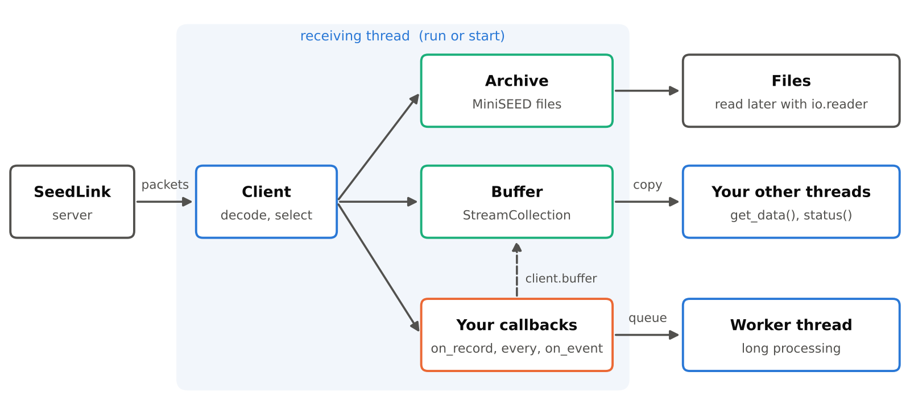

[ShakeLab documentation](../README.md) › [Signals](signals.md) ›
SeedLink

# SeedLink: real-time data

Seismic networks distribute their data in real time with SeedLink, the
protocol of SeisComP and of ringserver: a client connects to a server,
asks for some channels and receives their MiniSEED records a few
seconds after they are recorded. The servers also keep the last hours
or days of data, which a client can ask for after a disconnection or
to collect a past time window.

The package `shakelab.signals.seedlink` is a SeedLink client. A
`Client` connects to a server, requests the channels selected and sends
every record received to its destinations: a buffer in memory, an
archive of MiniSEED files, and functions of the user called at every
record, at regular intervals or at connection events. It reconnects
after network failures and resumes every station where it stopped.
Three functions cover the simplest uses: `read` collects a time window,
`archive` archives continuously and `records` iterates over the records
as they arrive.

This guide describes the protocol and how the client works (Part I),
the use of every function, method and of the command `slab-seedlink`
(Part II), and the design choices, validation and limits (Part III).
The records and collections received are described in
[`waveforms.md`](waveforms.md), metadata and response correction in
[`response.md`](response.md), the MiniSEED format and the archive
layouts in [`io.md`](io.md); data of the past are often easier to
download from the FDSN services ([`fdsnws.md`](fdsnws.md)).

The examples use a generic server, `rtserve.example.org`, holding the
three components of the strong-motion station IV.MODE (100 Hz), and
the window of the earthquake of 20 May 2012 in Emilia; the numbers in
the comments come from these data. The examples that run in real time
are limited with `duration`.

## Contents

Part I. Protocol and concepts

1. [The SeedLink protocol](#1-the-seedlink-protocol)
2. [Selecting channels](#2-selecting-channels)
3. [The client and its destinations](#3-the-client-and-its-destinations)
4. [Buffers](#4-buffers)
5. [Reliability](#5-reliability)
6. [Archives](#6-archives)
7. [Data time and wall-clock time](#7-data-time-and-wall-clock-time)

Part II. Use

8. [Quick functions](#8-quick-functions)
9. [Client](#9-client)
10. [Metadata in real time](#10-metadata-in-real-time)
11. [Errors, warnings and log](#11-errors-warnings-and-log)
12. [Command line](#12-command-line)
13. [Workflows](#13-workflows)

Part III. Design, validation and limits

14. [Design choices](#14-design-choices)
15. [Validation](#15-validation)
16. [Current limitations](#16-current-limitations)
17. [References](#17-references)

# Part I. Protocol and concepts

## 1. The SeedLink protocol

A SeedLink server receives the data of many stations and keeps, for
each station, a ring of the last packets, numbered in order of arrival
with a **sequence number**. A client opens a TCP connection (port
18000 by default), sends a few text commands and then receives a
continuous stream of packets, each holding one MiniSEED record:

1. `HELLO`: the server answers with its software, the protocol
   versions it speaks and its organization;
2. for each station, `STATION` with the network and station codes,
   `SELECT` with the location and channel codes, and `DATA` (from the
   next packet, from a given sequence number, or from a time);
3. `END` starts the transfer of all the stations requested.

Two versions of the protocol are in use, and the client speaks both,
choosing the highest that the server offers (`protocol="auto"`):

| | Version 3.1 | Version 4.0 |
|---|---|---|
| Definition | de facto standard of SeisComP and ringserver, no formal specification | FDSN specification |
| Packet | 8-byte header `SL` with a 24-bit sequence number, then a 512-byte MiniSEED 2 record | header `SE` with format, length, 64-bit sequence number and station, then a MiniSEED 2 or 3 record of any length |
| Time windows | `TIME start end` | `DATA ... start end` |
| Dial-up mode | `FETCH` | `ENDFETCH` |
| Server information | XML in MiniSEED log records | JSON |

In **real time** the connection stays open and the server sends every
new packet as it arrives. In **dial-up** mode (`fetch=True`) the
server sends the packets it holds, from the requested point, and then
closes the session with `END`: the way to collect past data or to
catch up after a pause. A **time window** asks for the packets of a
time interval among those held by the server; with an end in the past
it implies dial-up mode.

Servers keep a limited amount of data, usually hours or days, and
offer a description of what they hold (the `INFO` requests: stations,
streams and their time spans).

## 2. Selecting channels

Channels are selected with the patterns of ShakeLab, `NET.STA.LOC.CHA`
with `*`, `?`, sets `[...]` and alternatives `{A,B}`, where codes
missing at the end match anything (`"IV.MODE"` is every channel of
MODE; see [`waveforms.md`](waveforms.md) §8.3). The protocol knows
less: one `STATION` command per station (wildcards in station codes
are not accepted by every server) and `SELECT` patterns of location
and channel with `?` only. The client therefore:

- asks the server for its list of stations when a pattern has
  wildcards in the network or station codes, and requests each
  matching station;
- writes `SELECT` patterns as close as the protocol allows, widening
  them when needed (a set `HH[ZNE]` becomes `HH?`);
- filters every record it receives against the original patterns, so
  that only the selected channels reach the destinations, whatever the
  server sends.

## 3. The client and its destinations

Every record received goes, in this order, to the destinations of the
client:

1. the **archive**, if set: the MiniSEED packet is appended, unchanged,
   to its file;
2. the **metadata**, if given, are attached to the record;
3. the continuity with the previous record of the channel is checked:
   a gap or an overlap larger than half a sample is reported as an
   event;
4. the **status** of the channel (last sample, number of packets, gaps
   and overlaps) and the **buffer**, if set, are updated, under a lock;
5. the functions registered with **`on_record`** are called with the
   record (the buffer keeps its own copy, so that a callback that
   changes the record does not change the buffer);
6. the functions registered with **`every(..., clock="data")`** are
   called if the time of the data has passed their next instant.

The functions registered with `every(..., clock="wall")` are called
between packets, when their wall-clock interval has elapsed, and those
registered with `on_event` when an event occurs: connection,
disconnection, gap, overlap, end of a dial-up transfer.

All the callbacks run **in the thread that receives the data**: while a
callback runs, no packet is read. Callbacks must therefore be quick
(store a value, update a counter, put work in a queue); heavy work
(processing a window, writing results) belongs to another thread,
which receives a copy of the data (§13.5). The receiving thread is the
calling thread with `run`, which returns at a stop condition, or a
background thread with `start`, which returns at once.



*Figure 1. How the records flow through the client. The client decodes
the packets of the server, keeps the selected channels and sends each
record to its destinations: the archive (files, read later with
`io.reader`), the buffer, and your callbacks. Everything in the shaded
area runs in the receiving thread, callbacks included; other threads
read copies of the buffer, and long processing goes to a worker
thread through a queue (§13.5).*

## 4. Buffers

The buffer is a `StreamCollection` that collects the records received:

- **unlimited** (`set_buffer()`): every record is kept. To avoid
  concatenating arrays at every packet (which would copy the whole
  stream each time), the records wait in a list and are joined when
  the buffer is read. It grows with the data: suited to collecting a
  time window, not to a client that runs for days;
- **circular** (`set_buffer(max_duration=600)`): each channel keeps
  only the last `max_duration` seconds, records older than that being
  discarded as new ones arrive. Its streams are circular streams
  (`shakelab.signals.circular`, experimental), which keep every packet
  as a record;
- an **existing collection** (`set_buffer(collection)`), which keeps
  its own settings.

The buffer belongs to the receiving thread. Callbacks read it directly
(`client.buffer`); other threads use `get_data`, which returns, under
the lock, an independent copy with the contiguous records of each
channel joined into one record and standard (not circular) streams,
ready for processing. `get_data` can also select channels and a time
window.

## 5. Reliability

- **Reconnection.** After a network failure, or when no data arrive
  for `timeout` seconds (600 by default), the client reports a
  `disconnected` event and reconnects, after a delay that doubles at
  each failed attempt from 1 to 60 seconds. A failure of the first
  connection is raised at once, as is any failure with
  `reconnect=False`.
- **Resumption.** The client keeps the sequence number of the last
  packet of each station and, at every reconnection or new run of the
  same client, asks each station for the next packet: nothing is lost
  or repeated, as long as the server still holds the data. Packets
  received twice are discarded.
- **State file.** With `state_file`, the sequence numbers are saved in
  a JSON file every 10 seconds and at the end of each run, so that a
  new client (after a restart of the program or of the computer)
  resumes where the previous one stopped. The file is ignored if it
  belongs to another server or protocol version.
- **Keep-alive.** When no data arrive for `keepalive` seconds (60 by
  default), the client sends a short request (`INFO ID`), so that
  firewalls do not close an idle connection.
- **Gaps and overlaps** between consecutive records of a channel
  (beyond half a sample) are reported as events and counted in the
  status; they do not stop the reception.

## 6. Archives

`set_archive` appends the records received to MiniSEED files, exactly
as they arrive, so that an archive is identical to what the server
sent. The path is a template:

| Field | Value |
|---|---|
| `{net}`, `{sta}`, `{loc}`, `{cha}` | codes of the channel |
| `{time}` | start of the rotation interval, a `datetime` in UTC with any `strftime` format (needs `rotate`) |
| `{year}`, `{jday}` | year and day of the year of the interval (of the record without rotation) |

- a template without fields writes a single file;
- the codes separate the files by network, station or channel;
- `rotate` starts a new file at regular intervals (`"30s"`, `"10min"`,
  `"1h"`, `"1d"`, or seconds), aligned with the clock: intervals are
  multiples of the duration from the Unix epoch, hence from midnight
  UTC for divisors of a day;
- `layout="sds"` writes the SeisComP Data Structure, one file per
  channel and day ([`io.md`](io.md) §4), readable with
  `reader(..., layout="sds")`.

Each record goes to the file of its start time, whole. Files are
appended to, so that an interrupted archive is resumed in the same
files; every record is passed to the operating system as soon as it is
written; at most 64 files are kept open at the same time. Log records
of the server are not archived.

## 7. Data time and wall-clock time

Two clocks matter in real time. The **wall clock** is the time of the
computer; the **data time** is the time of the samples received. Their
difference is the **latency**: from the last sample received to now,
usually a few seconds (the time to fill a packet, plus transmission).
`status()` reports it for every channel.

`every(interval, func)` counts wall-clock time by default: `func` runs
every `interval` seconds, whatever the data. With `clock="data"` it
counts data time instead: `func` runs when the end of the latest record
passes the next multiple of `interval` from the first record. The
difference appears when data arrive faster or slower than real time:
a backlog after a reconnection, a dial-up transfer, an archive replayed
through a server. A function that analyzes the last minute of data
should usually follow the data time, so that every minute is analyzed
once, however the data arrive; a function that reports the state of
the reception should follow the wall clock.

# Part II. Use

## 8. Quick functions

`read` collects the data of a time window, or of a duration from now,
and returns them as a `StreamCollection` with the contiguous records of
each channel joined:

```python
from shakelab.signals import seedlink

data = seedlink.read("rtserve.example.org", "IV.MODE..HN?",
                     "2012-05-20T02:04:00", "2012-05-20T02:05:00")
print(data["IV.MODE..HNZ"][0])
# Record IV.MODE..HNZ: 2012-05-20T02:04:00.000000Z -
# 2012-05-20T02:05:00.000000Z, 100 Hz, 6001 samples
recent = seedlink.read("rtserve.example.org", "IV.MODE..HNZ",
                       duration=60)          # the next 60 s
seedlink.read("rtserve.example.org", "IV.MODE..HNZ")  # ValueError: no stop
```

A past window needs the server to hold the data; the result is cut to
the window. `starttime` and `endtime` follow the channels, by position
or by name (`starttime=...`), as in `get_data`, `records` and
`StreamCollection.select`; the other options are given by name. `archive` archives continuously (until interrupted, or for
`duration` seconds), and `records` iterates over the records as they
arrive:

```python
seedlink.archive("rtserve.example.org", "IV.MODE..HN?", "archive",
                 layout="sds", state_file="mode.state", duration=60)

count = 0
for record in seedlink.records("rtserve.example.org", "IV.MODE..HNZ"):
    count += 1
    if count == 10:
        break                       # leaving the loop stops the client
print(count)
# 10
```

`records` runs a client in a background thread and passes the records
through a queue of at most `max_queue` records (1000): if the loop is
slower than the data, reception pauses and the data wait on the
server. It accepts `starttime` and `endtime` (after the channels, as
`read`), `fetch` and `state_file`, as the client.

## 9. Client

### 9.1 Creating a client

```python
from shakelab.signals.seedlink import Client

client = Client("rtserve.example.org")
print(client)
# Client(rtserve.example.org:18000, 0 pattern(s), idle)
other = Client("192.168.1.20:18001", protocol="3.1",
               timeout=120, keepalive=30, state_file="client.state")
print(other.host, other.port, other.address)
# 192.168.1.20 18001 192.168.1.20:18001
print(Client("192.168.1.20:18001", port=18002).port)  # port prevails
# 18002
print(Client("[::1]:18001").address)                   # IPv6
# [::1]:18001
Client("http://rtserve.example.org")   # ValueError: write the server as HOST[:PORT]
```

The server is one address, `HOST[:PORT]`, as on the command line and
as the FDSN client (§2 of the [FDSN guide](fdsnws.md) for the
addresses of web services): a host name or an IPv4 address with an
optional port (18000 if omitted), or an IPv6 address alone or in
brackets with a port (`[::1]:18001`). The port given separately with
`port` takes precedence over the one in the address. SeedLink has no
scheme: `http://` and similar prefixes are refused.

| Parameter | Meaning | Default |
|---|---|---|
| `address` | server as `HOST[:PORT]` | port 18000 |
| `port` | server port, which takes precedence over the one in `address` | none |
| `protocol` | `"auto"`, `"3.1"` or `"4.0"` | `"auto"`: the highest offered |
| `metadata` | channel metadata attached to the records (§10) | none |
| `timeout` | seconds without data before reconnecting | 600 |
| `keepalive` | seconds without data before a keep-alive request; None disables it | 60 |
| `reconnect` | reconnect after network failures | True |
| `state_file` | JSON file of the sequence numbers (§5) | none |

After a connection, `client.server`, `client.organization` and
`client.protocol` describe the server. A client is configured
(selection, destinations, callbacks) while idle: these methods raise a
`RuntimeError` while it runs.

### 9.2 Selecting channels

```python
client.select("IV.MODE..HN?")
client.select(["IV.MODE..HNZ", "OX.{CAE,BAD}..HH[ZNE]"])
print(client.selection)
# ['IV.MODE..HN?', 'IV.MODE..HNZ', 'OX.CAE..HH[ZNE]', 'OX.BAD..HH[ZNE]']
client.select(file="channels.txt")       # patterns, one or more per line
client.select("IV.MODE..HN?.X")          # ValueError: more than 4 codes
```

A pattern file:

```text
# channels.txt
IV.MODE..HN?          # strong motion
OX.CAE..HH? OX.BAD..HHZ
```

`select` adds patterns to those already given; alternatives become
separate patterns, and repetitions are ignored. A pattern file holds
one or more patterns per line, separated by spaces, with `#` starting a
comment. A `MetadataCollection` selects its channels with an epoch
valid now (`client.select(metadata_reader("network.xml"))`).

### 9.3 Buffer and copies

```python
client = Client("rtserve.example.org")
client.select("IV.MODE..HN?")
client.set_buffer(max_duration=60)             # last minute
client.run(duration=30)

data = client.get_data("IV.MODE..HNZ")         # copy, records joined
vertical = client.get_data("*.*.*.HNZ", "2012-05-20T02:05:30")  # window
print(len(data["IV.MODE..HNZ"]))
# 1
```

With channel metadata (§10), `get_data(..., sensitivity=True)` divides
the copy by the sensitivity of each channel: physical units without a
correction of the whole response, at the cost of one division per
sample. The buffer keeps the samples as received, so that the whole
response can still be corrected on a copy; the circular buffer refuses
`remove_sensitivity` like the other processing methods, because the
records that arrive later would stay in counts.

`set_buffer()` without arguments makes an unlimited buffer,
`max_duration` a circular one, and a collection given as argument is
used as it is (§4). `client.buffer` is the buffer itself, for the
callbacks and for a client that is not running; `get_data(sid,
starttime, endtime)` the safe copy for any thread. If no buffer
and no callback are set, `run` creates an unlimited buffer and returns it.

### 9.4 Archive

```python
client = Client("rtserve.example.org", state_file="archive.state")
client.select("IV.MODE..HN?")
client.set_archive("archive", layout="sds")
client.run(duration=60)
```

Other organizations (§6):

```python
client.set_archive("data/today.mseed")                     # one file
client.set_archive("data/{net}.{sta}.{loc}.{cha}.mseed")   # per channel
client.set_archive("data/{sta}/{sta}.{cha}.{time:%Y%m%dT%H}.mseed",
                   rotate="1h")                            # hourly files
client.set_archive("data/{sta}.{time:%H%M}.mseed")  # ValueError: needs rotate
```

### 9.5 Callbacks

```python
client = Client("rtserve.example.org")
client.select("IV.MODE..HNZ")
client.set_buffer(max_duration=120)
peaks = []

@client.on_record
def track(client, record):
    peaks.append(record.peak)            # quick: store and return

@client.on_event
def report(client, event):
    print(event.kind)

def summary(client):
    print(len(client.buffer.records()))  # the buffer, from a callback

client.every(30.0, summary, clock="data")
client.every(10.0, lambda client: client.info())   # wall clock
client.every(0, summary)                 # ValueError: interval
```

`on_record` and `on_event` return the function, so that they can be
used as decorators, as above; `every` returns it too, but needs the
interval, so it is called with the function. The signatures:

| Method | Called as | When |
|---|---|---|
| `on_record(func, sensitivity=False)` | `func(client, record)` | at every record, after the buffer |
| `every(interval, func, clock="wall")` | `func(client)` | every `interval` seconds of wall-clock or data time (§7) |
| `on_event(func)` | `func(client, event)` | at connection events, gaps and overlaps, end of a dial-up transfer |

A `SeedLinkEvent` has `kind` (`"connected"`, `"disconnected"`, `"gap"`,
`"overlap"`, `"end"`), `time` (wall clock), `message`, and for gaps and
overlaps `sid`, `starttime` and `endtime` (from the expected start of
the record to its actual start).

`on_record` passes the record as received, in counts. With
`sensitivity=True` (in a call, not as a decorator) the function
receives a copy divided by the sensitivity of the channel, and is not
called for channels without one (one `MetadataWarning` each):

```python
client = Client("rtserve.example.org", metadata="station.xml")
client.select("IV.MODE..HN?")

def alarm(client, record):
    if record.peak > 0.1:                # m/s**2
        print(record.sid, record.time)

client.on_record(alarm, sensitivity=True)
``` A callback may call `client.stop()`: the
run stops after the callback returns.

### 9.6 Running

```python
client = Client("rtserve.example.org")
client.select("IV.MODE..HNZ")
client.set_buffer()
client.run(duration=10)                   # blocking, 10 s

client.start()                            # background thread
print(client.running)
# True
client.stop()                             # waits for the thread
print(client.running)
# False
```

`run` and `start` take the same stop conditions (given by name, except
`duration`: nothing selects channels here, so the window is not taken
by position):

| Argument | Meaning |
|---|---|
| `duration` | wall-clock seconds after which the run stops |
| `starttime` | the server sends the data it holds from this time (otherwise from the next packet, or from where an earlier run stopped) |
| `endtime` | end of the data: in the past it implies dial-up mode; in real time the run stops when the wall clock and every channel received have passed it; in both cases also after 10 s without packets past it |
| `fetch` | dial-up mode: the server sends what it holds and ends the session |

Without any of them a run lasts until `stop` is called (from a callback
or from another thread) or the program is interrupted. `wait(timeout)`
waits for the background thread and returns whether it has ended; an
error that ends the background thread is raised again by `wait` or
`stop`. The client is also a context manager, which stops it at the end
of the block:

```python
with Client("rtserve.example.org") as client:
    client.select("IV.MODE..HNZ")
    client.set_buffer(max_duration=300)
    client.start()
    finished = client.wait(timeout=5)
```

A client can run again after a stop: every station resumes from the
packet after the last one received.

### 9.7 Reception status

```python
client = Client("rtserve.example.org")
client.select("IV.MODE..HN?")
client.run(starttime="2012-05-20T02:04:00", endtime="2012-05-20T02:05:00")
for status in client.status():
    print(status.sid, status.last_sample, status.packets, status.gaps)
# IV.MODE..HNE 2012-05-20T02:05:01.750000Z 26 0
# IV.MODE..HNN 2012-05-20T02:05:03.220000Z 27 0
# IV.MODE..HNZ 2012-05-20T02:05:00.350000Z 26 0
client.info()                             # the client, then a table
```

`status(sid)` returns a `ChannelStatus` per channel received: `sid`,
`last_sample` (time of the last sample), `last_packet` (wall-clock time
of its arrival), `latency` (seconds from the last sample to the call),
`packets`, `gaps`, `overlaps`. It is safe from any thread. Packets are
received whole, so the last sample is usually past the requested end,
and the packets counted include those that only overlap the window.

`summary()` describes the client as text, and `info()` prints it, as
for the other objects of ShakeLab: the address and the state (idle or
running), the server and the protocol once contacted, the patterns,
the buffer, the archive, the callbacks, the metadata and the state
file, then the status of the channels as a table once data have
arrived. The stations and streams of the server are given by
`stations` and `streams` (§9.8) and by `slab-seedlink info`.

### 9.8 What the server offers

```python
for station in client.stations("IV"):
    print(station.code, station.description, station.begin_sequence,
          station.end_sequence)
for stream in client.streams("IV.MODE"):
    print(stream.sid, stream.starttime, stream.endtime)
# IV.MODE..HNE 2012-05-20T02:03:23.000000Z 2012-05-20T02:06:23.010000Z
# IV.MODE..HNN 2012-05-20T02:03:23.000000Z 2012-05-20T02:06:23.010000Z
# IV.MODE..HNZ 2012-05-20T02:03:23.000000Z 2012-05-20T02:06:23.010000Z
```

`stations(pattern)` returns `StationInfo` objects (`network`,
`station`, `code`, `description`, and the sequence numbers of the
first and last packets held), `streams(pattern)` `StreamInfo` objects
with the time span held for each channel. Each request opens a short
connection, also while the client runs; some servers restrict the
list of streams.

## 10. Metadata in real time

With `metadata` (a `MetadataCollection`, or files read with
`metadata_reader`), every record receives the metadata of its channel
as it arrives, so that the buffer can be corrected for the instrument
response like a file:

```python
client = Client("rtserve.example.org", metadata="station.xml")
client.select("IV.MODE..HN?")
client.set_buffer()
client.run(starttime="2012-05-20T02:03:23",
           endtime="2012-05-20T02:06:23")

data = client.get_data()
data.detrend()
data.taper(5.0)
data.deconvolve_response(prefilter=(0.05, 0.1, 30.0, 40.0))  # m/s**2
print(round(data["IV.MODE..HNZ"][0].peak, 4))
# 0.3258
```

Channels without metadata give one `MetadataWarning` each and keep
empty metadata. The metadata can also select the channels:
`client.select(metadata)`. For physical units without the whole
correction, `get_data(..., sensitivity=True)` and
`on_record(func, sensitivity=True)` divide copies of the records by the
sensitivity (§9.3, §9.5).

## 11. Errors, warnings and log

| Situation | Result |
|---|---|
| server unreachable at the first connection | `OSError` (e.g. `ConnectionRefusedError`), raised by `run`, or by `wait`/`stop` after `start` |
| server rejects a command, no station matches the selection | `SeedLinkError` (with the code of the server in version 4) |
| connection lost, no data for `timeout` | `disconnected` event and reconnection (an `OSError` with `reconnect=False`) |
| configuration while running | `RuntimeError` |
| invalid patterns, intervals, templates | `ValueError` or `TypeError` |
| channel without metadata | one `MetadataWarning` |
| a record that cannot join a circular buffer | logged as a warning, not buffered |

The client reports its activity to the logger
`shakelab.signals.seedlink.client` (connections, commands, skipped
packets): `logging.basicConfig(level=logging.INFO)` shows it.

## 12. Command line

`slab-seedlink` (also `python -m shakelab.signals.seedlink`) gives the
main uses from a terminal. The server is `HOST[:PORT]` (or
`--port`, which takes precedence); channels are patterns or a file of
patterns:

```sh
slab-seedlink info rtserve.example.org
slab-seedlink info rtserve.example.org --streams IV.MODE
slab-seedlink monitor rtserve.example.org "IV.*..HNZ" --status 10
slab-seedlink get rtserve.example.org:18000 "IV.MODE..HN?" \
    --start 2012-05-20T02:03:23 --end 2012-05-20T02:06:23 -o mode.mseed
slab-seedlink archive rtserve.example.org "IV.*..HN?" \
    --sds archive --state iv.state
slab-seedlink archive rtserve.example.org --file channels.txt \
    --path "data/{sta}.{time:%Y%m%dT%H}.mseed" --rotate 1h
```

| Subcommand | Options | Output |
|---|---|---|
| `info` | pattern, `--streams` | the stations, or the streams with their time span |
| `monitor` | patterns or `--file`, `--status SECONDS`, `--duration` | one line per record received, or a table of the latencies at regular intervals |
| `get` | patterns or `--file`, `--start`, `--end` or `--duration`, `-o`, `--owrite` | a MiniSEED file with the records of the window (an existing file is replaced only with `--owrite`) |
| `archive` | patterns or `--file`, `--sds ROOT` or `--path TEMPLATE` with `--rotate`, `--state`, `--duration` | a continuous archive |

All subcommands accept `--protocol`, `--timeout` and `-v` (connections
and events on the standard error). The exit status is 0 on success, 1
on errors or without data, 130 when interrupted.

## 13. Workflows

### 13.1 Monitoring the latencies of a network

```python
client = Client("rtserve.example.org")
client.select("IV.*..HNZ")
client.every(10.0, lambda client: client.info())
client.run(duration=60)
```

`on_record` is not needed: the status is kept for every channel
received. With no buffer and a callback, no data are stored.

### 13.2 Peak acceleration every 10 seconds

```python
client = Client("rtserve.example.org", metadata="station.xml")
client.select("IV.MODE..HN?")
client.set_buffer(max_duration=20)
peaks = {}

def peak_acceleration(client):
    data = client.get_data(sensitivity=True)   # m/s**2
    data.detrend()
    for record in data.records():
        latest = float(record.peak)
        peaks[record.sid] = max(peaks.get(record.sid, 0.0), latest)

client.every(10.0, peak_acceleration, clock="data")
client.run(starttime="2012-05-20T02:03:23",
           endtime="2012-05-20T02:06:23")
print({sid: round(value, 3) for sid, value in sorted(peaks.items())})
# {'IV.MODE..HNE': 0.268, 'IV.MODE..HNN': 0.419, 'IV.MODE..HNZ': 0.324}
```

The function runs every 10 s of data on the last 20 s held by the
circular buffer, and keeps the largest value of each channel. The
sensitivity is enough for a quick value (0.324 m/s² on the vertical
component, against 0.326 with the full response correction of §10).

### 13.3 A continuous archive that survives restarts

```python
seedlink.archive("rtserve.example.org", "IV.*..HN?", "archive",
                 layout="sds", state_file="archive.state",
                 duration=60)
```

Run without `duration` as a service of the operating system: after a
restart the state file resumes every station from the packet after the
last one archived, and the files are appended to.

### 13.4 The last minutes of an event from the server

```python
event = seedlink.read("rtserve.example.org", "IV.MODE..HN?",
                      starttime="2012-05-20T02:03:40",
                      endtime="2012-05-20T02:05:40")
print(len(event.records()), event.records()[0].duration)
# 3 120.0
```

The server must still hold the data: for older data use the FDSN
services ([`fdsnws.md`](fdsnws.md)).

### 13.5 Heavy processing in another thread

A callback that processes a long window would delay the reception. The
callback only takes a copy of the buffer and hands it to a worker
thread through a queue; this is how the real-time monitors of array
processing work
([YARRAY](../../shakelab/exploration/yarray/README.md)):

```python
import queue
import threading

work = queue.Queue(maxsize=2)

def take_window(client):
    try:
        work.put_nowait(client.get_data())    # skip if the worker is busy
    except queue.Full:
        pass

def worker():
    while (data := work.get()) is not None:
        data.detrend()
        # ... long processing of the window ...

thread = threading.Thread(target=worker)
thread.start()
client = Client("rtserve.example.org")
client.select("IV.MODE..HN?")
client.set_buffer(max_duration=300)
client.every(60.0, take_window, clock="data")
client.run(starttime="2012-05-20T02:03:23",
           endtime="2012-05-20T02:06:23")
work.put(None)
thread.join()
```

# Part III. Design, validation and limits

## 14. Design choices

- **Destinations, not modes.** A buffer, an archive and any number of
  callbacks can be combined in one client, instead of separate clients
  for collecting, archiving and processing.
- **The client filters.** The protocol cannot express every pattern;
  the client widens the request and filters what it receives, so that
  the destinations see exactly the selection.
- **Archives as received.** Packets are written unchanged, so that an
  archive is a faithful copy of what the server sent and costs no
  decoding or encoding.
- **Buffers as received.** The buffer keeps the samples in counts, with
  its own copy of every record; conversions to physical units are
  applied to the copies given to the user (`get_data`, `on_record`
  with `sensitivity=True`), so that the buffer never mixes units and
  the whole response can still be corrected.
- **No data lost while the server keeps them.** Sequence numbers per
  station, reconnection with growing delays and the state file make
  resumption automatic, also across restarts.
- **One receiving thread.** Callbacks run in it, in a fixed order,
  without locks of their own; other threads get copies under a lock.
  The order and the thread of every call are documented, so that the
  user knows what a slow callback delays.
- **Two clocks.** Periodic functions follow the wall clock or the data
  time, so that a replayed or delayed stream is analyzed as it would
  have been in real time.
- **One address.** The server is written `HOST[:PORT]` in Python and on
  the command line, and read as in every client of ShakeLab
  (`shakelab.libutils.address`); a separate port takes precedence.
- **Library first.** `read`, `archive`, `records` and `slab-seedlink`
  are built on the same `Client`; the real-time monitors of array
  processing use its callbacks.

## 15. Validation

The package is covered by the tests of `tests/signals/seedlink/` (79
tests), which run against a fake SeedLink server on a local port: it
speaks versions 3.1 and 4.0, serves MiniSEED packets of several
stations (also interleaved in time, as a real server), honours
sequence numbers, time windows and dial-up mode, answers the `INFO`
requests, and can drop a connection or reject a command.

| Check | Result |
|---|---|
| Server addresses: `HOST[:PORT]`, IPv6, separate port, schemes, invalid ports (also on the command line) | host and port as written, the separate port prevailing; errors when the client is created |
| Negotiation of the version, `HELLO` of SeisComP and ringserver | the highest common version |
| Commands of both versions (`STATION`, `SELECT`, `DATA`, `TIME`, `FETCH`, `END`, `ENDFETCH`), sequence numbers and their wrap-around in version 3 | as the protocols require |
| Selection with wildcards in station codes (also on servers that do not accept them) | the matching stations requested one by one |
| Physical units: `get_data` and `on_record` with `sensitivity=True`; a callback that changes the record | samples divided by the sensitivity of MODE.xml, channels without metadata left out with a warning; the buffer unchanged, in counts |
| Real-time and dial-up transfers, past windows of several stations | the requested data, the run stopping at the end |
| Unlimited and circular buffers, `get_data` | the data joined; the circular buffer limited to its duration |
| Connection dropped during the transfer | reconnection, resumption without losses or repetitions |
| Repeated packets, gaps | skipped; reported as events |
| Callbacks per record, wall-clock and data-time timers, stop from a callback | called in order and at the expected times |
| Background thread, errors in it | data copied safely; errors raised by `wait` |
| Archives: templates, rotation, SDS, resumption, many files | the packets of each file, unchanged |
| `INFO` stations and streams in XML (v3.1) and JSON (v4.0) | the expected lists |
| Command line | every subcommand |

Real servers (SeisComP and ringserver) are tested by hand, outside the
test suite.

## 16. Current limitations

- **Callbacks in the receiving thread.** A slow callback delays the
  reception and the wall-clock timers, which are checked between
  packets (at least every half second when no data arrive); the server
  keeps the data meanwhile, but latency grows.
- **Circular buffers** are experimental (a `FutureWarning` when one is
  created) and keep every packet as a separate record: use `get_data`
  for a joined copy.
- **No server.** ShakeLab does not serve SeedLink (to redistribute data
  or replay archives); the protocol module is shared with a future
  server.
- **Earlier versions** of the protocol (before 3.1) and the
  single-station mode of old servers are not supported; no
  authentication (version 4 allows it).
- **`read` returns the channels in order of arrival**, not sorted as
  `io.reader` does.
- **Interface asymmetries** (under review): the archive templates have
  `{time}` as the start of the rotation interval and no `{sid}` or
  `{start}`, unlike those of `io.writer`; `slab-seedlink get` writes
  MiniSEED only.

## 17. References

FDSN (2023). SeedLink protocol, version 4.0. International Federation
of Digital Seismograph Networks. https://docs.fdsn.org/projects/seedlink

SeisComP. SeedLink, in the documentation of SeisComP (GFZ Potsdam and
gempa GmbH): version 3.1 of the protocol.
