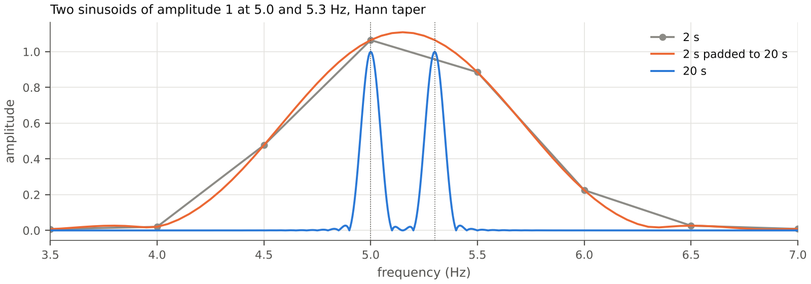
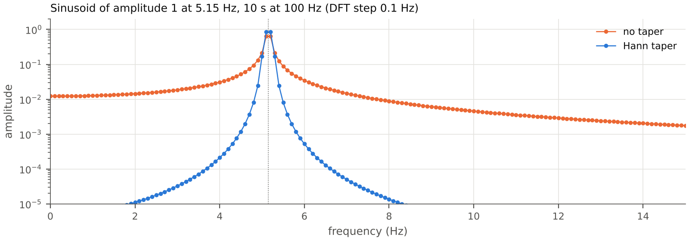
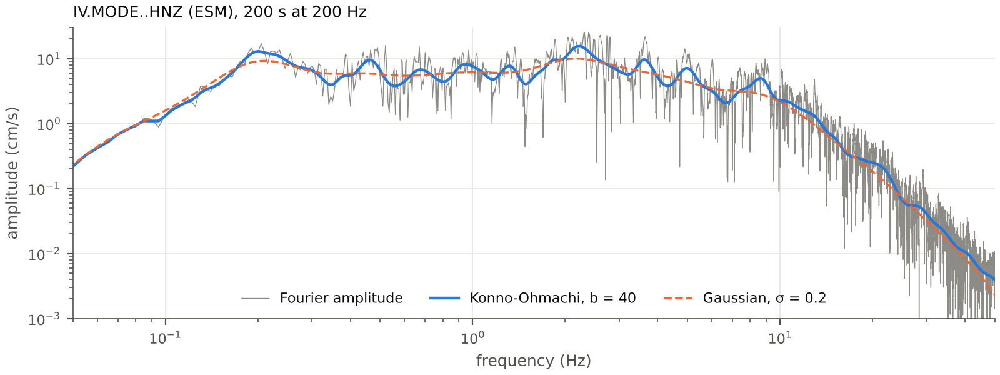
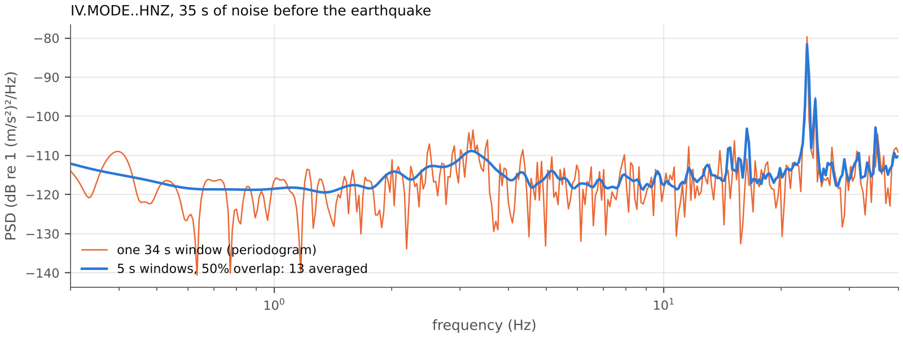
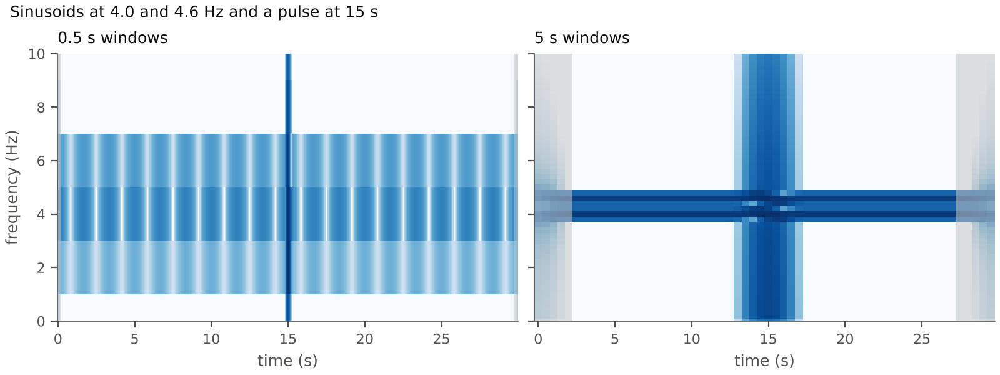
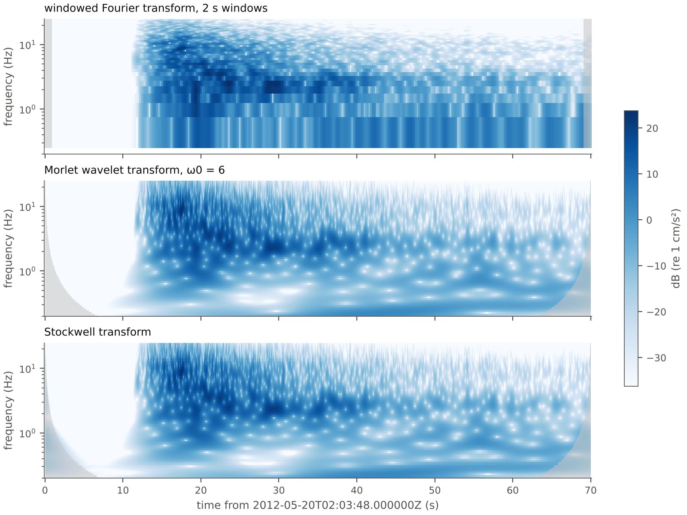

[ShakeLab documentation](../README.md) › [Signals](signals.md) ›
Spectra and spectrograms

# Spectra and spectrograms

The frequency content of a recording is described in ShakeLab at three
levels. The **Fourier spectrum** of a record (`Spectrum`, module
`shakelab.signals.spectrum`) is its one-sided transform, scaled to
approximate the continuous Fourier transform and carrying the metadata
of the record. **Spectrograms** (`Spectrogram`, module
`shakelab.signals.spectrogram`) show how the content changes in time,
with a windowed Fourier transform, a Morlet wavelet transform or a
Stockwell transform. **Windows and cross-spectra** (modules
`windowing` and `crossspectral`) divide records into windows and
average their products, the basis of power spectral densities,
coherences and of the multichannel methods of array processing. The
Fourier primitives on which all of them are built are in
`shakelab.signals.fourier`.

This guide gives the theory and the conventions (Part I), the use of
every class and function (Part II), and the design choices,
validation and limits (Part III). Records are described in
[`waveforms.md`](waveforms.md); the response correction of spectra in
[`response.md`](response.md).

The examples read an accelerogram, `acceleration.asc` (vertical
component, 200 Hz, 200 s, cm/s²), and a three-component recording in
raw counts with its metadata, `waveforms.mseed` and `station.xml`
(100 Hz, 180 s, about 37 s of noise before the earthquake). The
numbers in the comments come from the test data of ShakeLab (IV.MODE,
20 May 2012 Emilia earthquake, raw data of INGV and accelerogram
processed by ESM). The examples of a section continue those before
it.

## Contents

Part I. Theory and conventions

1. [The Fourier transform of a record](#1-the-fourier-transform-of-a-record)
2. [Resolution, leakage and smoothing](#2-resolution-leakage-and-smoothing)
3. [Power spectral density and averaging](#3-power-spectral-density-and-averaging)
4. [Time-frequency transforms](#4-time-frequency-transforms)
5. [Cross-spectral matrices](#5-cross-spectral-matrices)

Part II. Use

6. [Spectrum](#6-spectrum)
7. [Fourier primitives](#7-fourier-primitives)
8. [Spectrogram](#8-spectrogram)
9. [Windows](#9-windows)
10. [Cross-spectra](#10-cross-spectra)
11. [Workflows](#11-workflows)

Part III. Design, validation and limits

12. [Design choices](#12-design-choices)
13. [Validation](#13-validation)
14. [Current limitations](#14-current-limitations)
15. [References](#15-references)

# Part I. Theory and conventions

## 1. The Fourier transform of a record

A record of $`n`$ samples $`x_k`$ at interval $`\Delta`$ has the
discrete Fourier transform (DFT) at the frequencies
$`f_j = j/(n\Delta)`$. ShakeLab keeps the **one-sided** spectrum of
real signals, $`j = 0, \ldots, \lfloor n/2 \rfloor`$, from zero to the
Nyquist frequency $`f_N = 1/(2\Delta)`$ (included only for even
$`n`$), and **scales** it by the sampling interval:

```math
X(f_j) = \Delta \sum_{k=0}^{n-1} x_k\, e^{-2\pi i f_j k \Delta} .
```

The kernel $`e^{-2\pi i f t}`$ and the factor $`\Delta`$ make $`X`$ an
approximation of the continuous Fourier transform
$`X(f) = \int x(t)\, e^{-2\pi i f t}\, dt`$, with the time of the first
sample as origin: a record in m/s has a spectrum in m/s·s (m), the
spectrum does not depend on the sampling rate of the same signal, and
a causal system with Laplace transfer function $`H(s)`$ acts through
$`H(2\pi i f)`$. The inverse transform divides by $`\Delta`$, so the
two are exact inverses; the number of samples is kept with the
spectrum, since $`\lfloor n/2 \rfloor + 1`$ frequencies come from both
$`n`$ and $`n+1`$ samples.

With this scaling a sinusoid of amplitude $`A`$ observed for a time
$`T = n\Delta`$ has a peak of amplitude $`A\,T/2`$ at its frequency
(when it falls on a frequency of the DFT): the Fourier amplitude grows
with the duration, as for the continuous transform. Parseval's
theorem reads

```math
\Delta \sum_k |x_k|^2 = \frac{1}{n\Delta}\sum_{j=0}^{n-1} |X(f_j)|^2 ,
```

the energy of the signal (the sum over $`j`$ runs over the two-sided
spectrum; in the one-sided spectrum the terms between zero and Nyquist
count twice).

## 2. Resolution, leakage and smoothing

**Resolution.** The frequencies of the DFT are spaced by
$`\delta f = 1/T`$: two sinusoids closer than about $`1/T`$ cannot be
separated, whatever the sampling. Appending zeros to the record
(computing the transform on more samples) gives a denser grid of
frequencies, an interpolation of the same spectrum, but no better
resolution: only a longer record does (Figure 1).



*Figure 1. Two sinusoids 0.3 Hz apart, with a Hann taper. Two seconds
of signal (grey dots, the DFT frequencies) cannot separate them, and
padding the same two seconds to 20 s (orange) only fills in the same
broad peak; 20 s of signal (blue) resolve the two peaks.*

**Leakage.** The DFT treats the record as one period of a periodic
signal. A sinusoid whose frequency is not on the grid, or a record
that does not start and end at the same value, is discontinuous
across the ends: its energy leaks into all the frequencies, with side
lobes that decrease only as $`1/f`$. A **taper** (window) that brings
the ends smoothly to zero (a Hann window, a Tukey window, the cosine
taper of records) trades a wider central peak for side lobes lower by
orders of magnitude (Figure 2).



*Figure 2. A sinusoid whose frequency falls between two frequencies of
the DFT. Without a taper its energy leaks into the whole spectrum,
decreasing slowly away from the peak; the Hann taper confines it to a
few frequencies, at the cost of a slightly wider peak.*

**Smoothing.** The Fourier amplitude of a transient (an accelerogram)
fluctuates strongly from one frequency to the next; for display, for
spectral ratios and for site studies it is smoothed. ShakeLab smooths
in logarithmic frequency, where seismic spectra vary smoothly, with
the weighted mean of the values around each centre frequency
$`f_c`$, using one of two kernels of the ratio $`f/f_c`$:

```math
W_G = \exp\left[-\frac{1}{2}\left(\frac{\ln(f/f_c)}{\sigma}\right)^2\right],
\qquad
W_{KO} = \left[\frac{\sin\left(b \log_{10}(f/f_c)\right)}
{b \log_{10}(f/f_c)}\right]^4 ,
```

the Gaussian in natural-log frequency (width $`\sigma`$, default 0.2,
truncated at 3 $`\sigma`$) and the window of Konno and Ohmachi (1998)
with bandwidth coefficient $`b`$ (default 40; larger values give a
narrower window). Both have a constant relative width, so they smooth
the high frequencies over more values than the low ones (Figure 3).
The amplitude is smoothed in logarithm, and optionally the unwrapped
phase as well; the zero-frequency value is left unchanged.



*Figure 3. Fourier amplitude spectrum of the vertical accelerogram of
IV.MODE (ESM) and its smoothing with the Konno-Ohmachi window and the
Gaussian kernel: both follow the trend of the spectrum with a
constant relative bandwidth; the Gaussian with σ = 0.2 is broader than
the Konno-Ohmachi window with b = 40.*

## 3. Power spectral density and averaging

Ambient vibrations and noise are stationary random signals, described
by their **power spectral density** (PSD) $`S(f)`$: the mean power per
unit frequency, in units squared per Hz (for an acceleration,
(m/s²)²/Hz). The periodogram of one tapered window of $`m`$ samples,

```math
\hat S(f) = \frac{2\,\Delta}{\sum_k w_k^2}
\left|\sum_{k} w_k\, x_k\, e^{-2\pi i f k \Delta}\right|^2 ,
```

with the taper $`w_k`$ and the factor 2 of the one-sided density
(except at zero and Nyquist frequency), is an unbiased but very noisy
estimate: its standard deviation equals its mean, whatever the length
of the window. **Welch's method** reduces the variance by averaging the
periodograms of $`L`$ windows, overlapping or not: for independent
windows the relative standard deviation becomes $`1/\sqrt{L}`$
(Figure 4). The windows are correlated when they overlap; the
**effective number of independent windows** (Percival and Walden,
1993)

```math
L_{\mathrm{eff}} = \frac{L}{1 + 2\sum_{q=1}^{L-1}
\left(1 - \frac{q}{L}\right)\rho_q^2},
\qquad
\rho_q = \frac{\sum_k w_k\, w_{k+qs}}{\sum_k w_k^2} ,
```

with $`s`$ the step between windows, gives the variance of the
average: for Hann windows overlapping by 50%, $`L_{\mathrm{eff}}`$ is
about $`0.95\,L`$, while doubling the number of windows. The length of
the windows sets the resolution $`1/(m\Delta)`$; longer windows mean
fewer of them and a noisier estimate.



*Figure 4. Power spectral density of 35 s of noise recorded by the
accelerometer of IV.MODE before the earthquake. The periodogram of a
single window fluctuates by tens of dB from one frequency to the
next; averaging thirteen 5 s windows gives a stable estimate, with a
coarser resolution. The peak near 24 Hz is a narrow-band noise
source, visible in both.*

ShakeLab estimates PSDs today with the tools of the following
sections: the `"psd"` scaling of the windowed Fourier transform,
averaged over the windows, and the cross-spectral matrices of one
channel (§11.2); a dedicated interface for records and streams is not
yet available (§14).

## 4. Time-frequency transforms

A spectrogram represents a record as coefficients $`C(f, t)`$ of
frequency and time. All three transforms of ShakeLab return
coefficients calibrated the same way by default
(`scaling="amplitude"`): a sinusoid of amplitude $`A`$ gives
coefficients of modulus $`A`$ at its frequency, so that the methods
can be compared directly. They differ in how the analysing window
depends on the frequency, which sets the resolution in time and in
frequency: no transform can resolve both better than the uncertainty
relation $`\delta t\, \delta f \gtrsim 1/(4\pi)`$ allows.

**Windowed Fourier transform** (`"wft"`, short-time Fourier transform).
The record is cut into windows of fixed length $`T_w`$, tapered and
transformed; the coefficients are placed at the centres of the
windows. The resolution is the same at every frequency: $`1/T_w`$ in
frequency and about $`T_w`$ in time. Short windows follow fast changes
but blur close frequencies; long windows resolve frequencies but smear
transients (Figure 5). With `scaling="psd"` the squared modulus is the
PSD of each window (§3).



*Figure 5. A signal made of two sinusoids at 4.0 and 4.6 Hz and a short
pulse at 15 s. With 0.5 s windows the pulse is sharp in time but the
two sinusoids merge into one band 2 Hz wide; with 5 s windows the two
sinusoids are separated but the pulse spreads over 5 s. Shaded: edge
effects.*

**Continuous wavelet transform** (`"cwt"`) with the complex Morlet
wavelet, a Gaussian-modulated complex sinusoid,

```math
\psi(t) = \pi^{-1/4}\, e^{i \omega_0 t/s}\, e^{-t^2/(2 s^2)} ,
```

whose standard deviation $`s = \omega_0 / (2\pi f)`$ makes its central
frequency $`f`$. The window contains about the same number of cycles at
every frequency ($`\omega_0 = 6`$ by default): long at low frequency,
short at high frequency, with a constant relative bandwidth (constant
$`Q`$). Low frequencies are well resolved in frequency, high
frequencies in time. With `scaling="energy"` the wavelets have unit
energy, as in Torrence and Compo (1998), and the coefficients of a
sinusoid grow as $`1/\sqrt{f}`$.

**Stockwell transform** (`"st"`, S transform). The spectrum of the
record, shifted to each frequency $`f`$, is multiplied by a Gaussian
whose width is proportional to $`f`$ and transformed back: a
Fourier-like transform with a Gaussian window of standard deviation
$`1/f`$ in time (one period), between the two previous ones. It is
circular, keeps the absolute phase of the Fourier spectrum, and its
sum over time gives the Fourier spectrum; its frequencies are
those of the DFT, and its memory grows with the square of the number
of samples.

**Phase.** The coefficients are referred to their own time: the phase
of a sinusoid $`\cos(2\pi f t + \varphi)`$ is $`\varphi + 2\pi f t`$ at
every time and for every method.

**Edge effects.** Near the ends of the record the windows extend
beyond the data. The coefficients within the **cone of influence** of
the ends are affected: for the Morlet transform the e-folding time of
an edge discontinuity, $`\sqrt{2}\, s = \sqrt{2}\,\omega_0/(2\pi f)`$
(Torrence and Compo, 1998); for the Stockwell transform about
$`\sqrt{2}/f`$, also because it is circular; for the windowed transform
half a window, since the record is padded with zeros so that the
first and last windows are centred on its ends. `coi` and `coi_mask`
give these limits (Figure 6).



*Figure 6. The same 70 s of the vertical accelerogram of IV.MODE (ESM)
analysed by the three transforms, in dB with 60 dB of dynamic range.
The windowed transform has the same resolution at every frequency;
the Morlet and Stockwell transforms are sharper in time at high
frequency and in frequency at low frequency. The shaded areas are the
edge effects (`coi_mask`), which widen at low frequency for the
wavelet and Stockwell transforms.*

## 5. Cross-spectral matrices

Methods that compare channels (array processing, frequency domain
decomposition, spatial autocorrelation, coherence between components)
use, at each frequency $`f`$, the **cross-spectral matrix** of the
channels,

```math
𝐂(f) = \frac{1}{L}\sum_{l=1}^{L} 𝐗_l(f)\, 𝐗_l(f)^{H} ,
```

the average over $`L`$ windows (realizations) of the outer product of
the vector $`𝐗_l(f)`$ of the Fourier coefficients of the channels in
window $`l`$ ($`^H`$ is the conjugate transpose). With the `"psd"`
scaling the diagonal holds the PSDs of the channels and the
off-diagonal elements their cross power spectral densities; the
matrix depends only on the phase differences between channels, so
the time origin of each window cancels.

ShakeLab averages the windows by **blocks** of consecutive windows,
which gives the evolution of the matrices in time; windows have either
a fixed duration or a fixed number of **cycles** of each frequency
(longer windows at low frequency, as for the wavelets); a frequency
can be averaged with **sub-frequencies** around it, which adds
realizations at the cost of resolution. The **coherence**
$`|C_{ij}|/\sqrt{C_{ii} C_{jj}}`$ measures the linear relation between
two channels at a frequency (1 for channels that record the same
signal, near 0 for unrelated noise). The **eigendecomposition** of the
Hermitian matrix gives the singular values and vectors of the
frequency domain decomposition (FDD) used by YARRAY for the modes of
structures and valleys.

# Part II. Use

## 6. Spectrum

### 6.1 Construction and conversion

The spectrum of a record is computed by the record, or by the class
from samples; both keep the scaling of §1:

```python
import numpy as np
from shakelab.signals.io import reader
from shakelab.signals.spectrum import Spectrum

acc = reader("acceleration.asc")[0][0]      # 200 Hz, 40000 samples, cm/s**2
spectrum = acc.to_spectrum()        # or Spectrum.from_record(acc)
spectrum.info()
# source identifier IV.MODE..HNZ, 20001 frequencies, frequency step
# 0.005 Hz, time series of 40000 samples at 0.005 s

padded = Spectrum.from_samples(acc.data, acc.delta, 65536)  # zero padding
```

`to_spectrum()` and `from_record` copy the header of the record
(identifier, start time, units, channel metadata), so that the
spectrum can be corrected for the instrument and transformed back.
`from_samples(data, delta, nsamp)` transforms an array, with zero
padding or truncation to `nsamp` samples, and has an empty header.

The constructor takes spectral values directly, for example a transfer
function on the frequency axis of a record:

```python
from shakelab.signals import fourier

frequency = fourier.frequency_axis(acc.delta, acc.nsamp)
lowpass = Spectrum(fourier.butterworth(frequency, 5.0, order=4),
                   delta=acc.delta, nsamp=acc.nsamp)
```

`nsamp` must match the number of values ($`\lfloor n/2 \rfloor + 1`$);
by default the series is taken of even length. Back to the time
domain:

```python
record = spectrum.to_record()       # new Record with the header
samples = spectrum.to_samples()     # the samples only
acc.from_spectrum(spectrum)         # replaces the samples of acc, in place
```

`to_record()` returns a new record; `Record.from_spectrum` changes the
record it is called on (§14).

### 6.2 Attributes, indexing, operators

```python
spectrum.nsamp, spectrum.nfreq      # 40000 20001
spectrum.delta, spectrum.dfreq      # 0.005 0.005
spectrum.frequency                  # 0, 0.005, ..., 100 Hz
spectrum.amplitude                  # |X| in cm/s**2 * s = cm/s
spectrum.phase                      # radians, (-pi, pi]
spectrum.phase_unwrap               # unwrapped along frequency
spectrum.data                       # complex values
spectrum[10], spectrum[100:200]     # values (NumPy indexing of data)
len(spectrum)                       # 20001
spectrum.head.units                 # 'CM/S**2', the units of the record
```

The units of the header remain those of the time series; the
spectrum is in those units times seconds. The operators `*` and `/`
combine a spectrum with a number or with a spectrum on the same
frequency axis (same `nsamp` and `delta`), returning a new spectrum:

```python
filtered = spectrum * lowpass       # multiply by a transfer function
ratio = spectrum / spectrum         # 1 everywhere (spectral ratio)
half = spectrum / 2
```

Spectra on different axes raise a `ValueError`, other operands a
`TypeError`, and division by zero a `ZeroDivisionError`.

### 6.3 Processing

All the processing methods work in place, as on records:

```python
x = spectrum.copy()
x.filter(highpass=0.1, lowpass=20.0)        # Butterworth amplitude |H|
x = spectrum.copy()
x.filter(highpass=0.1, lowpass=20.0, causal=True)  # causal response
x = spectrum.copy()
x.filter(highpass=0.5, lowpass=10.0, method="sharp")  # zero outside the band

smooth = spectrum.copy()
smooth.logsmooth()                  # Gaussian, sigma 0.2, phase smoothed too
ko = spectrum.copy()
ko.logsmooth(method="konno-ohmachi", bandwidth=40.0, phase=False)

values = spectrum.interpolate([1.0, 2.5])   # complex values at any frequency
inverse = spectrum.copy()
inverse.invert(waterlevel=60.0)     # regularized 1 / X (§5 of response.md)
```

`filter` multiplies by the analog Butterworth response: its zero-phase
amplitude is $`|H|`$ (−3 dB at the corner), not the $`|H|^2`$ of the
forward-backward digital filter of `Record.filter` (see
[`waveforms.md`](waveforms.md) §5). `logsmooth(sigma, truncation,
method, bandwidth, phase)` smooths in logarithmic frequency (§2);
with `phase=False` the phase is kept as it is. `interpolate` raises a
`ValueError` outside the frequency axis.

The response methods of [`response.md`](response.md) exist on spectra
too: `convolve_response`, `deconvolve_response` (without `padding`)
and `remove_sensitivity`, with the metadata of the header.

## 7. Fourier primitives

`shakelab.signals.fourier` holds the functions on arrays on which the
classes are built; they follow the conventions of §1.

```python
from shakelab.signals import fourier

fourier.rfft_length(1000)           # 501 frequencies
fourier.fast_length(1001)           # 1024: efficient transform length
fourier.irfft_length(0.01, 0.1)     # 1000 samples for a 0.1 Hz step
freq = fourier.frequency_axis(0.01, 1000)   # 0, 0.1, ..., 50 Hz
grid = fourier.frequency_range(0.1, 20.0, 50)   # log-spaced; log=False

x = fourier.fft(acc.data, acc.delta)        # delta * rfft
back = fourier.ifft(x, acc.delta, acc.nsamp)
at = fourier.dft(acc.data, acc.delta, [0.37, 1.23])   # at any frequency
delayed = fourier.shift_time(acc.data, acc.delta, 0.5)  # circular shift
```

`dft(data, delta, freq, axis)` evaluates the scaled transform at
arbitrary frequencies, along any axis of a multidimensional array; at
the DFT frequencies it equals `fft`. Its cost is the number of samples
times the number of frequencies.

```python
h = fourier.butterworth(freq, 5.0, order=4, btype="lowpass")
w = fourier.cosine_taper(freq, (0.1, 0.2, 20.0, 30.0))   # band-pass window
inv = fourier.inverse_spectrum(h, waterlevel=40.0, method="water")
s = fourier.smooth(spectrum.frequency, spectrum.amplitude,
                   method="konno-ohmachi")
amp = fourier.smooth_amplitude(spectrum.frequency, spectrum.data,
                               method="gaussian", sigma=0.1)
both = fourier.smooth_amplitude_phase(spectrum.frequency, spectrum.data)
```

`smooth(freq, values, method, center, sigma, truncation, bandwidth)`
smooths real values and can compute them at other centre frequencies
(`center`), for example on a logarithmic grid; `smooth_amplitude`
keeps the phase, `smooth_amplitude_phase` smooths the log-amplitude
and the unwrapped phase (the method used by `Spectrum.logsmooth`).

## 8. Spectrogram

### 8.1 From a record

```python
gram = acc.spectrogram("wft", window=2.0)   # or Spectrogram.from_record
gram.info()
```

`Record.spectrogram(method, **options)` and
`Spectrogram.from_record(record, method, ...)` accept the options of
each method, in physical units; an option not used by the method
raises a `TypeError`:

| Option | `"wft"` | `"cwt"` | `"st"` |
|---|---|---|---|
| `window` | window length, s (default: 1/20 of the record, at least 16 samples) | | |
| `overlap` | fraction of the window, default 0.5 | | |
| `taper` | taper of the windows, default `"hann"` | | |
| `nfft` | transform length (zero padding) | | |
| `fmin`, `fmax` | band kept | band analysed (default: edge effects leave half the record; 80% of Nyquist) | band analysed (default: lowest DFT frequency to Nyquist) |
| `nfreq`, `spacing` | | number (100) and spacing (`"log"`, `"linear"`) | the same (frequencies rounded to the DFT grid) |
| `omega0` | | central angular frequency, default 6 | |
| `scaling` | `"amplitude"`, `"psd"`, None | `"amplitude"`, `"energy"` | `"amplitude"`, None |

```python
wft = acc.spectrogram("wft", window=2.0, overlap=0.75, fmax=25.0)
cwt = acc.spectrogram("cwt", fmin=0.2, fmax=25.0, nfreq=80)
st = acc.spectrogram("st", fmin=0.2, fmax=25.0, nfreq=80)
psd = acc.spectrogram("wft", window=5.0, scaling="psd")
print(wft.data.shape, cwt.data.shape, st.data.shape)
# (51, 400) (80, 40000) (80, 40000)
```

The wavelet and Stockwell transforms have a coefficient at every
sample; the windowed transform one per window. The Stockwell
frequencies are rounded to the DFT grid and duplicates removed, so
there may be fewer than `nfreq` (§14).

### 8.2 Attributes and operations

```python
cwt.frequency, cwt.time             # Hz; s from the start of the record
cwt.data                            # complex coefficients (n_freq, n_time)
cwt.amplitude, cwt.power, cwt.phase # |C|, |C|**2, angle
cwt.db(floor=60.0)                  # 10 log10(power), 60 dB of dynamic range
cwt.coi                             # edge effects per frequency, s
cwt.coi_mask                        # True where affected by the edges
cwt.method, cwt.scaling, cwt.parameters
cwt.sid, cwt.units, cwt.starttime   # from the header of the record
cwt.nfreq, cwt.ntime

part = cwt.cut(30.0, 60.0, fmin=1.0, fmax=10.0, inplace=False)
cwt.cut("2012-05-20T02:03:50", "2012-05-20T02:04:30")   # in place
```

`cut(starttime, endtime, fmin, fmax, inplace=True)` keeps a time window
(bounds included, as numbers from the start of the record or as
times) and a band; `copy()` returns an independent copy. Figures are
drawn from the arrays (`frequency`, `time`, `db()`, `coi_mask`), for
example with `pcolormesh`; the class has no plotting method.

### 8.3 Transforms on arrays

The three transforms also work on arrays of any shape, along any axis,
with the frequency as first axis of the result: they are used, for
example, by the frequency-wavenumber transforms of DAS data.

```python
from shakelab.signals.spectrogram import (
    cwt_coi,
    cwt_transform,
    morlet_wavelet,
    power_to_db,
    st_transform,
    wft_transform,
)

block = np.vstack([s[0].data for s in reader("waveforms.mseed")])  # (3, nsamp)
freq, time, coeff = wft_transform(block, 0.01, 500, step=250)
print(coeff.shape)                  # (251, 3, 73): frequency first
freq, coeff = cwt_transform(block, 0.01, [0.5, 1.0, 2.0], axis=-1)
freq, coeff = st_transform(block[0], 0.01, [0.5, 1.0, 2.0])
cwt_coi([0.5, 1.0, 2.0])            # [2.70, 1.35, 0.68] s
wavelet = morlet_wavelet(101, 10.0) # 101 samples, width 10 samples
power_to_db(np.abs(coeff) ** 2, floor=80.0)
```

`wft_transform(data, delta, window_length, step, window, nfft, centred,
axis, scaling, power)` takes lengths in samples and returns frequency,
times and coefficients; `cwt_transform(data, delta, freq, omega0, axis,
scaling, power)` and `st_transform(data, delta, freq, axis, scaling,
power)` return frequency and coefficients (§14). `power=True` returns
the squared modulus.

## 9. Windows

`shakelab.signals.windowing` divides series into windows of equal
length, the first step of every averaged estimate. Only complete
windows are used; the step is given in samples (`step`) or as a
fractional overlap (`overlap`, step $`\lfloor m(1-\mathrm{overlap})\rfloor`$).

```python
from shakelab.signals import windowing

data = reader("waveforms.mseed", metadata="station.xml")
data.detrend()
data.remove_sensitivity()           # m/s**2
z = data["IV.MODE..HNZ"][0]

size = windowing.window_size(z.delta, duration=10.0)        # 1000 samples
size = windowing.window_size(z.delta, cycles=20, frequency=2.0)  # 1000
starts = windowing.window_starts(z.nsamp, size, overlap=0.5)    # 0, 500, ...
windows = windowing.segments(z.data, size, overlap=0.5)         # (35, 1000)
hann = windowing.taper(size, "hann", norm="rms")    # or ("tukey", 0.1), "sum"
windowing.effective_realizations(hann, 500, 35)     # 33.2 of 35
pieces = windowing.split_record(z, 30.0, overlap=0.5)  # list of 11 Records
```

`segments` returns a view on the data (no copy: do not modify it);
`window_starts` also groups windows into blocks (`window_starts(35, 5)`
gives the first window of each block of 5). `taper` normalizes to unit
mean square (`"rms"`, which preserves the power of a stationary
signal) or unit sum (`"sum"`, which gives a sinusoid of amplitude
$`A`$ a DFT of modulus $`A/2`$). `split_record` returns new records with
their start times.

## 10. Cross-spectra

### 10.1 Coefficients and matrices

`coefficients` computes the Fourier coefficients of the windows of
several channels at chosen frequencies; `cross_spectral_matrix`
averages their outer products:

```python
from shakelab.signals.crossspectral import (
    CrossSpectra,
    coefficients,
    cross_spectral_matrix,
)

channels = np.vstack([s[0].data for s in data])     # (3, 18001), m/s**2
freq, values = coefficients(channels, 0.01, [1.0, 2.0], 1000, overlap=0.5)
print(values.shape)                 # (2, 35, 3): frequency, window, channel
matrix = cross_spectral_matrix(values[0])           # (3, 3) at 1 Hz
matrix, variance = cross_spectral_matrix(values[0], variance=True)
```

`coefficients(data, delta, freq, size, overlap, step, window,
transform, selection, padding, scaling)` evaluates the transform at
the requested frequencies (`transform="direct"`) or takes them from
one FFT per window (`"rfft"`, faster for many frequencies), at the
nearest bins (`selection="nearest"`) or interpolated (`"interp"`, with
`padding`). The default taper is a Tukey window with 10% tapered
edges; `scaling="psd"` (default) makes the squared modulus a PSD.

### 10.2 CrossSpectra

`CrossSpectra.from_data` combines the two steps for a set of
frequencies, by blocks of windows:

```python
freq = fourier.frequency_range(0.5, 20.0, 30)
spectra = CrossSpectra.from_data(
    channels, 0.01, freq,
    duration=10.0,                  # or cycles=20 (window per frequency)
    overlap=0.5,
    windows_per_block=5,            # default: all windows in one block
    block_overlap=0.0,
    subfrequencies=1, bandwidth=0.0,  # e.g. 5 and 0.1 for smoothing
    channels=data.sid,
)
spectra.info()
# CrossSpectra(3 channels, 30 frequencies, 210 blocks)
#   channels: IV.MODE..HNE, IV.MODE..HNN, IV.MODE..HNZ
#   frequencies: 0.5 - 20 Hz
#   blocks per frequency: 7 - 7
```

The data must be a synchronized array `(n_channels, nsamp)` (§14). At
each frequency, by index:

```python
spectra.frequency, spectra.nfreq, spectra.nchannels, spectra.channels
spectra.nblocks                     # blocks at each frequency
spectra.matrices(5)                 # (n_blocks, 3, 3) at the 6th frequency
spectra.times(5)                    # centres of the blocks, s
spectra.realizations(5)             # products averaged per block
average = spectra.mean()            # (n_freq, 3, 3), blocks weighted
values, vectors = spectra.decompose(5)  # eigenvalues (decreasing), vectors
scaled = spectra.coherence()        # coherence times the mean power
```

`coherence()` returns a new object whose matrices have unit diagonal
coherence multiplied by the mean power of the channels (the gain
differences are removed, the overall level kept): the coherence
proper is its modulus divided by the mean of the diagonal.
`summary()`, `info()` and `copy()` complete the class.

## 11. Workflows

### 11.1 Fourier amplitude spectrum of an accelerogram

```python
acc = reader("acceleration.asc")[0][0]
fas = acc.to_spectrum()
fas.logsmooth(method="konno-ohmachi", bandwidth=40.0, phase=False)
band = (fas.frequency >= 0.1) & (fas.frequency <= 25.0)
peak = fas.frequency[band][np.argmax(fas.amplitude[band])]
print(round(peak, 2), "Hz")         # largest smoothed amplitude: 2.22 Hz
```

### 11.2 Noise power spectral density (Welch)

```python
noise = data["IV.MODE..HNZ"][0].extract(0.0, 35.0)  # before the P wave
grid = fourier.frequency_range(0.2, 40.0, 100)
welch = CrossSpectra.from_data(noise.data[np.newaxis], noise.delta, grid,
                               duration=5.0, overlap=0.5)
psd = welch.mean()[:, 0, 0].real    # (m/s**2)**2/Hz
psd_db = 10 * np.log10(psd)         # dB relative to 1 (m/s**2)**2/Hz

gram = noise.spectrogram("wft", window=5.0, scaling="psd")
estimate = gram.power[:, 1:-1].mean(axis=1)   # without the padded ends
```

Both give the averaged periodogram of §3 with a Tukey or a Hann taper;
the spectrogram uses the DFT frequencies of its windows.

### 11.3 Comparing time-frequency transforms

```python
for method in ("wft", "cwt", "st"):
    options = {"window": 2.0} if method == "wft" else {"nfreq": 80}
    gram = acc.spectrogram(method, fmin=0.2, fmax=25.0, **options)
    valid = ~gram.coi_mask
    k, j = np.unravel_index(np.argmax(np.where(valid, gram.amplitude, 0)),
                            gram.data.shape)
    print(method, round(gram.frequency[k], 2), "Hz at",
          round(gram.time[j], 1), "s")
```

### 11.4 Coherence between components

```python
spectra = CrossSpectra.from_data(channels, 0.01, grid, cycles=20,
                                 overlap=0.5, channels=data.sid)
average = spectra.mean()
diagonal = np.einsum("fii->fi", average).real
coherence = np.abs(average[:, 0, 2]) / np.sqrt(diagonal[:, 0] * diagonal[:, 2])
```

The coherence of the east and vertical components is high where they
record the same waves and low where incoherent noise dominates.

# Part III. Design, validation and limits

## 12. Design choices

- **A scaling with physical meaning.** Spectra approximate the
  continuous Fourier transform (`delta * DFT`), so that their units
  are those of the data times seconds and they do not depend on the
  sampling rate; the inverse is exact. Spectrograms are calibrated in
  amplitude by default, so that the three methods, and a spectrogram
  and the amplitude of a sinusoid, can be compared directly; the other
  scalings (`"psd"`, `"energy"`) are explicit options.
- **One-sided spectra with their length.** Real records have one-sided
  spectra; the number of samples is kept, since it cannot be deduced
  from the number of frequencies.
- **Primitives and objects.** Every transform exists as a function on
  arrays, along any axis, used by the higher modules (array
  processing, frequency-wavenumber transforms), and as a method of
  records returning an object with the metadata of the record
  (`Spectrum`, `Spectrogram`).
- **Edge effects declared.** Each spectrogram carries the limits of
  the edge effects of its method (`coi`, `coi_mask`) instead of
  hiding them or cutting the result.
- **Windows in one place.** The division into windows, the tapers and
  the effective number of realizations are in `windowing`, shared by
  spectrograms, cross-spectra and the methods built on them.
- **Generic cross-spectra.** `crossspectral` knows nothing about arrays
  or structures: it estimates matrices of any set of channels, on
  which YARRAY builds beamforming and the frequency domain
  decomposition.
- **No plotting in the classes.** Figures are drawn from the arrays of
  the objects (`shakelab.graphics`, or matplotlib directly).

## 13. Validation

The modules are covered by the tests of `tests/signals/`
(`test_fourier.py`, 27 tests; `test_spectrum.py`, 18;
`test_spectrogram.py`, 25; `test_windowing.py`, 23;
`test_crossspectral.py`, 20). The main checks:

| Check | Result |
|---|---|
| Sinusoid of amplitude 3 over 20 s, on the DFT grid | spectral peak 30.0 = A T/2 |
| `to_spectrum` and back (`from_spectrum`) on the accelerogram | samples within 1e-14 |
| Amplitude scaling of the three transforms on a sinusoid | modulus A at its frequency |
| Phase of the three transforms on the same sinusoid | equal, referred to the time of the coefficient |
| `"psd"` scaling on white noise | the PSD of the noise, $`2\sigma^2\Delta`$ |
| Windowed transform against `scipy.signal.ShortTimeFFT` | equal coefficients |
| Stockwell transform summed over time | the Fourier spectrum |
| Impulse and chirp | localized coefficients; ridge on the instantaneous frequency |
| Morlet wavelet | unit energy or unit envelope sum, as requested |
| `dft` at the DFT frequencies | equal to `fft` |
| Effective realizations of Hann windows overlapping by 50% | 0.95 times the number of windows (Percival and Walden) |
| PSD of `coefficients` against the `"psd"` scaling of `wft_transform` | equal |
| Cross-spectrum of a delayed copy of a signal | phase $`2\pi f \tau`$ |
| Cross-spectral matrices of mixed white noise | the expected matrices |
| Rank-one matrices (one source seen by all channels) | one non-zero eigenvalue, eigenvector proportional to the gains |

## 14. Current limitations

- **Power spectral density.** There is no dedicated estimate of the PSD
  for records and streams (Welch's method with confidence intervals):
  it is obtained from `CrossSpectra` on one channel or from a
  spectrogram with `scaling="psd"` (§11.2).
- **Cross-spectra on arrays.** `coefficients` and `CrossSpectra` take
  synchronized arrays, not collections of records: the caller aligns
  the channels (see [`waveforms.md`](waveforms.md) §12.3).
- **One record at a time.** Spectra and spectrograms are computed for a
  single record; there is no collection of spectra.
- **Stockwell transform.** Memory and time grow with the square of the
  number of samples when all the frequencies are computed; requested
  frequencies are rounded to the DFT grid and merged without notice.
- **Filters.** `Spectrum.filter` applies the analog amplitude $`|H|`$,
  `Record.filter` the digital forward-backward $`|H|^2`$: the same
  arguments give different filters.
- **Interface asymmetries** (under review): `Spectrum` has `*` and `/`
  with numbers and spectra, but not with responses (unlike records) and
  no `+` or `-`; `wft_transform` returns times and the other transforms
  do not; `Record.from_spectrum` works in place while
  `Spectrum.to_record` returns a new record; `split_record` returns a
  list, not a stream; `Spectrum.logsmooth` corresponds to
  `fourier.smooth`.

## 15. References

Bendat, J. S., and Piersol, A. G. (2010). Random Data: Analysis and
Measurement Procedures, 4th edition. Wiley.

Brincker, R., Zhang, L., and Andersen, P. (2001). Modal identification
of output-only systems using frequency domain decomposition. Smart
Materials and Structures, 10(3), 441-445.

Harris, F. J. (1978). On the use of windows for harmonic analysis with
the discrete Fourier transform. Proceedings of the IEEE, 66(1),
51-83.

Konno, K., and Ohmachi, T. (1998). Ground-motion characteristics
estimated from spectral ratio between horizontal and vertical
components of microtremor. Bulletin of the Seismological Society of
America, 88(1), 228-241.

Percival, D. B., and Walden, A. T. (1993). Spectral Analysis for
Physical Applications. Cambridge University Press.

Stockwell, R. G., Mansinha, L., and Lowe, R. P. (1996). Localization of
the complex spectrum: the S transform. IEEE Transactions on Signal
Processing, 44(4), 998-1001.

Torrence, C., and Compo, G. P. (1998). A practical guide to wavelet
analysis. Bulletin of the American Meteorological Society, 79(1),
61-78.

Welch, P. D. (1967). The use of fast Fourier transform for the
estimation of power spectra: a method based on time averaging over
short, modified periodograms. IEEE Transactions on Audio and
Electroacoustics, 15(2), 70-73.
