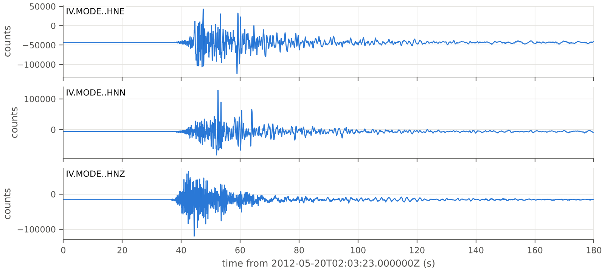
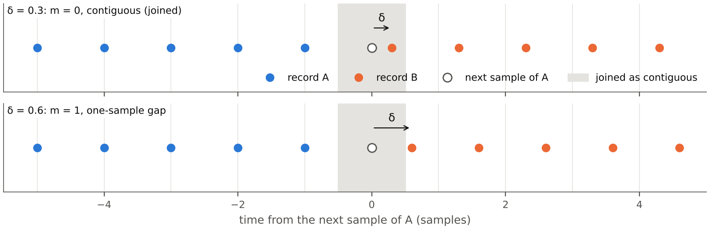
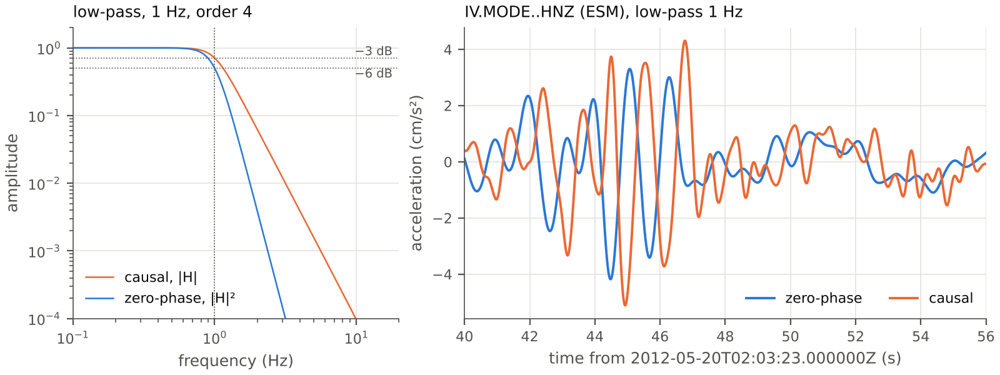
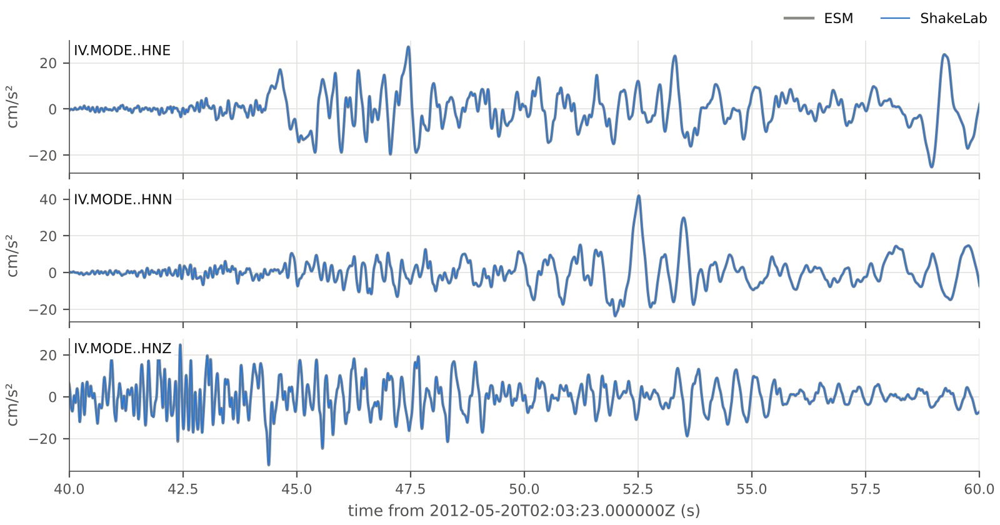
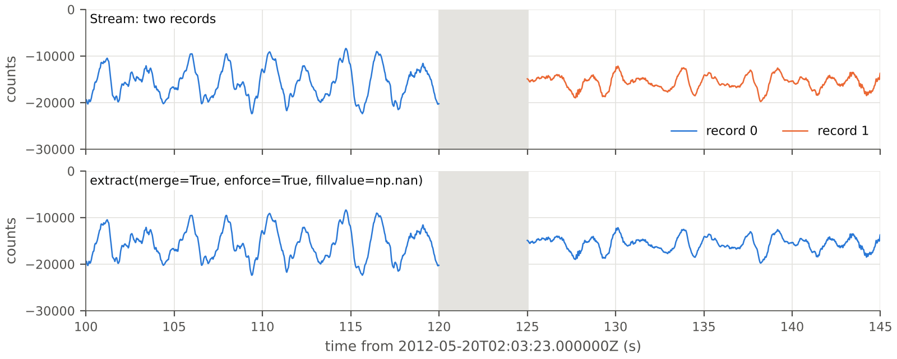
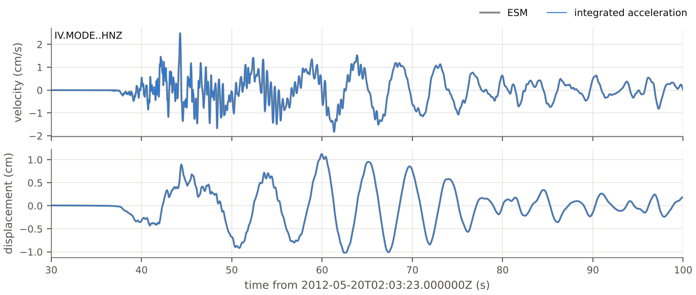

[ShakeLab documentation](../README.md) › [Signals](signals.md) › Waveforms

# Waveforms: records, streams and collections

`shakelab.signals.base` holds the waveform data of ShakeLab: the
`Record`, a continuous segment of uniformly sampled samples with its
header, the `Stream`, the records of one channel, and the
`StreamCollection`, the streams of many channels. Every reader of
ShakeLab returns them, every processing method works on them, and the
higher-level packages (spectra, ground-motion parameters, array
processing) start from them.

This guide gives the data model and the theory needed to use it
(Part I), the complete use of the three containers with an example for
every method (Part II), and the design choices, validation and limits
(Part III). An overview of the whole `signals` package is in the
[package README](../../shakelab/signals/README.md). Related guides:
channel metadata and instrument response in
[`response.md`](response.md), spectra and spectrograms in
[`spectral.md`](spectral.md), file formats and the reader in
[`io.md`](io.md), real-time acquisition in
[`seedlink.md`](seedlink.md).

The examples read a file `waveforms.mseed` with the three components
of a strong-motion station (100 Hz, 180 s, raw counts), its metadata
`station.xml`, and the processed acceleration and velocity of the
vertical component in two ASCII files (`acceleration.asc`,
`velocity.asc`; 200 Hz, cm/s²). The numbers shown in the comments
come from the recording of station IV.MODE of the 20 May 2012 Emilia
earthquake distributed with the tests of ShakeLab
(`tests/signals/data/`, with the processed data of the ESM database);
any other recording can be used in their place. The examples of a
section continue those before it.



*Figure 1. The data of the examples: the three components of IV.MODE
(INGV), 100 Hz, in raw counts, as read from `waveforms.mseed`.*

## Contents

Part I. Data model and theory

1. [Sampled signals and time](#1-sampled-signals-and-time)
2. [Containers](#2-containers)
3. [Header and channel metadata](#3-header-and-channel-metadata)
4. [Tolerances](#4-tolerances)
5. [Processing](#5-processing)

Part II. Use

6. [Record](#6-record)
7. [Stream](#7-stream)
8. [StreamCollection](#8-streamcollection)
9. [Views and copies](#9-views-and-copies)
10. [Processing at every level](#10-processing-at-every-level)
11. [Circular streams for real time](#11-circular-streams-for-real-time)
12. [Workflows](#12-workflows)

Part III. Design, validation and limits

13. [Design choices](#13-design-choices)
14. [Validation](#14-validation)
15. [Current limitations](#15-current-limitations)
16. [References](#16-references)

# Part I. Data model and theory

## 1. Sampled signals and time

A record holds $`n`$ samples $`x_k`$ taken at a constant sampling
interval $`\Delta`$ (`delta`, in seconds) from a start time $`t_0`$
(`time`, also `starttime`):

```math
t_k = t_0 + k\,\Delta, \qquad k = 0, 1, \ldots, n - 1 .
```

The sampling rate is $`f_s = 1/\Delta`$ (`rate`, in Hz); the two are
kept synchronized, so setting one sets the other. The highest
frequency represented is the Nyquist frequency $`f_N = f_s/2`$.

**Duration and end time.** The duration of a record is the time
between its first and its last sample,

```math
T = (n - 1)\,\Delta ,
```

and the end time (`endtime`) is the time of the last sample,
$`t_{n-1} = t_0 + T`$. A record of 18001 samples at 100 Hz lasts
180 s, not 180.01 s; a record of one sample lasts 0 s. The next sample
after a record, where a contiguous record starts, is at
$`t_{n-1} + \Delta`$. Where the width of the sampled interval is
needed (the period of a Fourier transform, the length of a taper) it
is $`n\Delta`$, and the guide says so.

**Times.** Absolute times are `Date` objects of
`shakelab.libutils.timeN`: integer nanoseconds in UTC, created from
ISO 8601 strings (`"2012-05-20T02:04:00"`, also with a space, or
without time or seconds) or from other `Date` objects. A `Date` plus
a number of seconds is a `Date`; the difference of two
`Date` objects is a number of seconds. Wherever a time is accepted,
any of these forms can be given.

**Relative times.** Time windows can also be given as numbers, in
seconds from a start: the start of the record (for `Record`), of the
earliest record of the stream (for `Stream`), of each stream (for
`StreamCollection`). A window $`[t_a, t_b]`$ includes both bounds: it
contains the samples with $`t_a \leq t_k \leq t_b`$, so that
`extract(0, 10)` of a 100 Hz record returns 1001 samples.

**Precision of time axes.** Times since the internal epoch of `Date`
(year 1) are about $`6.3\times10^{10}`$ s today; in double precision
they resolve only about 10 µs. Time axes are therefore given in
seconds from a reference: the start of the record by default, or any
`Date`, whose offset from the start of the record is computed exactly
in nanoseconds before the conversion to floating point
(`time_axis(reference)`, §6.2).

## 2. Containers

```text
StreamCollection            streams by source identifier (unique)
├── Stream  IV.MODE..HNE    records of one channel, in insertion order
│   ├── Record              samples (1-D array) + Header
│   └── Record              (after a gap, or of another metadata epoch)
├── Stream  IV.MODE..HNN
│   └── Record
└── Stream  IV.MODE..HNZ
    └── Record
```

- A **Record** is a continuous segment: a one-dimensional NumPy array
  of samples (`data`) and a `Header` (`head`) with sampling, start
  time, identifiers, units and the description of the channel. It
  holds no gaps; numerical operations and processing are defined on
  it.
- A **Stream** holds the records of one channel (one source
  identifier) in the order they were added. Records may be separated
  by gaps, overlap, or belong to different metadata epochs; a record
  appended right after the end of the last one is joined to it (§4).
- A **StreamCollection** holds one stream per source identifier, in
  the order they were created. Appending a record or a stream sends
  it to the stream of its channel, creating it if needed. Readers
  return collections.

The **source identifier** (`sid`) is the FDSN source code
`NET.STA.LOC.CHA` (network, station, location, channel; the location
may be empty, as in `IV.MODE..HNZ`). It is stored in the channel
metadata of each record. Channel patterns (`IV.MODE..HN?`,
`*.*.*.HH[ZNE]`, `IV.{MODE,MIRA}`), used by the reader and by the
metadata, are described in `shakelab.signals.codes`. The **event
identifier** (`eid`) is an optional label of a record (an event,
a test, a window), used to address records within a stream.

The three containers share `records()`, which returns the stored
records as a list, so that any of them can be handled as a sequence of
records; processing methods (filtering, response correction...) exist
on all three with the same arguments (§10). A **CircularStream** is a
stream that keeps only the last `max_duration` seconds, for real-time
acquisition (§11).

## 3. Header and channel metadata

The header of a record (`record.head`) holds:

| Field | Content |
|---|---|
| `delta`, `rate` | sampling interval (s) and rate (Hz), synchronized; finite and positive, or None |
| `time` | start time (`Date`, its own copy), or None |
| `eid` | event identifier, or None |
| `units` | units of the samples as declared by the source (`"m/s**2"`, `"CM/S**2"`), or None (e.g. raw counts) |
| `extra` | dictionary of free information about this record (e.g. the original header of a format, `extra["sac"]`, `extra["dyna"]`) |
| `meta` | channel description: a `ChannelEpoch` |
| `sid` | source identifier, stored in `meta` |

The **channel metadata** `head.meta` is a `ChannelEpoch` of
`shakelab.signals.metadata` (described with the instrument response in
[`response.md`](response.md)): source identifier, location
(`WgsPoint`, longitude, latitude, elevation), burial depth,
orientation (azimuth and dip), declared sampling rate, equipment,
instrument response (`StageSet`) and free information about the
channel (`meta.extra`). It is always present, empty when nothing is
known. The record exposes the most used fields: `record.sid`,
`record.location`, `record.orientation`, `record.response`.

The channel metadata is **shared**: the records of one epoch of a
channel (for example all the records read from one file with one
StationXML) refer to the same `ChannelEpoch` object, and copies of a
record keep the reference. Assignments through the record or header
attributes (`record.sid = ...`, `record.location = ...`,
`record.response = ...`) replace the epoch of that record with an
updated copy, so they never change other records; changing the shared
object directly (`record.head.meta.location = ...`) changes it for all
the records that refer to it.

`set_metadata(source)` assigns the metadata from a `ChannelEpoch` or,
normally, from a `MetadataCollection` read from StationXML, RESP or
FDSN text, choosing the epoch valid at the start of each record. It
warns (`MetadataWarning`) when different metadata are replaced, when
the declared sampling rate differs from that of the record, or when a
record extends beyond the end of its epoch.

## 4. Tolerances

Times in data formats have a limited resolution (0.1 ms in
MiniSEED 2, 1 ms in SAC) and floating-point arithmetic rounds them;
two tolerances, both expressed as fractions of the sampling interval,
decide when times coincide.

**Joining records.** When a record $`B`$ is appended to a record
$`A`$ with the same sampling interval, the offset of the start of
$`B`$ from the sample expected after the end of $`A`$, in samples, is

```math
\delta = \frac{t_0^{B} - \left(t_{n-1}^{A} + \Delta\right)}{\Delta},
\qquad m = \mathrm{round}(\delta) .
```

The start of $`B`$ is on the sampling grid of $`A`$ if
$`|\delta - m| \leq \tau_m`$, where $`\tau_m`$ is the merge tolerance
(`merge_tolerance`, default `MERGE_TOLERANCE = 0.5`, as in libmseed).
Then:

| $`m`$ | Meaning | `enforce=False` (default) | `enforce=True` |
|---|---|---|---|
| 0 | contiguous | joined | joined |
| > 0 | gap of $`m`$ samples | not joined | gap filled with $`m`$ values `fillvalue` |
| < 0 | overlap of $`-m`$ samples | not joined | $`A`$ kept up to the start of $`B`$, then $`B`$ |

If the start of $`B`$ is not on the grid ($`|\delta - m| > \tau_m`$),
the records are not joined, and with `enforce=True` a `ValueError` is
raised. When records are joined, the samples of $`B`$ take the times
of the grid of $`A`$: the start time of $`B`$ is not kept, and its
error, at most $`\tau_m \Delta`$, is absorbed.

With the default tolerance every offset is on the grid of some
integer $`m`$: a record starting 0.3 samples late is joined as
contiguous, one starting 0.6 samples late is taken as a gap of one
sample (filled with `enforce=True`, kept separate otherwise). A
smaller tolerance (e.g. `merge_tolerance=0.1`) keeps apart records
whose time stamps disagree by more than a tenth of a sample.



*Figure 2. Joining with the default tolerance: a record B starting 0.3
samples after the next sample of A falls within half a sample of it
(shaded) and is joined; one starting 0.6 samples after it is on the
grid one sample later, which leaves a gap of one sample.*

The sampling intervals must agree within a relative $`10^{-9}`$;
otherwise `Record.append` raises a `ValueError` (§15). The channel
metadata must be equal, or one of them empty (§6.5).

**Matching times to samples.** A window bound $`t`$ is converted to a
sample index of the grid, and a bound within $`\tau_s`$ samples of a
sample coincides with it (`snap_tolerance`, default
`SNAP_TOLERANCE = 1e-6`, which only absorbs rounding). The first and
last samples of a window $`[t_a, t_b]`$ are

```math
k_a = \left\lceil \frac{t_a - t_0}{\Delta} - \tau_s \right\rceil, \qquad
k_b = \left\lfloor \frac{t_b - t_0}{\Delta} + \tau_s \right\rfloor ,
```

clipped to the record. A window need not be aligned with the grid:
the first sample at or after $`t_a`$ is the first of the result, and
its time becomes the start time. The same tolerance decides whether a
duration is a whole number of samples (`zero_padding`) and how many
samples a resampled record has (§5).

## 5. Processing

Processing methods modify the record in place (§13); the numerical
operators return new records. This section gives the definitions that
matter to interpret the results; the use is in §6.7.

**Mean and trend.** `remove_mean()` (or `detrend("constant")`)
subtracts the mean; `detrend("linear")` (default) subtracts the
least-squares straight line, removing the offset and the drift of a
tilted or drifting sensor. Both come before tapering and response
correction.

**Butterworth filters.** `filter(highpass, lowpass, order)` designs a
digital Butterworth filter of order $`N`$ (`order`, default 4), as
second-order sections: low-pass with `lowpass` only, high-pass with
`highpass` only, band-pass with both (the band-pass has order $`2N`$).
The amplitude of the analog prototype is

```math
|H(f)| = \left[1 + \left(f/f_c\right)^{2N}\right]^{-1/2}
```

for a low-pass of corner $`f_c`$ ($`-3`$ dB at the corner). By
default the filter is applied forward and backward
(`scipy.signal.sosfiltfilt`): the phase cancels and the amplitude is
squared, $`|H(f)|^2`$, so the corner is at $`-6`$ dB (amplitude 0.5)
and the roll-off doubles. With `causal=True` the filter is applied
once (`scipy.signal.sosfilt`): causal, with the amplitude $`|H(f)|`$
($`-3`$ dB at the corner) and the phase delay of a physical filter,
as needed to keep onsets free of precursors. (A causal Butterworth
filter is also minimum phase: its poles are inside the unit circle and
its zeros on it.) The corners must be
below the Nyquist frequency. (The filter of `Spectrum.filter` is the
analog amplitude $`|H(f)|`$ in both cases; see
[`spectral.md`](spectral.md).)



*Figure 3. A Butterworth low-pass filter at 1 Hz of order 4. Left: the
amplitude of the causal filter, $`|H|`$, and of the zero-phase
filter, $`|H|^2`$. Right: the vertical acceleration of IV.MODE (ESM)
filtered both ways; the causal filter delays the signal by a fraction
of a second at these frequencies.*

**Taper.** `taper(time)` multiplies the record by a Tukey window: a
half cosine of duration `time` at each end and 1 in between. In terms
of the Tukey parameter, $`\alpha = 2\,\tau / (n\Delta)`$, the fraction
of the record inside the two cosine parts; durations longer than half
the record, or negative, give a full cosine (Hann) window. A pair
`(start, end)` gives different durations at the two ends, each the
half cosine of the symmetric taper of that duration (0 leaves an end
unchanged): it tapers only the side that needs it, for example the
part of a record that lies before a window of interest. Tapering
brings the ends smoothly to zero before Fourier-domain processing,
which treats the record as periodic.

**Resampling.** `resample(new_delta)` changes the sampling interval
keeping the start time. The resampled record covers the original one
without extrapolation:

```math
n' = \left\lfloor \frac{T}{\Delta'} + \tau_s \right\rfloor + 1 .
```

With `method="interp"` (default) the samples are interpolated
linearly; when downsampling, a zero-phase low-pass Butterworth filter
of order 4 at 90% of the new Nyquist frequency is applied first
(`antialias=True`). With `method="fft"` (or `"scipy"`) the record is
resampled in the Fourier domain (`scipy.signal.resample`), which
truncates the spectrum at the new Nyquist frequency or pads it with
zeros. The ratio $`\Delta'/\Delta`$ must be a fraction $`p/q`$ with
$`q \leq 1000`$ (2, 1/2, 3/2, 4/3...): the record is extended with fewer
than $`p`$ zeros so that its length is a whole number of new
intervals. The Fourier method treats the record as periodic, so a
record that does not start and end smoothly oscillates near its ends.

**Integration and differentiation.** With `method="fft"` (default)
the spectrum is multiplied by $`(i 2\pi f_j)^{\pm 1}`$ at the
frequencies $`f_j = j/(n\Delta)`$ of the transform: the record is
treated as periodic, the zero-frequency component (an integration
constant that the data cannot determine) is removed, and for an even
number of samples the Nyquist component is set to zero. With
`integrate(method="cum")` the cumulative trapezoidal rule is used,

```math
y_0 = 0, \qquad y_k = y_{k-1} + \frac{\Delta}{2}\left(x_{k-1} + x_k\right),
```

which keeps the integration constant (the result starts at zero); with
`differentiate(method="grad")` second-order central differences are
used inside the record and one-sided differences at its ends
(`numpy.gradient`). The Fourier methods are exact for band-limited
periodic signals; on records that do not start and end at zero, the
cumulative methods avoid the wrap-around of the periodic assumption.
The units declared in the header are not changed (§15).

**Time shift.** `shift(time)` moves the samples by `time` seconds
(positive delays the signal) without changing the start time, by a
phase rotation of the spectrum,

```math
Y(f) = X(f)\, e^{-i 2\pi f \tau} ,
```

which also shifts by fractions of a sample. The rotation is circular:
with `padding=True` (default) the record is extended with as many
zeros as it has samples before the transform, so that what leaves one
end does not reappear at the other.

**Convolution, deconvolution and correlation.** `convolve(kernel)`
computes the discrete convolution $`y_k = \sum_j x_j h_{k-j}`$
(`scipy.signal.convolve`), with the first coefficient of the kernel
at zero lag; `mode="full"` (default) gives $`n + m - 1`$ samples,
`"same"` $`n`$, `"valid"` $`n - m + 1`$. The sum has no factor
$`\Delta`$: to approximate a continuous convolution, multiply the
result by `delta`. `deconvolve(divisor)` is the exact polynomial
division of `scipy.signal.deconvolve` (the inverse of a full
convolution, not a regularized spectral inverse): the quotient
replaces the samples and the remainder is returned.

`correlate(other)` computes the discrete cross-correlation
(`scipy.signal.correlate`) and, unlike the methods above, does not
change the record: a correlation is a function of the lag
$`\tau`$, not a waveform in time, so it is returned as two arrays,
`lag` in seconds and `value`. A positive lag means that the record is
delayed with respect to `other`, and the peak of the correlation is at
the delay. When `other` is a record and both have a start time, the
difference of the start times is included: the lag is between the
absolute times of the two signals, and two records of the same signal
peak at zero lag whatever their start. With an array as `other` only
the samples count. `mode="full"` (default) gives the $`n + m - 1`$
lags with some overlap, `"same"` $`n`$ lags centred on zero, `"valid"`
only the lags of complete overlap. The values are not normalized.

**Instrument response.** `deconvolve_response()` divides the spectrum
of the record by the response $`H(f)`$ of the instrument, regularized
by a water level (in dB below the maximum of $`|H|`$) and optionally
multiplied by a band-pass window `prefilter=(f1, f2, f3, f4)`;
`convolve_response()` multiplies by it; `remove_sensitivity()` divides
by the overall sensitivity only. The theory, the conventions and the
options are in [`response.md`](response.md); §6.8 shows their use on
records.

# Part II. Use

## 6. Record

### 6.1 Construction

A record is built from an array of samples and its header fields; all
of them are optional and can be set later.

```python
import numpy as np
from shakelab.signals.base import Record

samples = np.sin(2 * np.pi * 1.0 * np.arange(1001) * 0.01)

record = Record(
    data=samples,
    delta=0.01,                     # or: record.rate = 100.0
    time="2026-01-01T00:00:00",
    sid="XX.TEST..HHZ",
    eid="test-1",
    units="m/s",
    location=(13.75, 45.65, 120.0),  # longitude, latitude[, elevation]
)
record.info()
# Record XX.TEST..HHZ: 2026-01-01T00:00:00.000000Z -
# 2026-01-01T00:00:10.000000Z, 100 Hz, 1001 samples, units m/s,
# event test-1
text = record.summary()             # the same text, as a string
print(record.head)                  # all the header fields
```

`summary()` returns the description of an object as text and `info()`
prints it; `print(record)` gives the same text. The record is
described on one line: source identifier, time span, sampling rate,
number of samples, and the units and the event identifier when they
are known.

The samples are copied: changing `samples` afterwards does not change
the record. They must be one-dimensional (a scalar becomes one
sample); their type is kept, so the integer counts of a MiniSEED file
stay integers until a processing method turns them into floating
point. `Record()` is an empty record (no samples, no sampling, no
time), which an `append` can fill (§6.5).

Records are usually read from files or services, which return a
`StreamCollection` (formats and options in [`io.md`](io.md)):

```python
from shakelab.signals.io import reader

collection = reader("waveforms.mseed", metadata="station.xml")
z = collection["IV.MODE..HNZ"][0]   # first record of the vertical
z.info()
# Record IV.MODE..HNZ: 2012-05-20T02:03:23.000000Z -
# 2012-05-20T02:06:23.000000Z, 100 Hz, 18001 samples

acc = reader("acceleration.asc")[0][0]      # processed, cm/s**2, 200 Hz
vel = reader("velocity.asc")[0][0]          # processed, cm/s
```

`z` (raw counts of the vertical component), `acc` and `vel` are used
in the examples that follow.

### 6.2 Attributes and time

```python
print(z.nsamp, len(z))              # 18001 18001
print(z.delta, z.rate)              # 0.01 100.0
print(z.time, z.starttime)          # same Date: time of the first sample
print(z.endtime)                    # 2012-05-20T02:06:23.000000Z
print(z.duration)                   # 180.0 s = (nsamp - 1) * delta
print(z.peak)                       # maximum absolute sample (counts)
print(z.sid, z.eid, z.head.units)   # IV.MODE..HNZ None None
print(z.location, z.orientation)    # from the channel metadata
print(z.response)                   # StageSet(sample_rate=100.0, stages=8)
```

`time`, `delta`, `rate`, `sid`, `eid`, `location`, `orientation` and
`response` can be assigned; `starttime`, `endtime`, `duration`,
`nsamp` and `peak` are computed. Changing `time` moves the whole
record; changing `delta` stretches it (use `resample` to change the
sampling of the same signal).

**Time axis.** `time_axis(reference, shift)` returns the time of each
sample in seconds:

```python
t = z.time_axis()                   # from the start: 0.0, 0.01, ...
t = z.taxis                         # the same, as a property
t = z.time_axis("2012-05-20T02:03:20")      # from a given time: 3.0, 3.01, ...
t = z.time_axis(z.time, shift=-10.0)        # -10.0, -9.99, ...
t = z.time_axis("absolute")         # since 0001-01-01, ~10 µs resolution
```

A common reference (an origin time, a pick, the start of the earliest
record) aligns several records on one axis with full precision (§1).
`"relative"`/`"r"` and `"absolute"`/`"a"` are accepted as names.

**Overlap with a window.** `overlaps(starttime, endtime)` tells whether
a window contains at least one sample:

```python
z.overlaps(170, 300)                # True: 170-180 s are in the record
z.overlaps(181, 300)                # False
z.overlaps("2012-05-20T02:04:00", None)     # True
```

### 6.3 Samples: indexing, slicing, iteration

A record is a sequence of samples, as a stream is a sequence of
records: `len` counts them, an integer selects one, iteration and `in`
visit them. A slice is a new record, as a slice of a stream is a new
stream: it holds a copy of the samples and starts at the time of its
first sample.

```python
z[0], z[-1]                         # first and last sample
len(z)                              # 18001
segment = z[100:200]                # Record of 100 samples, a copy
print(segment)
# Record IV.MODE..HNZ: 2012-05-20T02:03:24.000000Z -
# 2012-05-20T02:03:24.990000Z, 100 Hz, 100 samples

for value in z[:3]:                 # iterating over the samples
    print(value)

z[0] in z                           # True: compares with the samples
```

```python
z[::2]                              # ValueError: step 1 only
z[[0, 10, 20]]                      # TypeError: index z.data instead
```

A slice step other than 1 raises a `ValueError`: taking every second
sample would halve the sampling rate without an anti-alias filter (to
change the sampling use `resample`, §6.7). NumPy indexing (lists of indices, masks, steps) is done on the
samples, `record.data`, and gives arrays: the record refuses those
keys with a `TypeError` pointing there.

```python
z.data[100:200]                     # array: a view on the data
z.data[::2]                         # every second sample: a view
z.data[[0, 10, 20]]                 # NumPy fancy indexing: a copy
z.data[z.data > 0]                  # boolean mask: a copy
```

`in` takes a number and compares it with the samples; any other
operand raises a `TypeError`, so that `"ev01" in record` (an event
identifier, as in a stream) does not answer `False` without notice.
Whether a time falls within the record is asked to `overlaps`
(§6.2): `z.overlaps(t, t)`.

The samples are in `record.data`. Assigning to its elements or slices
changes the record in place; assigning a new array to `data` replaces
the samples with a copy of it (any length and type; the start time and
the sampling are kept):

```python
x = z.copy()
x.data[:100] = 0                    # in place
x.data = x.data.astype(float)       # counts to floating point
x.data = x.data[1000:2000]          # 1000 samples; time unchanged!
```

The last line keeps the start time of the original record, so the
samples are now at the wrong times: to take a part of a record use a
slice, `extract` or `cut`, which update the start time. The sample at a time
and the time of a sample follow from §1:

```python
k = int(np.argmax(np.abs(z.data)))  # index of the peak
t_peak = z.time + k * z.delta       # its time (Date)
k = round((t_peak - z.time) / z.delta)      # back to the index
```

### 6.4 Time windows: extract and cut

`extract(starttime, endtime)` returns a new record with the samples of
a window, bounds included; `cut(starttime, endtime)` trims the record
itself and returns None. Streams and collections have the same pair
(§7.4, §8.3). Bounds are `Date` objects or strings, or numbers of
seconds from the start of the record; None is the start or the end of
the record. `duration=` gives the length of the window after
`starttime` (or after the start of the record), instead of `endtime`.
Only the samples of the window are copied.

```python
part = z.extract("2012-05-20T02:04:00", "2012-05-20T02:04:10")
print(part.nsamp, part.time)        # 1001 2012-05-20T02:04:00.000000Z

part = z.extract(37.0, 47.0)        # the same window, relative to the start
part = z.extract("2012-05-20T02:04:00", duration=10.0)   # the same window
head = z.extract(None, 10.0)        # first 10 s (1001 samples)
tail = z.extract(170.0)             # last 10 s

y = z.copy()
y.cut(30.0, 90.0)                   # in place, returns None
```

The two bounds are of one kind: both times or both numbers. A time
followed by a number would be read as a number of seconds from the
start of the record, not from the time, which is rarely what is meant,
so the mixture raises a `TypeError` that points to `duration`:

```python
z.extract("2012-05-20T02:04:00", 30.0)      # TypeError: use duration
```

The window need not fall on the grid: the result starts at the first
sample at or after `starttime` and ends at the last sample at or
before `endtime` (§4).

```python
w = z.extract("2012-05-20T02:03:30.004", "2012-05-20T02:03:31")
print(w.time, w.nsamp)              # 2012-05-20T02:03:30.010000Z 100
```

A window that contains no sample raises a `ValueError` (for example
`z.extract(500, 600)`): a record cannot drop itself, as the records of
a stream are dropped (§7.4). A window partly outside the record is
clipped to it. `snap_tolerance` (default `SNAP_TOLERANCE`) can be
enlarged when the bounds come from times rounded more coarsely than
the sampling. The options after the window (`duration`,
`snap_tolerance`) are given by name.

### 6.5 Joining records: append

`a.append(b)` joins `b` to the end of `a` in place, following the
rules of §4; `b` is not modified. Records that cannot be joined (a
gap, an overlap, an offset off the sampling grid) raise a `ValueError`
that says why, unless `enforce=True`; `Stream.append` keeps them as
separate records instead (§7.1).

```python
a = z.extract(0.0, 59.99)           # 0-59.99 s, 6000 samples
b = z.extract(60.0, 119.99)         # contiguous with a
c = z.extract(125.0)                # after a gap of 5 s

x = a.copy()
x.append(b)                         # contiguous: now 12000 samples
x.append(c)                         # ValueError: records are not contiguous (gap of 5 s); x unchanged
x.append(c, enforce=True)           # gap filled with 0.0
print(x.nsamp)                      # 18001

x = a.copy()
x.append(c, enforce=True, fillvalue=np.nan)  # gap of NaN (float result)
```

With `enforce=True` an overlap is resolved in favour of the new
record: the current record is kept up to the first sample of the new
one.

```python
x = a.copy()
x.append(z.extract(50.0, 100.0))    # ValueError: records are not contiguous (overlap of 10 s)
x.append(z.extract(50.0, 100.0), enforce=True)
print(x.endtime)                    # 2012-05-20T02:05:03.000000Z
```

The merge tolerance absorbs time stamps a fraction of a sample off the
grid:

```python
late = b.copy()
late.time = b.time + 0.003          # 0.3 samples late
a.copy().append(late)               # joined, the 3 ms are absorbed

late.time = b.time + 0.006          # 0.6 samples late: a 1-sample gap
a.copy().append(late)               # ValueError: records are not contiguous (gap of 0.006 s)
a.copy().append(late, merge_tolerance=0.1)  # ValueError: ... (offset off the sampling grid)
```

`a.append(b)` also raises a `ValueError` if the sampling intervals differ,
if both records have a source identifier and they differ, or if both
have non-empty channel metadata and they differ (records of different
epochs are not joined). Appending to an empty record copies the
other one, header included; appending an empty record does nothing.
The `+` operator joins two records into a new one, and raises if they
cannot be joined without filling (§6.6):

```python
whole = a + b                       # new record, 12000 samples
```

### 6.6 Arithmetic

The operators return new records and never modify their operands;
the header is copied (the channel metadata stays shared, §9).

| Expression | Result |
|---|---|
| `record + 2.0`, `2.0 + record` | every sample plus 2 |
| `record - 2.0`, `2.0 - record` | every sample minus 2, 2 minus every sample |
| `record * 0.01`, `0.01 * record` | every sample times 0.01 |
| `record / 9.81` | every sample divided by 9.81 (`ZeroDivisionError` for 0) |
| `record_a + record_b` | the two records joined (contiguous only, else `ValueError`) |
| `record * response` | response applied (`convolve_response`) |
| `record / response` | response removed (`deconvolve_response`, default options) |

where `response` is a stage, a `StageSet`, a `ChannelEpoch` or a
`MetadataCollection` (§6.8). Other operands raise a `TypeError`:
records are not multiplied or subtracted sample by sample (do it on
`data`, after checking that the time axes agree).

```python
si = acc * 0.01                     # cm/s**2 to m/s**2 (units not changed)
si.head.units = "m/s**2"
g = si / 9.80665                    # fraction of g
centred = z - np.mean(z.data)       # as z.remove_mean(), on a copy
corrected = z / z.response          # counts to m/s**2, default options
```

The scale factors do not change `head.units`, which must be updated
by hand.

### 6.7 Processing

Every processing method works in place and returns None (§13). To
keep the original, process a copy. Integer samples become floating
point.

```python
x = z.copy()
x.remove_mean()                     # subtract the mean
x.detrend()                         # subtract the least-squares line
x.detrend("constant")               # same as remove_mean
x.taper(5.0)                        # 5 s cosine at each end
x.taper((5.0, 0.0))                 # 5 s at the beginning, none at the end
x.taper(-1)                         # full cosine (Hann) window
```

**Filtering.**

```python
x = acc.copy()
x.filter(highpass=0.5, lowpass=10.0)        # zero-phase band-pass
x = acc.copy()
x.filter(lowpass=1.0)               # zero-phase low-pass: -6 dB at 1 Hz
x = acc.copy()
x.filter(lowpass=1.0, causal=True)  # causal: -3 dB, delayed
x = acc.copy()
x.filter(highpass=0.1, order=2)     # order 2
```

On the acceleration of the example the causal 1 Hz low-pass moves the
peak from 44.48 to 44.93 s after the start, while the zero-phase
filter leaves it in place. Corners at or above the Nyquist frequency,
`highpass >= lowpass` or a record too short for the forward-backward
filter raise a `ValueError`.

**Resampling.**

```python
x = acc.copy()                      # 200 Hz, 40000 samples
x.resample(0.01)                    # 100 Hz, interpolation with anti-alias
print(x.rate, x.nsamp)              # 100.0 20000
x = acc.copy()
x.resample(0.01, method="fft")      # Fourier method (ratio 2/1)
x = acc.copy()
x.resample(1 / 150, method="fft")   # 150 Hz (ratio 4/3)
x = acc.copy()
x.resample(0.004)                   # upsampling to 250 Hz, interpolation
```

A ratio that is not a simple fraction (`resample(0.0123,
method="fft")`) raises a `ValueError`; use the interpolation.

**Padding and shifting.**

```python
x = acc.copy()
x.zero_padding(10.0)                # append 10 s of zeros (2000 samples)
x.zero_padding()                    # double the length
x = acc.copy()
x.shift(1.0)                        # delay the signal by 1 s, same window
x.shift(-0.0025)                    # advance by half a sample
```

`zero_padding(time)` requires a whole number of samples (else
`ValueError`). `shift` keeps the start time and the length: the
samples move within the window, and those moved beyond the end are
lost.

**Integration and differentiation.**

```python
v = acc.copy()
v.integrate()                       # Fourier method: zero mean, periodic
v = acc.copy()
v.integrate(method="cum")           # trapezoidal, starts at zero
v.head.units = "cm/s"               # units are not updated

a2 = vel.copy()
a2.differentiate()                  # Fourier method
a2 = vel.copy()
a2.differentiate(method="grad")     # finite differences
```

§12.4 compares the integral of `acc` with `vel`.

**Convolution, deconvolution, correlation.**

```python
kernel = np.ones(5) / 5             # moving average over 5 samples
x = acc.copy()
x.convolve(kernel, mode="same")     # same length, start time kept

x = acc.copy()
x.convolve([1.0, -0.5])             # full: nsamp + 1 samples
remainder = x.deconvolve([1.0, -0.5])       # back to acc, remainder ~0

ref = acc.extract(40.0, 50.0)
lag, value = acc.correlate(ref)     # nsamp + ref.nsamp - 1 lags
delay = lag[np.argmax(value)]       # 0.0 s: ref is a part of acc
lag, value = acc.correlate(ref.data)        # samples only, no times
offset = lag[np.argmax(value)]      # 40.0 s: where ref sits in acc
```

`method` (`"auto"`, `"direct"`, `"fft"`) selects the algorithm of
SciPy. Kernels given as records must have the same sampling interval;
their start time is ignored (§5).

### 6.8 Instrument response and sensitivity

The response is described in [`response.md`](response.md); on records
it is used as follows. With the metadata assigned (by the reader or by
`set_metadata`), the response of the channel is the default:

```python
from shakelab.signals.io import metadata_reader

metadata = metadata_reader("station.xml")
raw = reader("waveforms.mseed")             # without metadata
z = raw["IV.MODE..HNZ"][0]
z.set_metadata(metadata)            # epoch valid at the start of z

ground = z.copy()
ground.detrend()
ground.taper(5.0)
ground.deconvolve_response(prefilter=(0.05, 0.1, 30.0, 40.0))
print(ground.head.units, ground.peak)       # m/s**2 0.326

quick = z.copy()
quick.detrend()
quick.remove_sensitivity()          # divide by the overall sensitivity
print(quick.peak)                   # 0.324
```

`deconvolve_response(resp, waterlevel=60, method="water", stages=None,
prefilter=None, padding=False)`: `resp` defaults to the response of the
record and can be a stage, a `StageSet`, a `ChannelEpoch` or a
`MetadataCollection` (the epoch of the record is then selected by
source identifier and time); `stages` limits the correction to some
stage types (e.g. `("gain", "paz")`); `padding=True` adds zeros to
avoid wrap-around (on detrended and tapered records only). The units
become the input units of the response. Correcting a record twice is
refused: data whose units differ from the output units of the response
(here `ground` in m/s**2 against a response that outputs counts) raise a
`ValueError`.

`convolve_response` applies a response, for example to simulate the
recording of a ground motion by an instrument:

```python
counts = ground.copy()
counts.convolve_response()          # back to counts (units of the output)
```

The operators `z / metadata` and `ground * z.response` do the same with
the default options (§6.6).

### 6.9 Spectra and spectrograms

```python
spectrum = ground.to_spectrum()        # Spectrum with a copy of the header
print(spectrum.nfreq, spectrum.dfreq)      # 9001 frequencies, 0.0056 Hz

x = Record()
x.from_spectrum(spectrum)           # inverse transform, in place
gram = ground.spectrogram("wft", window=2.0)   # or "cwt", "st"
```

The scaling of the coefficients, the `Spectrum` and `Spectrogram`
classes and their options are in [`spectral.md`](spectral.md).

## 7. Stream

### 7.1 Construction and append

A stream is created empty, optionally with its source identifier, and
filled with `append`. It stores a copy of each record, so the records
of the caller are never changed, neither when stored nor when later
records are joined to them.

```python
from shakelab.signals.base import Stream

stream = Stream()                   # or Stream("IV.MODE..HNZ")
stream.append(a)                    # 0-59.99 s
stream.append(b)                    # joined to the last record
stream.append(c)                    # gap: a new record
stream.info()
# Stream IV.MODE..HNZ: 2 records, 2012-05-20T02:03:23.000000Z -
# 2012-05-20T02:06:23.000000Z, 17501 samples
#   0  2012-05-20T02:03:23.000000Z - 2012-05-20T02:05:22.990000Z,
#      100 Hz, 12000 samples
#   1  2012-05-20T02:05:28.000000Z - 2012-05-20T02:06:23.000000Z,
#      100 Hz, 5501 samples
```

The description of a stream (`summary()`, `info()`, `print`) has a
first line with the channel, the number of records, the time span and
the number of samples, then one line per record, by position.

`append(record, enforce=False, fillvalue=0.0, merge_tolerance=None)`
joins the record to the **last** record of the stream when §4 allows it
and their metadata are compatible; otherwise it adds a new record.
With `enforce=True` gaps are filled and overlaps resolved:

```python
filled = Stream()
for part in (a, b, c):
    filled.append(part, enforce=True)       # one record of 18001 samples
```

The stream takes the source identifier of its first record; records
without one take that of the stream, and a record of another channel
raises a `ValueError`. Records are kept in the order they are
appended and only the last one is a candidate for joining: data
arriving out of order are stored as separate records. `sort()` orders
them by start time (`sort(reverse=True)` from the latest), but does
not join them; to obtain one record, extract with `merge=True`
(§7.4).

```python
late_first = Stream()
late_first.append(b)
late_first.append(a)                # not joined: a precedes b
late_first.sort()                   # a, b (still two records)
whole = late_first.extract(merge=True)      # one Record, 12000 samples
```

### 7.2 Indexing, keys, slicing and iteration

```python
stream = Stream("IV.MODE..HNZ")
for k, start in enumerate((0.0, 60.0, 120.0)):
    part = z.extract(start, start + 30.0)
    part.eid = f"window-{k}"
    stream.append(part)

len(stream)                         # 3 records
stream[0], stream[-1]               # records by position (the stored ones)
stream["window-1"]                  # record by event identifier
stream.get_record("window-1")       # the same
stream[1:]                          # a new Stream with records 1 and 2
stream.eid                          # ['window-0', 'window-1', 'window-2']
stream.records()                    # list of the stored records

for record in stream:               # iteration over the records
    print(record.eid, record.time, record.nsamp)
```

A missing or ambiguous event identifier raises a `KeyError`; other key
types (floats, lists) a `TypeError`. A slice is a new stream holding
the stored records, not copies (§9). `in` follows the indexing:
`"window-1" in stream` tells whether a record has that event
identifier, `record in stream` whether that record (not a copy of it)
is stored in the stream.

`remove(key)` takes a record out by position or event identifier and
returns it:

```python
removed = stream.remove("window-0")         # or stream.remove(0)
print(stream.eid)                   # ['window-1', 'window-2']
```

### 7.3 Attributes

```python
stream.sid                          # 'IV.MODE..HNZ'
stream.nsamp                        # samples of all the records
stream.starttime                    # earliest start of a record
stream.endtime                      # latest end of a record
repr(stream)                        # "Stream(sid='IV.MODE..HNZ', records=2)"
```

`starttime` and `endtime` raise a `ValueError` if a record has no
time, and are None for an empty stream.

### 7.4 Time windows and selection of events

`extract(starttime, endtime, duration=None, merge=False,
enforce=False, fillvalue=0.0, snap_tolerance=..., merge_tolerance=None)`
cuts every record to the window and returns new, independent data:
a Stream, or with `merge=True` one Record. Numbers are seconds from
the start of the stream (its earliest record); as for records, the two
bounds are of one kind and `duration` gives a length after
`starttime`. `cut` takes the same window and trims the stream in
place.

```python
gappy = Stream()
for part in (a, b, c):
    gappy.append(part)              # two records, gap at 120-125 s

window = gappy.extract(100.0, 140.0)        # Stream: two pieces
print(len(window))                  # 2
one = gappy.extract(100.0, 140.0, merge=True, enforce=True,
                    fillvalue=np.nan)        # Record, NaN in the gap
gappy.extract(100.0, 140.0, merge=True)     # ValueError: not contiguous
empty = gappy.extract(500.0, 600.0)         # Stream without records
gappy.extract(500.0, 600.0, merge=True)     # ValueError: no sample
```

Records without samples in the window are skipped, and the result may
be an empty stream. With `merge=True` the result is a record, which
cannot be empty: a window without samples raises a `ValueError`, as
for a record. `cut` removes the records left without samples:

```python
trimmed = gappy.copy()
trimmed.cut(100.0, 110.0)           # in place: one record, 100-110 s
print(len(trimmed))                 # 1
```

`select(sid=None, starttime=None, endtime=None, eid=None,
duration=None)` returns a new stream with copies of the records of
some events, within an optional window of absolute times, as
`StreamCollection.select` (§8.3). Event identifiers are matched
exactly, or with the wildcards `*` (any text) and `?` (one
character); a list gives alternatives, and records without identifier
match no pattern. One record by event identifier is taken by indexing:

```python
stream.select(eid="window-*")       # Stream of copies of the windows
stream.select(eid=["window-1", "window-2"],
              starttime="2012-05-20T02:05:23", duration=10.0)
                                    # first 10 s of window-2
stream["window-1"].extract(0.0, 2.0)        # Record, numbers from its start
```

### 7.5 Processing and metadata

The processing methods of §6.7 that make sense record by record exist
on the stream with the same arguments and apply to every record:
`remove_mean`, `detrend`, `filter`, `resample`, `taper`, `shift`,
`integrate`, `differentiate`, `convolve_response`,
`deconvolve_response`, `remove_sensitivity` (§10).

```python
work = gappy.copy()
work.detrend()
work.taper(1.0)                     # each record tapered at its own ends
work.filter(highpass=0.1)
work.set_metadata(metadata)         # one copy of the epoch for all the records
```

Each record is processed separately: filters and tapers act at the
ends of every record, also at the edges of a gap. To process across
gaps, extract a merged record first (§12.2).

## 8. StreamCollection

### 8.1 Construction, reading and writing

```python
from shakelab.signals.base import StreamCollection

collection = reader("waveforms.mseed", metadata="station.xml")
collection = StreamCollection()
collection.read("waveforms.mseed", metadata="station.xml")  # the same
collection.info()
# StreamCollection: 3 streams, 3 records, 2012-05-20T02:03:23.000000Z -
# 2012-05-20T02:06:23.000000Z
#   IV.MODE..HNE  1 record, 100 Hz, 2012-05-20T02:03:23.000000Z -
#                 2012-05-20T02:06:23.000000Z, 18001 samples
#   ...
collection.write("{sta}.{cha}.mseed")       # one file per channel
collection.write("event/", format="sac")   # SAC files in a folder
```

`read` adds the data of files, patterns, folders or lists to the
collection, in place (it returns None, as every method that changes
the object); `write` writes it in any format, to one
file, to a folder or with a name template. Both delegate to
`shakelab.signals.io` ([`io.md`](io.md)).

`append(data)` adds a record or a stream to the stream of its channel,
creating the stream if needed. The records are copied (§9) and joined
as in `Stream.append`, with the same `enforce`, `fillvalue` and
`merge_tolerance`. Data without a source identifier raise a
`ValueError`.

```python
built = StreamCollection()
built.append(a)                     # a new stream IV.MODE..HNZ
built.append(b)                     # joined to a
built.append(collection["IV.MODE..HNE"])     # a whole stream
```

`merge(other)` appends every stream of another collection, with the
same options. Data already present are not recognized: merging a
collection with itself, or two collections with the same records,
stores the overlapping records twice, as separate records. With
`enforce=True` a record that overlaps the end of the last stored one
replaces the overlapping samples, while a record starting at or before
the start of the last stored one raises a `ValueError`.

```python
merged = StreamCollection()
merged.merge(collection)
merged.merge(collection)            # the same data again
print([len(stream) for stream in merged])   # [2, 2, 2]: stored twice

joined = StreamCollection()
t0 = collection["IV.MODE..HNZ"].starttime
joined.merge(collection.extract(starttime=t0, duration=100.0))
joined.merge(collection.extract(starttime=t0 + 50.0), enforce=True)
print([len(stream) for stream in joined])   # [1, 1, 1]: overlaps resolved
```

### 8.2 Indexing, keys, slicing and iteration

```python
len(collection)                     # 3 streams
collection[0], collection[-1]       # streams by position (the stored ones)
collection["IV.MODE..HNZ"]          # stream by source identifier
collection.get_stream("IV.MODE..HNZ")       # the same
collection[:2]                      # new collection with the first two streams
collection.sid                      # ['IV.MODE..HNE', ..., 'IV.MODE..HNZ']
collection.nsamp                    # samples of all the records: 54003
collection.starttime                # earliest start of a stream
collection.endtime                  # latest end of a stream
collection["IV.MODE..HNZ"][0]       # first record of a channel

for stream in collection:           # streams
    for record in stream:           # records of each stream
        print(record.sid, record.time, record.nsamp)

for record in collection.records(): # all the records, stream by stream
    print(record.sid, record.peak)
```

`starttime` and `endtime` span all the streams, as those of a stream
span its records: they raise a `ValueError` if a record has no time,
and are None for a collection without records. They give the window
of the data at hand, for example `collection.extract(
collection.starttime + 10.0, duration=60.0)`. The description of a
collection (`summary()`, `info()`) has one line per stream; the
records are described by the streams.

A missing source identifier raises a `KeyError`, another key type a
`TypeError`. As for streams, `in` follows the indexing:
`"IV.MODE..HNZ" in collection` tells whether the collection has a
stream with that source identifier.

```python
removed = collection.copy().remove("IV.MODE..HNE")   # or by position
ordered = collection.copy()
ordered.sort()                      # streams by sid, records by time
ordered.sort(reverse=True)          # from HNZ to HNE, latest records first
ordered.sort(sort_records=False)    # streams only
```

### 8.3 Selection by time, channel and event

`extract(starttime=None, endtime=None, duration=None, merge=False,
...)` cuts every stream to a window and returns a new collection
(streams without samples in the window are left out); with
`merge=True` each stream holds one record. `cut` takes the same window
and trims the collection in place, removing the streams left empty.
The bounds of a collection are absolute times (`Date` objects or
strings), and `duration` gives a length after `starttime`: a number of
seconds would count from the start of each stream, and channels that
start at different times would be cut to different windows, so it
raises a `TypeError`.

```python
window = collection.extract(starttime="2012-05-20T02:04:00",
                            endtime="2012-05-20T02:04:10")
print(window.sid, window[0][0].nsamp)       # 3 streams, 1001 samples each
window = collection.extract(starttime="2012-05-20T02:04:00",
                            duration=10.0)   # the same window
joined = collection.extract(merge=True, enforce=True)  # one record per stream
collection.extract(starttime=0.0, endtime=10.0)        # TypeError: dates
z_part = collection["IV.MODE..HNZ"].extract(0.0, 10.0)  # one channel: Stream
```

`select(sid=None, starttime=None, endtime=None, eid=None,
duration=None)` chooses what to keep, as `extract` chooses when: the
channels that match a pattern, or a list of patterns, of
`shakelab.signals.codes` (`*`, `?`, `[...]`, `{A,B}`, code by code;
codes missing at the end match anything), the records of some events
(identifiers matched exactly or with `*` and `?`, as for streams,
§7.4), within an optional time window with the bounds included. It
returns a new collection with copies of the selected records, cut to
the window; records without samples in the window are left out, and a
selection that matches nothing is an empty collection. A set that is
not closed (`HN[Z`), empty or nested raises a `ValueError`, as
unbalanced braces do, instead of matching nothing.

```python
horizontal = collection.select("*.*.*.HN{N,E}")
print(horizontal.sid)               # ['IV.MODE..HNE', 'IV.MODE..HNN']
part = collection.select(["IV.MODE..HNZ", "IV.MODE..HNE"],
                         "2012-05-20T02:04:00", "2012-05-20T02:04:10")
print(part.sid, part[0][0].nsamp)   # 2 streams, 1001 samples each
events = collection.select(eid="IT-2012-*")  # records of some events
```

The window bounds are absolute times (`Date` objects or ISO 8601
strings), as in the reader: `select` is the selection of
`io.reader`, applied to a collection in memory, so that
`reader(source, select=p, starttime=a, endtime=b)` and
`reader(source).select(p, starttime=a, endtime=b)` give the same
data. The window may follow the channels by position, as in the
example above, or be given by name (`starttime=`, `endtime=`);
`eid` and `duration` are always given by name. Reading with the
selection is cheaper, since the samples outside
it are not kept:

```python
horizontal = reader("waveforms.mseed", select="*.*.*.HN{N,E}",
                    starttime="2012-05-20T02:04:00",
                    endtime="2012-05-20T02:04:10")
print(horizontal.sid)               # ['IV.MODE..HNE', 'IV.MODE..HNN']
```

The stored streams of some channels, not copies, are taken with
indexing or `match_sid`:

```python
from shakelab.signals.codes import match_sid

stored = [stream for stream in collection
          if match_sid(stream.sid, "IV.MODE..HN[NE]")]
```

### 8.4 Arithmetic

A collection can be multiplied or divided by a response, giving a new
collection with the response applied or removed from every record
(default options):

```python
raw = reader("waveforms.mseed")
raw.detrend()
raw.taper(5.0)
acceleration = raw / metadata       # MetadataCollection: epoch per channel
print(acceleration["IV.MODE..HNZ"][0].head.units)   # m/s**2
```

Numbers, other collections and streams are not accepted; streams have
no operators (§15).

### 8.5 Processing and metadata

The processing methods of the stream (§7.5) exist on the collection
and apply to every record of every stream; `set_metadata` assigns the
epochs of a `MetadataCollection` to all the records, sharing one copy
per epoch, and reports the channels without metadata in a single
warning instead of raising.

```python
work = reader("waveforms.mseed")
work.set_metadata(metadata)
work.detrend()
work.taper(5.0)
work.deconvolve_response(prefilter=(0.05, 0.1, 30.0, 40.0))
work.filter(highpass=0.1, lowpass=25.0)
```

A collection created with `StreamCollection(max_duration=60.0)` holds
circular streams (§11).

## 9. Views and copies

Every operation either returns stored objects (changing them changes
the container), or new and independent data. The channel metadata
(`head.meta`) is shared by all copies of a record, as described in
§3; the table lists whether the samples are shared.

| Operation | Returns | Samples shared with the container |
|---|---|---|
| `record.data`, `record.data[i:j]`, `record.data[::k]` | NumPy array (view) | yes |
| `record.data[[i, j]]`, `record.data[mask]` | NumPy array (copy) | no |
| `record[i:j]` | new Record | no |
| `Record(data=array)`, `record.data = array` | — | no: the array is copied |
| `record.copy()`, `record.extract()` | new Record | no |
| `cut()` on records, streams and collections, processing methods | None (changed in place) | — |
| `record + x`, `record * x`, `record / response` | new Record | no |
| `record.to_spectrum()`, `record.spectrogram()` | new object, copy of the header | no |
| `stream[i]`, `stream[eid]`, `stream.get_record()` | stored Record | yes |
| `stream[i:j]` | new Stream of the stored records | yes |
| `for record in stream`, `stream.records()` | stored Records | yes |
| `stream.remove(key)` | the Record taken out | (no longer in the stream) |
| `stream.append(record)` | — | no: a copy is stored |
| `stream.copy()`, `stream.extract()`, `stream.select()` | new Stream (Record with `merge=True`) | no |
| `collection[i]`, `collection[sid]`, `get_stream()` | stored Stream | yes |
| `collection[i:j]` | new collection of the stored Streams | yes |
| `for stream in collection`, `collection.records()` | stored Streams, Records | yes |
| `collection.append()`, `collection.merge()` | — | no: copies are stored |
| `collection.copy()`, `collection.extract()`, `collection.select()`, `collection / response` | new StreamCollection | no |
| `set_metadata(collection)` | — | one copy of each epoch, shared by the records of the call |

So a processing method called on a stored object changes the
container (`collection["IV.MODE..HNZ"].filter(...)` filters that
stream inside the collection), while the same call on an extracted or
copied object does not.

```python
collection["IV.MODE..HNZ"].detrend()        # changes the collection
part = collection["IV.MODE..HNZ"][0:1]      # new Stream, same records
part.taper(1.0)                     # also tapers the record in the collection
safe = collection["IV.MODE..HNZ"].copy()    # independent
safe.taper(1.0)                     # the collection is not touched
```

## 10. Processing at every level

| Method | Record | Stream | StreamCollection |
|---|:-:|:-:|:-:|
| `remove_mean`, `detrend`, `taper`, `filter`, `resample`, `shift` | ✓ | ✓ | ✓ |
| `integrate`, `differentiate` | ✓ | ✓ | ✓ |
| `convolve_response`, `deconvolve_response`, `remove_sensitivity` | ✓ | ✓ | ✓ |
| `set_metadata` | ✓ | ✓ | ✓ |
| `extract`, `append`, `copy`, `records`, `info` | ✓ | ✓ | ✓ |
| `cut`, `zero_padding`, `convolve`, `deconvolve`, `correlate` | ✓ | | |
| `to_spectrum`, `from_spectrum`, `spectrogram` | ✓ | | |
| `time_axis`, `overlaps`, `peak`, `duration` | ✓ | | |
| `starttime`, `endtime`, `nsamp`, `summary` | ✓ | ✓ | ✓ |
| `sort`, `remove` | | ✓ | ✓ |
| `merge`, `read`, `write` | | | ✓ |
| `*` and `/` with a response | ✓ | | ✓ |
| `+`, `-`, `*`, `/` with numbers; `+` of records | ✓ | | |

The methods of streams and collections have the same arguments as
those of the record and call them record by record: the
implementation is in `Record`, and the containers delegate (§13). An
error in one record stops the loop and leaves the records already
processed changed; work on a copy when this matters. Circular streams
refuse the processing methods (§11).

## 11. Circular streams for real time

A `StreamCollection(max_duration=...)` creates `CircularStream`
objects, which keep only the samples within `max_duration` seconds of
the latest sample. They are the buffers of the SeedLink client
(`client.set_buffer(max_duration=...)`, [`seedlink.md`](seedlink.md)).
The module is experimental: importing it emits a `FutureWarning`.

```python
buffer = StreamCollection(max_duration=60.0)
for start in range(0, 180, 10):     # packets of 10 s, in time order
    buffer.append(z.extract(start, start + 9.99))

ring = buffer["IV.MODE..HNZ"]
print(repr(ring))                   # CircularStream(..., records=7)
print(ring.starttime, ring.endtime) # the last 60 s
latest = ring.extract(merge=True)   # one Record, 6001 samples
latest.detrend()                    # process the extracted copy
```

Records must arrive in time order (otherwise `ValueError`), are kept
as separate blocks (never concatenated, to avoid copying a growing
array) and are trimmed as new data arrive; overlaps are rejected
unless `enforce=True`. Processing methods raise
`NotImplementedError`: applied block by block they would create edge
effects at every block. `cut` raises it too, since the buffer keeps
its own window. Slices, `extract` and `select` return standard
streams, which can be processed.

## 12. Workflows

### 12.1 From counts to ground acceleration

```python
from shakelab.signals.io import metadata_reader, reader

metadata = metadata_reader("station.xml")
data = reader("waveforms.mseed", metadata=metadata)
data.detrend()                      # offset and drift
data.taper(5.0)                     # smooth ends for the transform
data.deconvolve_response(prefilter=(0.05, 0.1, 30.0, 40.0))
for record in data.records():
    print(record.sid, record.head.units, round(record.peak * 100, 2))
# IV.MODE..HNE m/s**2 27.02
# IV.MODE..HNN m/s**2 41.78
# IV.MODE..HNZ m/s**2 32.58
```

The peaks agree with the processed records of the ESM database within
0.5% (§14).



*Figure 4. Raw counts of IV.MODE corrected for the instrument response
(blue) and the acceleration processed by ESM (grey).*

### 12.2 Gaps

```python
gappy = Stream()
for part in (a, b, c):              # two records, 5 s missing
    gappy.append(part)

starts = [record.endtime for record in gappy[:-1]]
ends = [record.starttime for record in gappy[1:]]
for gap_start, gap_end in zip(starts, ends):
    print(f"gap from {gap_start} to {gap_end}: {gap_end - gap_start} s")

continuous = gappy.extract(merge=True, enforce=True, fillvalue=np.nan)
mask = np.isnan(continuous.data)    # where the data are missing
```



*Figure 5. Top: a stream of the vertical component of IV.MODE with
5 s missing (shaded), held as two records. Bottom: the record
extracted with `merge=True, enforce=True, fillvalue=np.nan`; the NaN
samples are not drawn.*

Gaps filled with NaN keep the missing data visible; filtering or
transforming a record with NaN gives NaN everywhere, so fill with a
value (0 after removing the mean, or an interpolation of `data`) only
when the processing needs it, and process the separate records
otherwise.

### 12.3 Three components on a common window

```python
start = max(stream.starttime for stream in data)
end = min(stream.endtime for stream in data)
common = data.extract(starttime=start, endtime=end, merge=True)

matrix = np.vstack([stream[0].data for stream in common])
print(common.sid, matrix.shape)     # (3, 18001)
```

The rows of `matrix` are simultaneous samples (the records share the
grid). Records with different sampling must be resampled first.

### 12.4 Integrating an accelerogram

With the processed acceleration and velocity read in §6.1:

```python
v = acc.copy()
v.integrate(method="cum")
v.head.units = "cm/s"
print(round(v.peak, 3), round(vel.peak, 3))  # 2.493 2.494
d = v.copy()
d.integrate(method="cum")           # displacement in cm
```

The integration of the processed acceleration gives the processed
velocity of ESM within 0.03% at the peak (§14). On raw or
unfiltered accelerograms the integral drifts: band-pass filter first.



*Figure 6. The vertical acceleration of IV.MODE processed by ESM,
integrated once and twice with the trapezoidal rule (blue), and the
velocity and displacement of ESM (grey).*

# Part III. Design, validation and limits

## 13. Design choices

- **One implementation, delegated.** Every operation on samples is
  implemented once, in `Record`; `Stream` and `StreamCollection` apply
  it record by record with the same arguments, and add only what
  belongs to a set of records (joining, ordering, selection, metadata
  shared per epoch). The same holds for spectra: `Record.to_spectrum`
  and `Record.spectrogram` delegate to `Spectrum` and `Spectrogram`,
  which sit above the waveforms in the hierarchy of the package.
- **Processing in place, operators on copies.** Processing methods
  change the object and return None, as a chain of steps on one
  dataset (detrend, taper, correct, filter) usually needs; the
  numerical operators return new records and never modify their
  operands, as in arithmetic. To keep the input, process a copy.
- **Containers store copies.** `Stream.append` and
  `StreamCollection.append` store copies, so later joins, trims and
  processing inside the container never change the records of the
  caller; reading the stored objects back (indexing, iteration,
  slicing, `records()`) gives the stored ones, as for Python lists, so
  that they can be processed in place.
- **One indexing rule at every level.** A record is a sequence of
  samples, a stream of records, a collection of streams: an integer
  gives one element and a slice a new object of the same class. A
  sliced record is a copy, because the samples of a record are always
  its own; slices with a step are refused, since they would change
  the sampling without an anti-alias filter. `in` follows the
  indexing, and an operand of the wrong kind is an error rather than
  `False`.
- **Selection in memory as at reading.** `StreamCollection.select`
  and the reader share one implementation, so the same patterns and
  window give the same data whether they are applied while reading or
  afterwards; the result holds copies, as `MetadataCollection.select`.
- **Metadata shared by reference.** A channel epoch, with its response
  of tens of stages, is shared by all the records of that epoch and
  by their copies, instead of being copied with every record; changes
  through the record attributes replace it with a copy (§3).
- **Insertion order and explicit joining.** A stream keeps the order
  in which records arrive and joins only a record contiguous with the
  last one: the cost of an append does not grow with the history, and
  nothing is reordered or filled silently. Sorting, filling gaps and
  resolving overlaps are explicit (`sort`, `enforce`, `fillvalue`,
  `extract(merge=True)`).
- **Inclusive windows and duration between samples.** Windows include
  both bounds and `duration` is the time from the first to the last
  sample, so that `extract(t1, t2)` of a record covering both bounds
  starts at `t1` and ends at `t2`, and the end time of a record is a
  time of the record.
- **Windows: when, and what.** `cut` and `extract` choose a time
  window, in place or on a copy, with the same arguments at every
  level; `select` chooses channels and events (and, as the reader, a
  window); indexing takes one element by position or identifier. A
  window has bounds of one kind: numbers of seconds from the start of
  the object on records and streams, absolute times everywhere, and
  `duration` for a length after `starttime`. A time followed by a
  number is refused rather than read as seconds from the start of the
  object; a collection takes absolute times only, so that every
  channel is cut to the same window. `duration` is the length in the
  sense of `Record.duration`, from the first to the last sample:
  `extract(t, duration=d)` on the grid gives a record of duration `d`.
- **Windows by position.** `starttime` and `endtime` may be given by
  position right after what the window applies to: the object itself
  (`cut`, `extract`, `overlaps`) or the channels chosen (`select`, and
  the clients of [`seedlink.md`](seedlink.md) and
  [`fdsnws.md`](fdsnws.md)); elsewhere, as in the reader, by name.
  The other options are given by name.
- **Empty windows.** A record cannot drop itself, so a window without
  samples is a `ValueError` for a record (and for `merge=True`, which
  makes one); a stream or a collection drops the records without
  samples and may become empty, as `select` and the reader do.
- **One name for the identifiers.** `sid` and `eid` keep their
  singular name at every level: one value where there is one (the
  channel of a record or a stream, the event of a record), the list of
  the elements where there are many (`Stream.eid`, the events of the
  records; `StreamCollection.sid`, the channels, as
  `MetadataCollection.sid`).
- **Descriptions.** Every object that can describe itself has
  `summary()`, which returns the text, and `info()`, which prints it;
  a container gives one line per element, so that a long stream or a
  large collection stays readable.
- **Results in their own domain.** `correlate` returns lags and
  values instead of replacing the samples of the record: a
  correlation is not a waveform in time, and an object with a false
  time axis could be cut, written or merged as if it were one.
- **Filters named by their effect.** `filter(causal=True)` names the
  choice between a filter applied both ways (zero phase) and once
  (causal); the causal Butterworth filter is also minimum phase, which
  is a property of it rather than the choice made.
- **Tolerances in samples.** Both tolerances are fractions of the
  sampling interval, so that they mean the same at 1 Hz and at
  1000 Hz: half a sample for joining (as libmseed), to absorb the
  resolution of the formats; a millionth for snapping, to absorb only
  rounding.
- **Times as integer nanoseconds.** `Date` keeps absolute times exact;
  time axes in floating point are relative to a reference.
- **No plotting, no formats in the classes.** Figures are made by
  `shakelab.graphics`, files are read and written by
  `shakelab.signals.io` and `libio`; the collection offers `read` and
  `write` as entry points that delegate to them.
- **Not copied from other libraries by principle.** The names and the
  semantics (duration between samples, inclusive windows, shared
  metadata, explicit joining) were chosen for consistency within
  ShakeLab and may differ from those of ObsPy.

## 14. Validation

The containers are covered by the tests of `tests/signals/test_base.py`
(126 tests: header, construction, indexing, times, windows on and off
the grid, joining with gaps, overlaps and rounded time stamps,
metadata, operators, processing, response correction, streams,
collections, selection, descriptions, views and copies) and `tests/signals/test_circular.py` (10 tests). The
following checks were made on the test data of IV.MODE (raw counts,
StationXML of INGV) and on the records processed by the Engineering
Strong-Motion database (ESM 3.0, manual processing, 200 Hz):

| Check | Result |
|---|---|
| Response correction of the raw counts (detrend, 5 s taper, prefilter 0.05-0.1-30-40 Hz) against the ESM acceleration | peaks 27.02, 41.78, 32.58 cm/s² against 26.97, 41.87, 32.73 (E, N, Z): within 0.5% |
| Correction by the sensitivity only | peaks within 1% of ESM |
| Integration of the ESM acceleration (Z) against the ESM velocity | peak 2.493 cm/s against 2.494 (both methods); samples within 3.3% of the peak |
| Second integration against the ESM displacement | peak 1.1234 cm against 1.1235; samples within 1.1% of the peak |
| Differentiation of the ESM velocity against the ESM acceleration | peak 32.69 (Fourier) and 32.54 (`grad`) cm/s² against 32.73 |
| Zero-phase low-pass on a sine at the corner | amplitude 0.500 ($`-6`$ dB); causal 0.707 ($`-3`$ dB) |
| Resampling 200 → 100 Hz, interpolation and Fourier | peaks 32.353 and 32.353 cm/s² |
| Joining of records split from one record, with `enforce=True` across the gap | samples identical to the original |

The differences with ESM reflect its own processing (Butterworth
band-pass of order 2, from 0.02-0.03 to 40 Hz, baseline correction),
not errors of the operations. The joining rules follow those of
libmseed for MiniSEED (half-sample tolerance); the MiniSEED reader is
compared with libmseed in the tests of `libio`.

## 15. Current limitations

- **Performance.** `Stream.append` and `StreamCollection.append` copy
  and concatenate arrays: building a long stream from many small
  contiguous records is quadratic in its length, and finding the
  stream of a channel is linear in the number of streams. Circular
  streams avoid the concatenation; for large archives read files in
  one call.
- **Different sampling intervals.** Two records of one channel whose
  sampling intervals differ by more than a relative $`10^{-9}`$ (a
  digitizer with a slightly different declared rate) are not kept as
  separate records: `Stream.append` raises a `ValueError`.
- **Units.** The units of the header are updated by the response
  corrections but not by integration, differentiation or the
  arithmetic operators.
- **Processing across gaps.** Processing works record by record; a
  continuous result across gaps requires filling them
  (`extract(merge=True, enforce=True)`).
- **Partial processing on errors.** A processing method of a stream
  or collection stops at the first record that fails, leaving the
  previous ones processed.
- **Circular streams** are experimental (API, representation and
  performance may change).
- **Interface asymmetries** (under review): the operators differ
  between the classes (§10).

## 16. References

Butterworth, S. (1930). On the theory of filter amplifiers. Wireless
Engineer, 7, 536-541.

Boore, D. M., and Bommer, J. J. (2005). Processing of strong-motion
accelerograms: needs, options and consequences. Soil Dynamics and
Earthquake Engineering, 25(2), 93-115.

FDSN (2012). SEED Reference Manual, Standard for the Exchange of
Earthquake Data, SEED Format Version 2.4. International Federation of
Digital Seismograph Networks.

Harris, F. J. (1978). On the use of windows for harmonic analysis with
the discrete Fourier transform. Proceedings of the IEEE, 66(1),
51-83.

Luzi, L., Puglia, R., Russo, E., et al. (2016). The Engineering
Strong-Motion Database: a platform to access pan-European
accelerometric data. Seismological Research Letters, 87(4), 987-997.

Mascandola, C., Felicetta, C., Russo, E., Luzi, L., Lanzano, G.,
Sgobba, S., Brunelli, G., Ramadan, F., Pacor, F., and ORFEUS
Strong-Motion SMC (2026). Engineering Strong Motion Database (ESM),
version 3.0. Istituto Nazionale di Geofisica e Vulcanologia (INGV).
doi:10.13127/esm.3.

Oppenheim, A. V., and Schafer, R. W. (2010). Discrete-Time Signal
Processing, 3rd edition. Pearson.

Virtanen, P., et al. (2020). SciPy 1.0: fundamental algorithms for
scientific computing in Python. Nature Methods, 17, 261-272.
